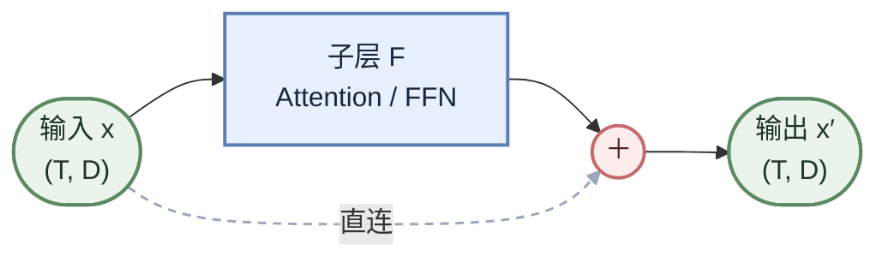
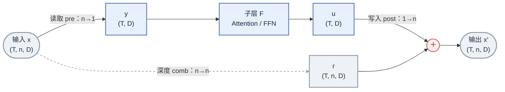
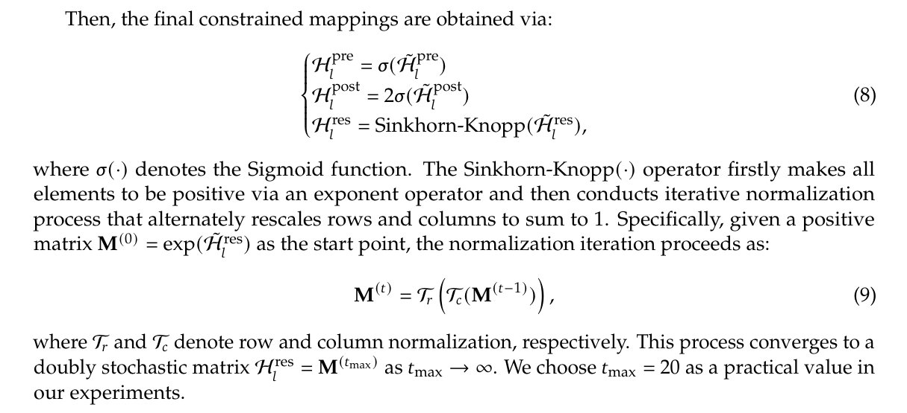
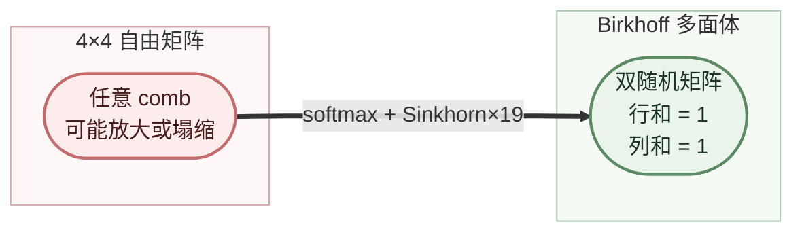
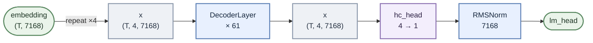
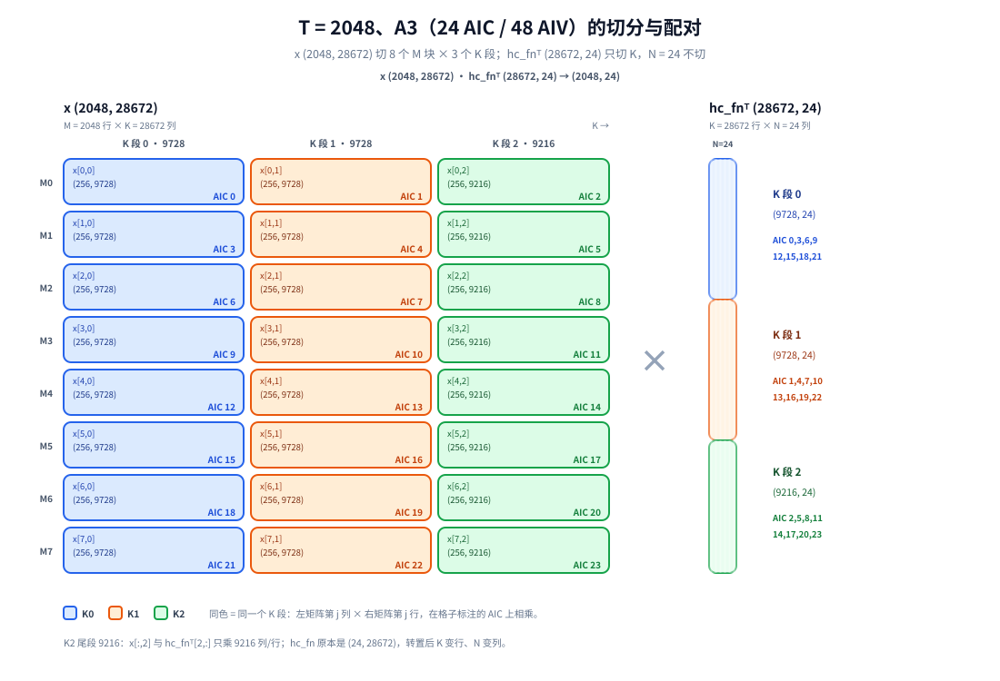
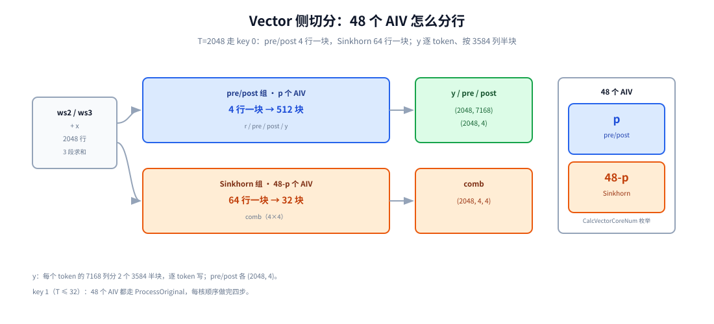
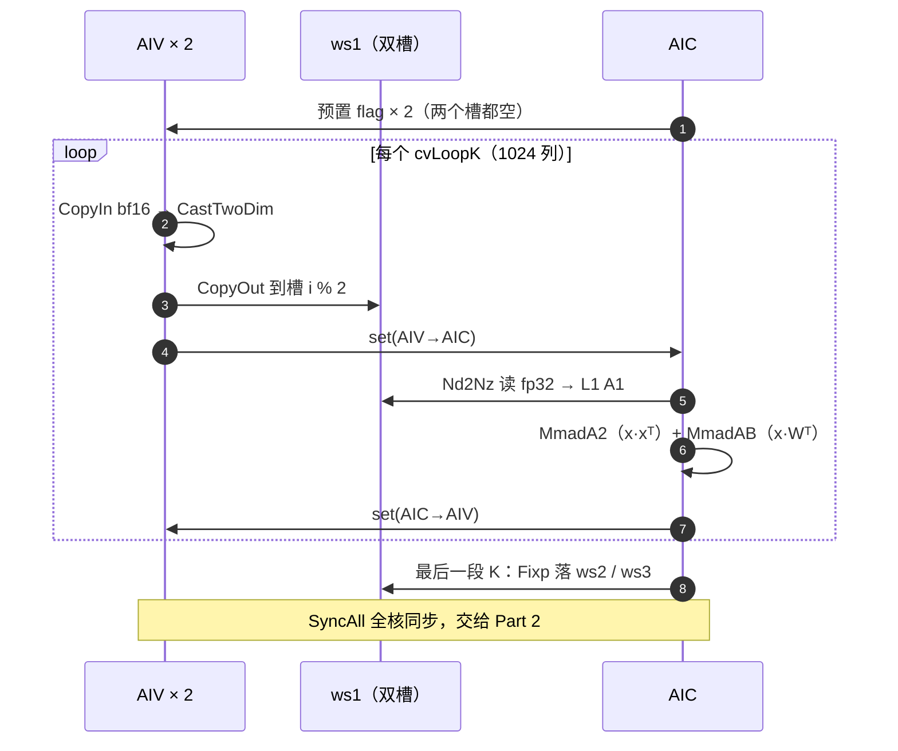
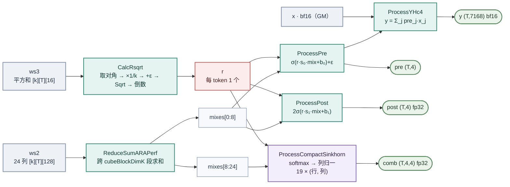
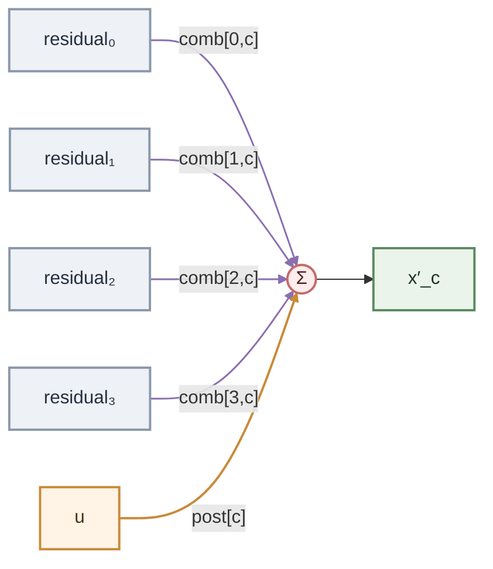

# 残差架构演进：从 Residual Connections 到 DeepSeek mHC

> **范围**：第 0–3 章讲演进与原理；第 4 章给出 vllm-ascend 的代码基线、模型参数、算子清单与开销。

---

## 阅读指引

各章按"上一章遗留的局限 → 下一章引入的补充"递进组织，建议顺序阅读。

| 章节 | 主题 | 核心问题 | 主要结论 |
| --- | --- | --- | --- |
| 0 | 引言：三代演进 | 三代残差各自的定位与代价是什么？ | 恒等通路 → 多流可学习连接 → 流形约束 |
| 1 | 单流残差与恒等映射 | 深层网络为何退化，残差连接如何缓解？ | 分支改学残差 $F \approx H - x$，最坏退化为恒等映射 |
| 2 | 多流残差与可学习连接 | 如何在不加宽隐藏维度的前提下扩展残差主干？ | 扩为 $n$ 条流，以读取门、写入门、深度混合取代固定加法 |
| 3 | mHC：流形约束 | 多流自由连接为何在深度方向失稳，如何约束？ | 投影至双随机流形，谱范数 $\le 1$，深度连乘非扩张 |
| 4 | DeepSeek mHC 工程实现 | 上述约束如何落地为算子与数据流？ | `hc_pre` 压缩、`hc_post` 写回、`hc_head` 收口；参数约 84 M、激活 ×4、KV Cache 不变 |

---

## 0、引言

从 ResNet 的一条恒等边，到 DeepSeek-V4 的四条残差流加一个双随机混合矩阵，残差连接走过了三代。它的目的始终没变：给主干留一条恒等通路，让子层只学增量，从而压住深层网络的退化。变的是实现方式——**子层算出的增量怎么汇回主干**。先看整体脉络，图片来自 [DeepSeek-V4 论文](https://arxiv.org/pdf/2512.24880)：


先约定两个符号：$x$ 是残差流（residual stream）中跨层传递的表示，即捷径/主干上流动的信息；$F(x)$ 是残差分支算出的、要写回残差流的增量。

三代并排成一张表（$n$ 为残差流条数）：

| 代次 | 残差流（V4 中 $n=4$） | 汇回公式（$A_l$ 读取、$B_l$ 混合、$C_l$ 写入） | 连接的自由度 |
| --- | --- | --- | --- |
| Residual Connections | 1 条 | $x_{l+1} = x_l + F(x_l)$ | 无：直连恒等，加法写死 |
| HC | $n$ 条 | $x_{l+1} = B_l\,x_l + C_l\,F_l(A_l\,x_l)$ | 三组连接全部自由学习 |
| mHC | $n$ 条 | 同式，但 $B_l$ 约束为双随机矩阵 | $B_l$ 受限，$A_l$、$C_l$ 有界 |

**Residual Connections（残差连接）：1 条流，加法写死。** 它压住了深层退化，但主干容量固定，$+$ 也没有选择性。

**HC（超连接）：$n$ 条流，三组映射可学。** 把残差流加宽成 $n$ 条，$A_l$ 读取（`pre`，$1 \times n$）、$B_l$ 混合（`comb`，$n \times n$）、$C_l$ 写入（`post`，$n \times 1$）全部放开学习。容量、选择性、跨流重组一次解决，且 $n \ll d$，额外计算可忽略。代价是 $B_l$ 完全自由、谱范数不受控：61 层连乘，单层谱范数为 1.02 时最坏累计放大 $1.02^{61} \approx 3.35$ 倍，1.1 时是 $1.1^{61} \approx 335$ 倍；前向激活与反向梯度都沿这条通路被同样放大，范数小于 1 时则逐层衰减。

**mHC（流形约束超连接）：$n$ 条流，混合矩阵受限。** 公式不变，只改三组映射的取值域：最危险的 $B_l$ 投影到双随机矩阵（每行、每列和为 1 的非负矩阵），$A_l$、$C_l$ 用 Sigmoid 压成有界正权重（$\sigma(\cdot)+\varepsilon$ 与 $2\sigma(\cdot)$）。

双随机矩阵的谱范数 $\le 1$、对乘法封闭，所以深度连乘既不放大也不塌缩；$A_l$、$C_l$ 恒为非负，门控不会正负抵消。投影由 Sinkhorn-Knopp 迭代完成。

三代的动作链：


一句话：**用几何约束换数值稳定性**——不砍表达，只把参数限制在流形上。

---

## 1、Residual Connections

### 1.1 概述

先把三个符号的角色分清：

| 符号 | 含义 | 谁负责 |
| --- | --- | --- |
| $H(x)$ | 这个块**希望最终逼近**的目标映射 | 训练目标，不是某个层的输出 |
| $F(x)$ | 子层**实际输出**的东西 | 可学习参数 |
| $x$ | 输入，走直连通道 | 不经过任何参数 |

传统网络让子层直接拟合 $H(x)$，由此带来**退化问题**（degradation）：网络越深，训练误差反而越大。ResNet 的改动很小——子层不变，只改学习目标：不学 $H(x)$，只学残差 $F(x)=H(x)-x$，也就是"还差多少"。网络不必一次学出完整映射，只需学对当前表示的增量。

这一思路出自 [Deep Residual Learning for Image Recognition（He et al., 2015）](https://arxiv.org/pdf/1512.03385)。ResNet 正是靠它在 2015 年 ILSVRC 上夺冠，把可训练深度从十几层推到 152 层，成为计算机视觉乃至整个深度学习的里程碑。ResNet 是残差网络（Residual Network），其核心创新只有一条：**残差连接**（Residual Connections）——今天 Transformer 的每个 block 仍然是 $x \leftarrow x + \mathrm{Sublayer}(\mathrm{Norm}(x))$ 这一形式。

一个残差块只有两条分支：一条是**不经过任何参数**的直连边，把输入原样送到输出；另一条是子层 $F$。



写成公式就是

$$
x_{l+1} = x_l + F(x_l)
$$

形状没有任何变化：进 $(T, D)$，出 $(T, D)$，$D = 7168$。

两条边合起来：$\mathrm{out}=F(x)+x$。当 $F$ 学的是 $H(x)-x$ 时，

$$
\mathrm{out}\approx\bigl(H(x)-x\bigr)+x=H(x).
$$

加回来的 $x$ 正好**抵消**残差里的 $-x$，不是额外再加一份。只有子层仍按传统方式学 $H(x)$、又接了直连边时，才会得到 $\mathrm{out}=\mathrm{Conv}(x)+x\approx H(x)+x$——这等于把目标和输入重复叠加，是错误设计，ResNet 从未这样定义。另外，"新增层没学到有效特征也不变差"指的是 $F\to0$、输出退化为 $x$，不是子层输出 $\approx H(x)$。

一句话：**短路连接不是"在 $H$ 旁边加一个 $x$"，而是"在 $F$ 旁边加一个 $x$"，而 $F$ 的定义里已经含了 $-x$。**

跨层传递的 $x$ 因此被称为**残差流**（residual stream）：每一层只往这条流里写入一个增量 $F(x_l)$，而不是把整条流替换掉。从表示学习的角度看，每层学的是对当前表示的**修正**，浅层学到的表示可以沿直连边直接被深层复用，不必逐层重新编码。

**结果**：残差主干始终只有**一条流**：直连通道是恒等映射，子层输出经固定的 $+$ 汇回。即使子层什么都没学到（$F \to 0$），输出也退化为 $x_l$，性能至少不劣于加深之前——这就是"短路连接保证性能不下降"的准确含义。此外，直连边也为梯度提供了一条不衰减的通路，顺带缓解了梯度消失。

### 1.2 原理

记第 $i$ 层的子层为 $F_i$（不同层权重不同），每层做的是

$$
x_{i+1} = x_i + F_i(x_i).
$$

从第 $l$ 层开始逐层代入，直到最后一层 $L$：

$$
\begin{aligned}
x_{l+1} &= x_l + F_l(x_l),\\
x_{l+2} &= x_{l+1} + F_{l+1}(x_{l+1})\\
        &= x_l + F_l(x_l) + F_{l+1}(x_{l+1}),\\
&\ \vdots\\
x_L &= x_l + \sum_{i=l}^{L-1} F_i(x_i).
\end{aligned}
$$

记 $\mathcal{L}$ 为损失。$x_L$ 对 $x_l$ 的依赖有两条路：直连的 $x_l$ 本身，以及每个 $F_i(x_i)$ 中间接含有的 $x_l$。对 $x_l$ 求 Jacobian：

$$
\frac{\partial x_L}{\partial x_l}
= I + \sum_{i=l}^{L-1}\frac{\partial F_i(x_i)}{\partial x_l}.
$$

第一项 $I$ 来自直连；第二项里的 $\partial F_i(x_i)/\partial x_l$ 是**总导数**——按链式法则展开，它是所有从 $x_l$ 到 $x_i$ 的路径上的 Jacobian 乘积之和。乘上上游梯度：

$$
\frac{\partial \mathcal{L}}{\partial x_l}
= \underbrace{\frac{\partial \mathcal{L}}{\partial x_L}}_{\text{直连项}}
+\underbrace{\sum_{i=l}^{L-1}\frac{\partial \mathcal{L}}{\partial x_L}\frac{\partial F_i(x_i)}{\partial x_l}}_{\text{子层路径项}}.
$$

两部分的性质完全不同：

- **直连项**：$\partial \mathcal{L}/\partial x_L$ 乘上 $I$，原样传回。不经过权重，也不含多层 Jacobian 连乘，**不会随深度指数衰减**。
- **子层路径项**：每条路径都是一串 Jacobian 连乘，层数越多乘得越长。这些 Jacobian 的谱范数普遍小于 1，乘积随深度指数趋零（梯度消失）；普遍大于 1 则指数放大（梯度爆炸）。深层网络难训，主要难在这一项。

所以"梯度高速公路"的准确含义是：**反向传播时存在一条不经过权重、不做连乘的直连通道，把上游梯度直接送到任意浅层。** 即使所有子层路径都衰减到 0（$\partial F_i/\partial x \to 0$），直连项仍然完整。

标量情形下 $I$ 退化为数字 $1$，上式就是常见写法

$$
\frac{\partial \mathcal{L}}{\partial x_l}
= \frac{\partial \mathcal{L}}{\partial x_L}\left(1+\frac{\partial}{\partial x_l}\sum_{i=l}^{L-1}F_i(x_i)\right),
$$

括号里的 $1$ 就是直连项。

一点边界：这说的是"存在一条不衰减的通路"，不是"梯度总和一定不衰减"——子层路径项在极端情况下可以和直连项抵消（标量下 $F_i'=-1$ 时 $1+F_i'=0$）。但直连项本身不会被逐层乘小，层数增加不会自动把它抹掉，这正是 ResNet 能堆深的关键。

顺带划清另一个边界：残差主要缓解的是深度带来的退化与系统性衰减，**不是梯度爆炸**——$I$ 只保证有一条增益为 1 的通路，不负责给梯度设上限；子层 Jacobian 的谱范数大时，$I+J$ 照样能把梯度放大。爆炸要靠归一化、梯度裁剪、合适初始化等手段。

### 1.3 局限

ResNet 的残差块只有一条主干、一个写死的 $+$，由此带来三个限制：

| 局限 | 具体表现 | HC 的改法 |
| --- | --- | --- |
| 容量固定 | 所有层共用一条 $D=7168$ 的残差流；直接把它加宽 4 倍，Attention/FFN 的主要矩阵乘要涨约 16 倍（宽度平方） | 扩成 $n$ 条流；子层仍只读 1 条，计算基本不变 |
| 汇入无选择性 | $x+F(x)$ 是固定 $1:1$：想更信子层，只能靠 $F$ 自己把输出做大；想忽略子层，只能靠 $F$ 输出 0 | 读取门、写入门逐 token 可学 |
| 无法分流重组 | 所有信息都叠加在同一条流里，多份表示无法独立保存、按需交换 | 满矩阵在 $n$ 条流之间混合 |

具体到一层里，这些限制表现为：

- 想同时保留"原始 token 信息"和"改写后的语义"，只能叠在同一个向量里，后续层无法分开取用；
- 不需要改写的 token，残差仍以固定权重参与相加，子层只能靠"输出 0"来近似旁路。

三条指向同一个根源：**主干只有一条，且汇入方式写死。**

---

## 2、Hyper-Connections

### 2.1 概述

HC（Hyper-Connections）出自 [HYPER-CONNECTIONS](https://arxiv.org/pdf/2409.19606)。它针对残差连接的三个限制做两件事：把残差流从 1 条扩成 $n$ 条，再把固定的 $+$ 拆成三组可学习连接：

| 连接 | 方向 | 作用 |
| --- | --- | --- |
| 深度连接 | $n \to n$ | 流与流之间混合，纵向传递 |
| 宽度读取 | $n \to 1$ | 加权压成 1 条，送进子层 |
| 宽度写入 | $1 \to n$ | 子层输出按权重写回各流 |

这里加宽的是**残差流**，不是隐藏维度：子层始终只读 1 条 $D$ 维流，所以 Attention/FFN 的计算基本不变；多出来的只有 $n \times D$ 的激活和每层两组小门控投影。

三组连接的值都由当前 token 的多流状态投影得到，逐 token 不同——共享的只是投影权重，不是连接本身。与引言的符号对应：$A_l$ 即读取门 `pre`，$C_l$ 即写入门 `post`，$B_l=\mathrm{comb}^{\top}$。

### 2.2 原理

记第 $l$ 层的多流状态为 $x_l \in \mathbb{R}^{T \times n \times D}$，第 $j$ 条流为 $x_j \in \mathbb{R}^{T \times D}$。三组连接都是逐 token 的：$\mathrm{pre}, \mathrm{post} \in \mathbb{R}^{T \times n}$，$\mathrm{comb} \in \mathbb{R}^{T \times n \times n}$。

一层的数据流：



按步骤写开：

| 步骤 | 公式 | 形状 |
| --- | --- | --- |
| 读取 | $y = \sum_{j=1}^{n} \mathrm{pre}_j\, x_j$ | $(T, D)$ |
| 子层 | $u = F(y)$ | $(T, D)$ |
| 深度 | $r_c = \sum_{j=1}^{n} \mathrm{comb}_{j,c}\, x_j$ | $(T, n, D)$ |
| 写入 | $x_{l+1,c} = r_c + \mathrm{post}_c\, u$ | $(T, n, D)$ |

把深度与写入合并：

$$
x_{l+1} = \mathrm{comb}^{\top} x_l + \mathrm{post} \odot u
$$

约定 $\mathrm{comb}_{j,c}$ 是"源流 $j$ 写入目标流 $c$"的权重，所以作用在流轴上时用 $\mathrm{comb}^{\top}$；$\mathrm{post} \odot u$ 表示同一个 $u$ 乘上每条流各自的写入门。

> 对照 ResNet 的残差块：$\mathrm{comb} = I$、$\mathrm{post} = \mathbf{1}$ 时，上式精确退化成 $x + F(x)$。**残差连接是 HC 的一个特例。**

这也把残差连接的三条局限逐个解掉了：容量与分流由 $n$ 条流提供；选择性由逐 token 的 $\mathrm{pre}/\mathrm{post}$ 提供；重组由满矩阵 $\mathrm{comb}$ 提供——流与流之间可以按 token 互相搬运信息，梯度也能走不同的流。

### 2.3 局限

HC 用很小的计算代价换来这三组连接，但代价集中在这几处：

| 项 | 影响 |
| --- | --- |
| 激活显存 | 残差主干从 $(T, D)$ 变成 $(T, 4, D)$，激活约 4 倍（KV Cache **不受影响**：进 Attention 前已压回单流） |
| 计算量 | 每层多两次 $(24 \times 4D)$ 的门控投影 |
| 数值稳定性 | $\mathrm{comb}$ 完全自由时，$\prod_{l} \mathrm{comb}_l$ 的谱范数可能随深度指数增长或衰减 |

第三条最危险。残差连接这条通路的系数是 $I$（谱范数恒为 1），HC 把它换成了 $\mathrm{comb}$，于是通路的增益变成 $\prod_l \mathrm{comb}_l$。假设某层学出的 $\mathrm{comb}$ 谱范数为 1.02，61 层连乘后最坏放大 $1.02^{61} \approx 3.35$ 倍；若为 1.1，则是 $1.1^{61} \approx 335$ 倍。

后果分两层。数值上，前向激活与反向梯度都按同样倍数漂移：放大到一定程度就是激活溢出、梯度爆炸，缩小则是激活与梯度一起消失；轻则训练对学习率、初始化和梯度裁剪变得敏感，重则出现 NaN 或深层参数几乎不再更新。结构上，残差流被放大时，每层子层增量相对越来越小，深层等于被旁路；被压缩时则相反，残差积累被逐层覆盖。

**mHC 的出发点就是：把 $\mathrm{comb}$ 钉在一个"绝不放大"的集合里。** 它只动这一个变量——多流结构与三组连接全部保留。

---

## 3、Manifold-Constrained Hyper-Connections



### 3.1 概述

mHC（Manifold-Constrained Hyper-Connections，流形约束超连接）保留 HC 的多流结构，只给三组连接分别加约束。DeepSeek-V4 取 `hc_mult = 4`，即 $n = 4$：

| 连接 | 原始取值范围 | mHC 的约束 | 约束后的集合 |
| --- | --- | --- | --- |
| `comb`（深度） | 任意 $4 \times 4$ 实数矩阵 | Sinkhorn 归一化为**双随机矩阵** | Birkhoff 多面体 |
| `pre`（读取） | 任意实数 | $\sigma(\cdot) + \varepsilon \in (\varepsilon,\ 1+\varepsilon)$ | 有界正权重 |
| `post`（写入） | 任意实数 | $2\sigma(\cdot) \in (0,\ 2)$ | 有界正权重 |



三组约束的分工很清楚：**最危险的 `comb`（要跨层连乘）被钉死，`pre`/`post` 只做有界激活**，把"整体增强/削弱"的能力保留下来。

### 3.2 原理

**为什么有效。** 记所有双随机矩阵的集合为

$$
\mathcal{B}_n = \left\{\, M \in \mathbb{R}^{n \times n} \;\Big|\; \sum_{j} M_{ij} = 1\ (\forall i),\quad \sum_{i} M_{ij} = 1\ (\forall j),\quad M_{ij} \ge 0\ (\forall i,j) \,\right\}
$$

即每行、每列和都为 1 的非负矩阵。它有两条关键性质：

1. **列和为 1**（$\sum_{i} \mathrm{comb}_{ij} = 1$）→ 每条输出流是输入 4 条流的**凸组合**，总"质量"守恒，不会被放大。
2. **行和为 1**（$\sum_{j} \mathrm{comb}_{ij} = 1$）→ 每条输入流的贡献被完整分配出去，不会被某一列吞掉。

数学上，双随机矩阵的谱半径恒为 1（Perron-Frobenius），且其 2-范数不超过 1。于是任意深度的连乘都**非扩张**：

$$
\bigl\| \mathrm{comb}_L \cdots \mathrm{comb}_1\, x \bigr\|_2 \;\le\; \| x \|_2
$$

对任意深度 $L$ 成立。

这正是残差连接那条"恒等通道"在多流场景下的推广：残差连接保证 $\| x + F(x) \|$ 里有一份不衰减的 $x$；mHC 保证"多条流的混合"这一步本身既不衰减也不放大。

**怎么投影。** Sinkhorn-Knopp 定理：对任意正矩阵 $A$，交替做"行归一化 → 列归一化"，迭代收敛到一个双随机矩阵，且它是 $A$ 在 KL 散度意义下到 Birkhoff 多面体的投影。

实现上就是 20 轮交替（第 0 轮是 softmax 本身，之后再做 19 轮）。每一轮的两步归一化是：

$$
M_{ij} \leftarrow \frac{M_{ij}}{\sum_{k} M_{ik} + \varepsilon},
\qquad
M_{ij} \leftarrow \frac{M_{ij}}{\sum_{k} M_{kj} + \varepsilon}
$$

```python
comb = softmax(mixes_comb) + eps            # 第 0 轮
for it in range(1, 20):                     # 第 1 ~ 19 轮
    comb = comb / (comb.sum(dim=-1, keepdim=True) + eps)   # 行归一化
    comb = comb / (comb.sum(dim=-2, keepdim=True) + eps)   # 列归一化
```

**数值演示**：取一个 $4 \times 4$ 的 logits 矩阵，按同样规则实际跑一遍（$\varepsilon = 10^{-6}$）。初始 softmax 后行和为 1、列和未齐：

$$
M^{(0)} =
\begin{bmatrix}
0.5151 & 0.2094 & 0.1040 & 0.1715 \\
0.1524 & 0.5593 & 0.1022 & 0.1862 \\
0.1140 & 0.1701 & 0.4623 & 0.2537 \\
0.2135 & 0.0868 & 0.1748 & 0.5250
\end{bmatrix}
$$

第 19 轮后，行、列和都已到 1.0000：

$$
M^{(19)} =
\begin{bmatrix}
0.5176 & 0.2046 & 0.1269 & 0.1509 \\
0.1550 & 0.5529 & 0.1262 & 0.1659 \\
0.1073 & 0.1555 & 0.5281 & 0.2091 \\
0.2201 & 0.0870 & 0.2188 & 0.4741
\end{bmatrix}
$$

收敛过程：

| 迭代轮次 | max 行和偏差 | max 列和偏差 |
| --- | --- | --- |
| 0（仅 softmax） | $\approx 0$（构造保证） | 0.156 |
| 1 | 0.052 | 0 |
| 2 | 0.0065 | 0 |
| 3 | 0.0010 | 0 |
| 5 | $< 10^{-4}$ | 0 |
| 19 | $< 10^{-5}$ | 0 |

第 1 轮结束时列和已精确为 1，此后行和逐轮收敛：5 轮左右就到 $10^{-4}$ 量级，20 轮是给极端分布留的余量。这也解释了配置里 `hc_sinkhorn_iters=20` 而不是 100——再往上收益趋零，而每轮每个 token 要做 32 次除法（行、列各 16 次）和 8 次归约（行、列各 4 次）。

一个容易被忽略的变化：Sinkhorn 会调整对角权重，允许"流与流互相借力"，而不是把每条流钉死在原位。示例中第 3 行（下标 2）的主对角由 `0.4623` 升到 `0.5281`，第 2 行（下标 1）则由 `0.5593` 略降到 `0.5529`。

**表达力够不够。** 常见疑问：把 16 个自由度压到 9 个（$4 \times 4$ 双随机矩阵的维度是 $(n-1)^2 = 9$），模型不会变笨吗？

1. **9 维流形足够表达"流间重组"的主要模式**。真正有害的自由度是"整体放大/缩小"，而它恰好被去掉了。
2. **$\mathrm{pre}$、$\mathrm{post}$ 没有做双随机归一化**，只做有界激活，保留了"整体增强/削弱"的能力。约束只加在最危险的地方——跨层连乘的 $\mathrm{comb}$。
3. **每个 token 独立算一套**门控，表达力在 batch 维度上展开，而不是靠单矩阵的自由度堆。

换句话说：mHC 不是把 HC 变弱，而是把 HC 里**唯一会导致深度不稳定的那一维**（谱半径）钉死，其余维度全部放开。

理论到此完整：**残差连接给出恒等通路 → HC 把通路扩成可学习的多流 → mHC 把最危险的混合矩阵约束到流形上**。下面进入第 4 章。

---

## 4、工程实现

前三章把 mHC 讲成了三个对象：$n=4$ 条残差流、一套逐 token 的门控（`pre` / `post` / `comb`）、一个双随机约束。这一章看它们怎么落进 vllm-ascend：先给代码基线、模型参数与算子清单，再看一次前向的数据流，然后逐个拆算子，最后算开销。

**代码索引**

| 项 | 位置 |
| --- | --- |
| 代码基线 | vllm-ascend v0.32.0rc |
| 模型实现 | [vllm_ascend/models/deepseek_v4/model.py](../model.py)（`DeepseekV4DecoderLayer` / `DeepseekV4Model`） |
| `hc_pre` Python 封装 | [model.py:L783-L787](../model.py#L783-L787) |
| `hc_post` Python 封装 | [model.py:L789-L793](../model.py#L789-L793) |
| `hc_head` | [model.py:L949-L956](../model.py#L949-L956) |
| 算子注册（torch schema） | [csrc/torch_binding.cpp:L3526-L3552](../../../../csrc/torch_binding.cpp#L3526-L3552) |
| `hc_pre` 算子 | [csrc/moe/hc_pre](../../../../csrc/moe/hc_pre) |
| `hc_post` 算子 | [csrc/moe/hc_post](../../../../csrc/moe/hc_post) |

**模型与 mHC 参数**

取 DeepSeek-V4-Pro-0813（W4A8），字段来自权重目录下的 [0_DeepSeek-V4-Pro-0813-w4a8_config.json](0_DeepSeek-V4-Pro-0813-w4a8_config.json)：

| 参数 | 值 | 说明 |
| --- | --- | --- |
| 模型 | DeepSeek-V4-Pro-0813 | — |
| 量化方式 | W4A8 | 只压线性层；`hc_*` 门控权重仍是 fp32 |
| `hc_mult` | 4 | 残差流条数 $n$ |
| `hc_sinkhorn_iters` | 20 | 1 次 softmax + 19 轮行/列归一 |
| `hc_eps` | 1e-6 | 门控下限，兼作 Sinkhorn 的防零项 |
| `hidden_size` | 7168 | 单条流宽度 $D$ |
| `num_hidden_layers` | 61 | 主模型解码层数 |
| `hc_dim`（派生） | 28672 | $4 \times 7168$，一个 token 的 4 条流拼起来 |
| `mix_hc`（派生） | 24 | $(2 + 4) \times 4$，门控投影的行数 |

**算子清单**

mHC 在 vllm-ascend 里对应**2 个自定义 Ascend C 算子**——`torch.ops._C_ascend.npu_hc_pre_v2`、`torch.ops._C_ascend.npu_hc_post`——以及**一个 `hc_head` 收口操作**：

| 位置 | 接口 | 实现 | 调用次数 |
| --- | --- | --- | --- |
| 层内 · 读 | `npu_hc_pre_v2` | Ascend C，`csrc/moe/hc_pre` | 每层 2 次：Attention 前、FFN 前 |
| 层内 · 写 | `npu_hc_post` | Ascend C，`csrc/moe/hc_post` | 每层 2 次：Attention 后、FFN 后 |
| 模型出口 | `hc_head` | 纯 PyTorch，无 kernel | 每前向 1 次 |

两个 Ascend C 算子都是「算子原型 + Ascend C kernel + ACLNN 接口」的形态：原型在 [hc_pre_def.cpp](../../../../csrc/moe/hc_pre/op_host/hc_pre_def.cpp) / [hc_post_def.cpp](../../../../csrc/moe/hc_post/op_host/hc_post_def.cpp)，kernel 在各自的 `op_kernel/`，torch 侧经 [torch_binding.cpp](../../../../csrc/torch_binding.cpp) 的 `EXEC_NPU_CMD(aclnnHcPre, ...)` 调起。两个原型都挂了 `ascend910b` / `ascend910_93`（A2/A3）。**本章按 A2 / A3 这一套讲**，下面提到的切分、workspace、核分工，都是 A2/A3 的代码。`hc_head` 没有 kernel——它只在 61 层跑完后把 4 条流按权重压回 1 条，几行 PyTorch 就够。

按主模型 61 层算，一次前向是 $61 \times 4 = 244$ 次自定义算子调用，外加 1 次 `hc_head`。下面按「数据流 → 算子 → 开销」展开。

### 4.1 数据流

**模型两端。** 入口把 embedding 沿"流"复制 4 份（[model.py:L1004](../model.py#L1004)），出口用 `hc_head` 压回 1 条（调用在 [model.py:L1043](../model.py#L1043)），之后才是最终的 RMSNorm 与 `lm_head`：



注意 `hc_head` 之后还有一层 `self.norm`（[model.py:L1045](../model.py#L1045)）：`hc_head` 只负责"4 → 1"的加权求和，带 $\gamma$ 的最终归一化仍按普通模型放在 `lm_head` 之前。

**层内结构。** 每个 DecoderLayer 里 `hc_pre` / `hc_post` 各两次，把 Attention 和 MoE 各包一圈：


对应的代码骨架（[model.py:L795-L829](../model.py#L795-L829)）：

```python
residual = hidden_states.clone()                            # 留下压缩前的 4 条流
hidden_states, post, comb = self.hc_pre(...)                # 4 → 1
hidden_states = self.input_layernorm(hidden_states)
hidden_states = self.self_attn(hidden_states)               # 子层只看得到 1 条流
hidden_states = self.hc_post(hidden_states, residual, post, comb)   # 1 → 4

residual = hidden_states.clone()
hidden_states, post, comb = self.hc_pre(...)                # 4 → 1
hidden_states, hidden_states_fp32 = self.rms_norm_cast(hidden_states)
hidden_states = self.mlp(hidden_states, hidden_states_fp32=hidden_states_fp32)
hidden_states = self.hc_post(hidden_states, residual, post, comb)   # 1 → 4
```

三点值得记：

- **Attention 与 MoE 始终只看到 1 条 $D$ 维流**，mHC 的额外开销集中在层边界——子层矩阵乘的形状与不加 mHC 时完全一致。
- 归一化也只作用在这条单流上：Attention 前是 `input_layernorm`，FFN 前是 `rms_norm_cast`（一次产出 bf16 与 fp32 两份，fp32 那份供 MoE 路由使用）。
- 每层要存两次「压缩前」的 4 条流（`residual`）：`hc_post` 的深度混合必须用原始 4 条流，不能拿 `hc_pre` 的输出反推，所以两次 `clone()` 省不掉。

### 4.2 hc_pre

#### 4.2.1 概述与调用链

`hc_pre` 在层里只做一件事：把 4 条残差流压成 1 条，同时产出写回要用的 `post`、`comb`。每个 DecoderLayer 调两次（Attention 前、FFN 前），61 层共 122 次；Python 封装不做任何预处理，shape 校验、输出分配、tiling、计算全在算子内部。

一次调用是 **4 个张量进、3 个张量出**：

| 张量 | 形状 | dtype | 角色 |
| --- | --- | --- | --- |
| `x` | `(T, 4, 7168)` | bf16 | 4 条残差流 |
| `hc_fn` | `(24, 28672)` | fp32 | 门控投影权重 |
| `hc_scale` | `(3,)` | fp32 | pre / post / comb 三个温度 |
| `hc_base` | `(24,)` | fp32 | 三段偏置 |
| `y` | `(T, 7168)` | bf16 | 压成 1 条流 |
| `post` | `(T, 4)` | fp32 | 写回门控 |
| `comb` | `(T, 4, 4)` | fp32 | 双随机组合矩阵 |

`24 = 4 + 4 + 16`：前 4 行给 `pre`，中间 4 行给 `post`，后 16 行是 `comb` 的 $4 \times 4$ 摊平；`hc_scale` 的 3 个温度、`hc_base` 的 3 段偏置与这三块一一对应。输入侧 `T` 是矩阵乘的 M，`4 × 7168 = 28672` 就是矩阵乘的 K。

**算子文件清单** （只列 A2/A3 路径）：

```text
csrc/moe/hc_pre/
├── op_host/                        # host 侧：原型 + tiling
│   ├── hc_pre_def.cpp              # 算子原型：4 入 4 出 + 4 个 attr 的声明与默认值
│   ├── hc_pre_proto.cpp            # 空文件（原型全在 def.cpp）
│   ├── hc_pre_tiling.h             # HcPreTilingData 的字段定义 + HcPreTiling 类声明
│   └── hc_pre_tiling.cpp           # 4.2.2 那条链：TilingForHcPre → 五步 → PostTiling
└── op_kernel/                      # device 侧：入口 + 三块实现
    ├── hc_pre.cpp                  # 下面调用链的入口：MIX_AIC_1_2，按 TilingKey 分派 Part1/Part2
    ├── hc_pre_m_k_split_core.h     # 4.2.3 的主体：Part 1 的 M/K 网格 + Part 2 的四步
    ├── hc_pre_cube_compute.h       # 4.2.3 的 cube 段：ComputeDecode / MmadA2 / MmadAB / Fixp
    └── hc_pre_base.h               # 4.2.3 的 vector 原语：ProcessPre/Post、Sinkhorn、Brcb/Reduce
```

合计约 4.1k 行。另有 `op_host/hc_pre_tiling_arch35.h` 与 6 个 `*_arch35.h` 是 ASCEND950（arch35）的实现；`CMakeLists.txt` 只做目录递归，没有算子逻辑。

调用链：Python 侧只转一次 op，真正的分层在 C++ 与 kernel 里。

```text
hc_pre(x, hc_fn, hc_scale, hc_base)                    model.py:L783
└─ torch.ops._C_ascend.npu_hc_pre_v2
   └─ npu_hc_pre_v2_npu(...)                           torch_binding.cpp:L1645
      ├─ check_hc_pre_shape_and_dtype(...)             torch_binding.cpp:L1582
      │    hc_mult = 4；x 的流维 = 4；hc_fn = (24, hc·d)；x bf16，其余三个 fp32
      └─ run_hc_pre_fusion(...)                        torch_binding.cpp:L1629
         ├─ construct_hc_pre_output_tensor     → y / post / comb
         └─ EXEC_NPU_CMD(aclnnHcPre, ...)              torch_binding.cpp:L1639
            └─ TilingForHcPre                          hc_pre_tiling.cpp:L725
               └─ HcPreTiling（A2/A3；key 0/1/2、blockDim、workspace）
                  └─ hc_pre kernel                      hc_pre.cpp:L34
                     ├─ TilingKey 0：bs > 32 → Part 2 两组核
                     │  ├─ Part 1  HcPreMembaseKSplitCorePart1
                     │  │  ├─ AIV ×2：bf16 → fp32 → ws1
                     │  │  └─ AIC：x·Wᵀ + x·xᵀ → ws2 / ws3
                     │  └─ Part 2  HcPreMembaseKSplitCorePart2
                     │     ├─ pre / post → y
                     │     └─ comb（Sinkhorn）
                     ├─ TilingKey 1：bs ≤ 32 → 同 Part 1；Part 2 单组
                     └─ TilingKey 2：preMix → Part 1 + 专用 Part 2（V4 不走）
```

把树里 `TilingKey 0` 这一支展开，两段式是这样衔接的：

```text
HcPreMembaseKSplitCorePart1
├─ AIV ×2：bf16 → fp32 → ws1
├─ AIC：x·Wᵀ → ws2；x·xᵀ → ws3
└─ SyncAll<false>()                    // hc_pre_m_k_split_core.h:L213
        ↓
HcPreMembaseKSplitCorePart2
├─ ws2 / ws3 跨 K 段求和 → r、24 个 logits
├─ pre / post / comb
└─ y = Σ_j pre_j x_j
```

#### 4.2.2 HcPreTiling 切分

**一句话。** 以 T = 2048、A3 的 24 AIC / 48 AIV 为例：tiling 把 `x (2048, 4, 7168)` 和 `hc_fn (24, 28672)` 看成 `(2048, 28672) × (28672, 24)` 的矩阵乘（hc_fn 取转置），x 按 8×3 切，hc_fn 只按 K 切 3 段，切完再在核内按 1024 列一拍算，最后让 Part 2 用 48 个 AIV 按行收。

> 本文按 A3（Ascend910_9382）的真实值 **24 AIC / 48 AIV** 举例；A2 的 910B3 是 20 AIC / 40 AIV，网格会不同。


**总调用链。** host 侧只做三件事：把 shape/attr 变成 `bs` / `hc` / `d`，算出每个 AIC 的 M×K 块和每个 vector 核的行块，最后写进 `HcPreTilingData`。

```text
TilingForHcPre                                 hc_pre_tiling.cpp:L725
│  # 入口：ASCEND950 → arch35 那套；A2/A3 → HcPreTiling（本节）
└─ HcPreTiling::DoOpTiling                     L657
   │  # 五步：平台 → shape/attr → 切分 → workspace → 回写
   ├─ GetPlatformInfo                          L68    # AIV/AIC/UB；A3 = 48/24
   ├─ GetShapeAttrsInfoInner                   L108   # shape → bs / d / hcMix=24
   │  └─ GetAttr                               L89    # hc_mult=4、iters=20、eps
   ├─ CalcOpTiling                             L611
   │  ├─ k = hc_mult × d                      L612   # 28672，cube 的 K
   │  ├─ M/K 网格                              L615   # mDimNum=8、kDimNum=3
   │  ├─ singleCoreM / splitKSize              L632   # 每核 256 × 9728，K2 尾 9216
   │  ├─ mL1Size / kL1Size / cvLoopKSize       L636   # 256 行 / 128 / 一拍 1024
   │  ├─ stage1MFactor                         L650   # ≈ UB/12KB ≈ 16 行
   │  └─ CalcMKSplitCoreMembasePart2Tiling     L207   # 定 TilingKey 与 Part 2 切法
   │     ├─ CalcPremixPart2Tiling              L417   # 有 pre_mix 才走：key 2（V4 不走）
   │     ├─ bs <= 32 → key 1（SPMD）          L213   # 48 AIV 各扫一段
   │     └─ bs > 32 → key 0（MPMD）           L217
   │        ├─ CalcVectorCoreNum               L173   # 估时枚举 p 与 48−p
   │        ├─ dFactor / dLoop                 L273   # D 块：7168 → 3584 × 2
   │        ├─ prePostRowFactor                L340   # 一次几行，上限 4
   │        └─ CalcSinkhornTiling              L550   # 由 L413 调用，上限 64
   ├─ GetWorkspaceSize                         L682   # ws1+ws2+ws3+16MB，≥ 208MB
   └─ PostTiling                               L702   # TilingKey / BlockDim / Save
```

三个读这棵树时的提示：

1. 行号标的是**函数定义处**，调用点在 `DoOpTiling` / `CalcOpTiling` 里；
2. 顺序是有依赖的：`GetWorkspaceSize` 必须排在 `CalcOpTiling` 之后，它按刚算出的 `mL1Size` / `cubeBlockDimK` 反推大小；`tilingKey_` 在 L207 就定了，`PostTiling` 只负责写进 context；
3. `SetBlockDim` 填的是 **AIC 数（24）**，但 kernel 声明了 `MIX_AIC_1_2`，所以实际起 48 个 AIV。

**Cube 侧切分。** 输入看成一个矩阵乘：`(M, K, N) = (2048, 28672, 24)`。24 个 AIC 排成 `mDimNum × kDimNum` 的网格，每个格子是一个 AIC 的 M×K 块。



先看 Cube 侧的 shape：

| 张量 | 切前 | 切后 |
| --- | --- | --- |
| x | `(2048, 4, 7168)` = `(2048, 28672)` | 每 AIC `(256, 9728)`；K2 尾段 `(256, 9216)` |
| hc_fn | `(24, 28672)` | 每 AIC `(24, 9728)`；K2 `(24, 9216)` |

1. **M 轴**：`mDimNum = min(24, ceil(2048 / 256)) = 8`；24 % 8 = 0，不用抬因子。`singleCoreM = RoundUp(ceil(2048 / 8), 16) = 256`。`mDimNum` / `kDimNum` 由 tiling 按 T 与 AIC 核数决定，与 `hc_fn` 无关；`hc_fn` 只提供固定的 K = 28672 与 N = 24。下面只按 T = 2048 讲：M 切 8 块，K 切 3 段，每核 256×9728（K2 尾段 9216）；换 T 时同一组公式重跑，不再展开其他取值。

2. **K 轴**：`kDimNum = 24 / 8 = 3`；`splitKSize = RoundUp(ceil(28672 / 3), 256) = 9728`；`cubeBlockDimK = 3`。8 × 3 = 24，正好铺满 24 个 AIC；K2 是尾段 9216 列（`kGmEndOffset` 截到 28672）：

| K 段 | 列范围 | 列数 | 用它的 AIC |
| --- | --- | --- | --- |
| K0 | 0–9727 | 9728 | 0,3,6,9,12,15,18,21 |
| K1 | 9728–19455 | 9728 | 1,4,7,10,13,16,19,22 |
| K2 | 19456–28671 | 9216 | 2,5,8,11,14,17,20,23 |

`hc_fn` 也跟着 K 段切：每个 AIC 拿 `(24, 9728)` 或 `(24, 9216)`，24 行全保留；x 多一个 M 轴切分，hc_fn 没有。

K 被切开，每个 AIC 写出的 24 列就只是自己这段 K 的**部分和**；3 段怎么合，等 ws 交给 Part 2 由 AIV 来合并。

**M 和 K 各自对齐到多少。** 上面那两个数是这么凑出来的，两个常量各管一维：

| 常量 | 值 | 管哪一维 | 为什么是这个数 |
| --- | --- | --- | --- |
| `AscendC::BLOCK_CUBE` | 16 | M | cube 的分形边长（16×16 tile）；Mmad 的 `m` 最小 16，NZ 落盘也按 16 行对齐 |
| `K_MULIT_CORE_SPLIT_BASE_SIZE` | 256 | K | 切核粒度的经验值：保证 32 与 128 都整除，且每个核的起点 1 KB 对齐 |

K 这一维**必须**能被 32 整除：`ComputeL0Pairs` 每次固定搬 `K_L0_SIZE = 32` 个元素发一个 Mmad，不看还剩多少，尾块不足 32 会把 L1 里的残留数据乘进去。128 是 L1 的取数粒度（512 B）；256 再放大一档，让每个 `cvLoopKSize = 1024` 的尾部只可能是 256/512/768/1024 四种形态。反例：若只取 `splitKSize = 9558` 不对齐，某核尾段是 `86 = 64 + 22`，最后一个 Mmad 只有 22 个有效列。

这条对齐和双缓冲**无关**——双缓冲的是 ws1、L1 的 A1/B1、L0A/L0B 三级槽位，尺寸由 `mL1Size × cvLoopKSize`、`kL1Size` 决定（见下文"三层双缓冲"，别混）。

**AIC 这一段怎么算。** `x` 是 bf16，A1 要 fp32；AIC 是 cube，不负责 cast，所以由配对的 AIV 先转好放进 ws1（`MIX_AIC_1_2`：1 AIC : 2 AIV）。第 1 步是 AIV 的前置，第 2 步开始才是 AIC。

**数据在哪。** x 和 hc_fn 都在 GM（HBM）；ws1 是 GM workspace，不是 UB/L1。

| 数据 | 内存 | 形态 |
| --- | --- | --- |
| x | GM（HBM） | bf16，`(256, 1024)` / 拍 |
| hc_fn | GM（HBM） | fp32，`(24, 1024)` / 拍 |
| ws1 | GM workspace | fp32，`(256, 1024)` / 拍，双缓冲 |
| A1 / B1 | L1 | `256×128` / `24×128` |
| L0A / L0B | L0 | Mmad 左/右操作数 |
| L0C | L0C | 累加器 |
| ws2 / ws3 | GM workspace | 部分和 |

ws1 不是 UB，也不是 L1：host 先由 `aclnnHcPreGetWorkspaceSize` 算出 `workspace_size`，再用 `at::empty({workspace_size}, kByte)` 在 GM 上分配；AIV 用 DMA 写、AIC 用 DMA 读，双缓冲让两边 overlap。

**一拍怎么流。** 每拍先由 AIV 从 GM 读 `256×1024` 的 bf16 x，UB cast 成 fp32 后写 ws1（GM）；AIC 再从 ws1 读 A1 进 L1，同时从 GM 读 hc_fn 的 B1 进 L1。AIC 算的时候手里是 L1 的 A1/B1，不直接碰 GM 里的 x。

| 阶段 | 一次多大 | 从 → 到 | 粒度 |
| --- | --- | --- | --- |
| AIV 读 x | `(256, 1024)` bf16 | GM → UB | 每拍；按 ~16 行一批 |
| AIV 写 ws1 | `(256, 1024)` fp32 | UB → GM ws1 | 每拍，双缓冲 |
| AIC 取 A1 | `(256, 128)` fp32 | ws1 GM → L1 | 每 128 列块 |
| AIC 取 B1 | `(24, 128)` fp32 | hc_fn GM → L1 | 每 128 列块 |
| L1 → L0 | `k=32` 碎片 | L1 → L0A/L0B | 每个 Mmad 步 |
| Fixp | `(256, 24)` / `(256, 16)` | L0C → ws2/ws3 GM | 最后一块 K |

**不是整段搬。** 整段 A1 `(256, 9728)` 是 9.5 MB，L1 放不下；L1 一次只放一块 `(256, 128)` 的 A1（128 KB）和 `(24, 128)` 的 B1（12 KB）。一拍 1024 列拆 8 块，8 块走完是一拍，10 拍走完才是整段 K。AIV 按拍写 ws1，AIC 按 128 列块消费。


**一拍怎么切。** 同一个 AIC 的 K 段，x 是 `(256, 9728)`，hc_fnᵀ 是 `(9728, 24)`；两边都按 1024 列切拍。x 的 K 是列，所以 10 拍横向排；hc_fnᵀ 的 K 是行，所以 10 段纵向排；同号即同一拍：第 i 拍就是 x 的 `(256, 1024)` 对 hc_fnᵀ 的 `(1024, 24)`，尾拍 512 对 512。K2 是 9216，只有 9 拍，没有尾拍。


**一拍里算什么。** 一拍 = 1024 列 = 8 个 128 块；每块 A1/B1 发两个 Mmad，累加到 L0C。分四步：


1. **前置：AIV 先 cast。** 每个 beat 取 `256×1024` 的 bf16 `x`，转成 fp32 写进 ws1。K0/K1 的 9728 列 = 9×1024 + 512，所以 10 拍；K2 的 9216 = 9×1024，正好 9 拍。
2. **AIC 取进 L1。** 每个 beat 的 1024 列再按 128 列一块，分 8 次取进 L1：A1 是 `256×128` 的 x，B1 是 `24×128` 的 hc_fn；尾拍 512 只取 4 块。
3. **每块发两个 Mmad。** `Mmad` 是 cube 的矩阵乘加指令（Matrix Multiply-Accumulate）：`C += A×B`，A/B 在 L0A/L0B，结果累加到 L0C。这里一次发两条，分别算 `x·Wᵀ` 和 `x·xᵀ`。同一份 A1 既当左操作数，也当右操作数：
   - `x·Wᵀ`：`256×128 · 128×24 → 256×24`，累加到 L0C，最后写 ws2；
   - `x·xᵀ`：`256×128 · 128×256`，按 16×16 tile 算，只有对角线是平方和，累加到 L0C，最后写 ws3。

`x·Wᵀ` 是混合投影，用 hc_fn；`x·xᵀ` 不用 hc_fn，只取 Gram 对角线，给 Part 2 算 `r`。为什么要这个 `r`、为什么用 matmul 算平方和，见 4.2.3。
4. **10 拍累加，最后一次 Fixp。** K0/K1 是 9 个满拍 × 8 块 + 尾拍 4 块 = 76 个 L1 块；K2 是 9 拍 × 8 块 = 72 个。所有 K 块都累加到 L0C 里各自的累加器（A2 一块、AB 一块，不混在一起），只有最后一个 beat 的最后一块之后才 Fixp，把结果落到 ws2/ws3。`Fixp` 是 Fixpipe 的封装：把 L0C 的累加结果搬出去，不是计算。AB 走 NZ→ND 写 ws2；A2 保持 NZ 写 ws3。所以只在最后调一次。

**为什么 AB 要 NZ→ND，A2 不用。** L0C 是 cube 的 NZ（16×16 fractal）布局；Part 2 读 ws2 时按 token 行取 24 列，ND 行主序最省事，Fixpipe 在搬出时顺手转，不用额外 kernel。ws3 保持 NZ，因为 `CalcRsqrt` 直接用 16×16 对角 mask 取平方和，转成 ND 反而多一步。

**L1 → L0 → L0C 怎么搬。** A1/B1 在 L1；每个 Mmad 前用 `LoadData` 搬到 L0A/L0B：`x·Wᵀ` 是 A1→L0A、B1→L0B；`x·xᵀ` 是 A1→L0A、A1→L0B（同一份 x 既当左操作数也当右操作数）。Mmad 结果累加到 L0C；最后 Fixp 把 L0C 写回 ws2/ws3。

一句话：x 从 ws1、hc_fn 从 GM 先搬到 L1 的 A1/B1，再按 `k=32` 碎片进 L0A/L0B；`Mmad` 把这一碎片的部分和累加到 L0C；下一块覆盖 L1/L0，L0C 不清零。

**L1 到 L0 再切 32。** L1 的 A1 `(256,128)` 和 B1 `(24,128)` 不是整块进 L0；每个 Mmad 只搬 `k=32` 的碎片：A1→L0A `(256,32)`，B1→L0B `(24,32)`。一个 128 块分 4 步（`k=0/32/64/96`），4 步依次累加到 L0C。`x·xᵀ` 还要把同一份 A1 再搬一份到 L0B 当右操作数。L0A/L0B 双槽，下一步搬的时候当前步在算。


**为什么分两刀。** `cvLoopKSize=1024` 是 AIV 和 AIC 的交接/同步粒度；`kL1=128` 是 L1 的取数粒度。1024 = 8×128：AIV 一次写满一拍，AIC 再按 128 自己切；flag 和等待每 1024 列才一次，cast/DMA 也是大块。若一拍改成 128，同步会多 8 倍、ws1 槽从 1MB 降到 128KB，AIV/AIC 都更碎。AIV 写下一拍时，AIC 可以算当前拍，ws1 双槽 overlap。计算细节在 4.2.3 展开。

**三层双缓冲，别混。** 每一级都有自己的 ping-pong：

| 缓冲 | 谁写 → 谁读 | 重叠什么 |
| --- | --- | --- |
| ws1（GM）双槽 | AIV → AIC | 写下一拍 vs 算当前拍 |
| L1 A1/B1 双槽 | GM/ws1 → Mmad | 搬下一块 128 vs 算当前块 |
| L0A/L0B 双槽 | L1 → Mmad | 搬下一片 32 vs 算当前片 |

L0C 不是双缓冲：A2/AB 各占一块独立累加器，最后各 Fixp 一次。除 L0C 外，数据通路上的 ws1、L1 A1/B1、L0A/L0B 都是双槽 ping-pong。

**ws：Cube → Vector 的交接。** 三块 workspace 把 Cube 的部分和交给 Part 2：

| 张量 | shape | 说明 |
| --- | --- | --- |
| ws1 | `(256, 1024)` fp32 | AIV cast 好的 x 切片；每 AIC 每拍，双缓冲 |
| ws2 | `[3][2048][128]` | 24 列 logits 的 K 段部分和；前 24 列有效 |
| ws3 | `[3][2048][16]` | 平方和的 K 段部分和；只有对角有效 |

- **ws1**：AIV 把 bf16 cast 成 fp32 的 `x` 切片，AIC 读它进 L1。`(256, 1024)` 是**一个 AIC 的一拍**，双缓冲两槽；24 个 AIC 各有一份。
- **ws2**：每个 K 段的 24 列 logits 部分和。`[3][2048][128]`：3 = K 段数（`cubeBlockDimK`），2048 = token 数，128 = 24 列按 512 B 对齐后的行距（前 24 列有效）。
- **ws3**：每个 K 段的平方和部分和。`[3][2048][16]`：16 = 16×16 平方和 tile 的宽度，只有对角线是有效的 token 平方和。

Part 2 把 3 段加起来，得到完整的 `r` / `pre` / `post` / `comb` / `y`。一句话：**cube 在 K 上分家，Part 2 在 K 上团圆。** 具体怎么用见 4.2.3。

`ws2` 的行距是 128 而不是 24：cube 落盘按 512 B 缓存行对齐，Part 2 搬回来得按 128 跨。

**Vector 侧切分。** Cube 的结果经 ws2/ws3 交给 Part 2；Part 2 不在 AIC 上，只用 48 个 AIV。先看 Vector 侧的 shape：

| 张量 | 切前 | 切后 |
| --- | --- | --- |
| pre/post | `(2048, 4)` | 4 行一块 `(4, 4)` |
| comb | `(2048, 4, 4)` | 64 行一块 `(64, 16)` |
| y | `(2048, 7168)` | 1 token × `(1, 3584)` |

Vector 侧先按 TilingKey 选跑法：


源码里这个条件是 `bs`；本文 3D 路径 `bs = T`。T=2048 走 key 0：pre/post 每行约 `3d`，Sinkhorn 每行约 `64·hcMult·(iters+4)`，`CalcVectorCoreNum` 在 48 个 AIV 上枚举 1…47，取 `max(两组延迟)` 最小、其次最平衡的点；两组跑不同代码路径，所以 `SetScheduleMode(1)` 让各核独立调度。



T=2048 走 key 0 时：pre/post 组 `p` 个 AIV，4 行一块，`2048/4 = 512` 块；Sinkhorn 组 `48-p` 个 AIV，64 行一块，`2048/64 = 32` 块；`p` 由 `CalcVectorCoreNum` 枚举行。`y` 逐 token，7168 列分 2 个 3584 半块。key 1（T ≤ 32）则 48 个 AIV 都走 `ProcessOriginal`，每核顺序做完四步。

TilingKey 是 tiling 与 kernel 的分支契约：tiling 按 `bs`、`pre_mix` 选好 key 并 `SetTilingKey`，kernel 入口用 `TILING_KEY_IS` 选对应实现；每个 key 可以有自己的核划分、workspace 和模板实例（`Part2<T,false>` / `<T,true>`），不必在热路径里做运行时分支。

#### 4.2.3 计算：切好的数据怎么算

**先看分工。** Cube 和 Vector 不是“谁更快”，而是两类指令、两套数据通路：

| | Cube（AIC） | Vector（AIV） |
| --- | --- | --- |
| 计算 | 矩阵乘 `Mmad`：`x·Wᵀ`、`x·xᵀ` | 逐元素/归约：cast、`r`、σ、softmax、Sinkhorn、`Σ pre_j x_j` |
| 数据 | L1/L0、NZ/16×16 fractal、K 方向累加 | UB、行主序、mask/repeat/gather |
| 并行 | 切 M×K，K 段出部分和 | 切行，Part 2 每行 K 完整 |
| 精度 | `x·xᵀ` 全 fp32，`x·Wᵀ` HF32 | fp32 计算，`y` 写回 bf16 |
| 在 hc_pre | Part 1 | Part 1 的 cast + Part 2 |

一句话：**Cube 负责“乘加”，Vector 负责“非线性与逐元素”**。Part 1 用 cube 把 28672 维的乘加压成 24 列部分和；Part 2 用 vector 把部分和拼成 `r` / `pre` / `post` / `comb` / `y`。

**Part 1（cube）：AIV 转格式，AIC 两个 matmul**

Part 1 是 cube 主导的一段：AIV 只把 bf16 摊成 fp32，AIC 在同一份数据上发两个 Mmad。两者以 `cvLoopKSize = 1024` 为一拍，靠一组计数 flag 交接：



```text
HcPreMembaseKSplitCorePart1<T>::Process()               // hc_pre_m_k_split_core.h:L189
├─ GetMkBlockInfo()                                     // blockIdx → (mRange, kRange)  L74
├─ for m ∈ mRange step mL1Size                          // 通常一轮走完
│    └─ ProcessMChunk()                                 // L100
│         for k ∈ kRange step cvLoopKSize
│           ├─ AIV：CopyIn → CastTwoDim → CopyOut(ws1[slot])   // L163-182
│           └─ AIC：ComputeDecode(…) → [isLastK] Fixp(…)        // L142-147
└─ SyncAll<false>()                                     // L213
```

**AIV 侧只做 cast**：每个 cube 核配两个 AIV，把这段 K 的 token 行对半分（`(realMSize + 1) / 2`，[L156-L160](../../../../csrc/moe/hc_pre/op_kernel/hc_pre_m_k_split_core.h#L156-L160)），每个 AIV 按 `stage1MFactor` 行一批（约 `UB / 12 KB` ≈ 16 行）搬、转、写。写出去的行距是 `cvLoopKSize`，所以 ws1 的一槽就是一块 `(mL1Size, 1024)` 的 fp32 行主序切片。

**AIC 侧：同一份 A1，两个 matmul。** L1 里 A1（fp32 的 `x`）与 B1（`hc_fn` 的 24 行）各双槽，每槽 128 KB；L0A/L0B 各两槽 32 KB 放 k=32 的碎片；L0C 分两块：A2 占低 16 KB，AB 从 16 KB 起。

`ComputeDecode`（[hc_pre_cube_compute.h:L357](../../../../csrc/moe/hc_pre/op_kernel/hc_pre_cube_compute.h#L357)）每 64 个 K（两个 k=32 步）一轮，`ComputeL0Pairs`（[L301](../../../../csrc/moe/hc_pre/op_kernel/hc_pre_cube_compute.h#L301)）每步发一对 Mmad，B 操作数都取自同一块 `l1a_`：

| Mmad | 算式 | 落点 | 精度 |
| --- | --- | --- | --- |
| `MmadA2`（[L489](../../../../csrc/moe/hc_pre/op_kernel/hc_pre_cube_compute.h#L489)） | $x x^{\top}$，16×16 tile | L0C 低 16 KB，NZ | 全 fp32 累加 |
| `MmadAB`（[L529](../../../../csrc/moe/hc_pre/op_kernel/hc_pre_cube_compute.h#L529)） | $x W^{\top}$ → 24 列 | L0C 偏移 16 KB 起 | HF32 |

累加靠 `unitFlag` 与 `cmatrixInitVal = isFirstK && kGmOffset == 0` 串起来：第一段 K 初始化累加器，中间段只累加，最后一段关掉并触发 `Fixp`（[L268](../../../../csrc/moe/hc_pre/op_kernel/hc_pre_cube_compute.h#L268)）——A2 按 NZ 落 ws3、AB 按 ND 落 ws2。

**为什么需要平方和。** mHC 在投影前按 token 做 RMS 归一化：`r_i = 1 / sqrt((1/k) Σ_j x[i,j]² + eps)`，其中 `k = hcMult·d = 28672`。投影用的是未归一化的 x，`r` 作为标量后乘到 24 个 logits 上——等价于先把 x 归一化再投影，但省掉一次 28672 维的逐元素缩放。`x·xᵀ` 的对角线正好是 `Σ_j x[i,j]²`；Part 2 跨 3 段相加后再 `×1/k → +eps → sqrt → 倒数` 得到 `r`。

**为什么用 matmul 算平方和。** Gram 的 16×16 块里只有对角线有用（第 $i$ 行第 $i$ 列正好是第 $i$ 个 token 的 $\sum x^2$），其余 15/16 白算；但 B 操作数直接取自**已经躺在 L1 里的 A1**（`LoadAToL0B` 读的就是 `l1a_`，[L469](../../../../csrc/moe/hc_pre/op_kernel/hc_pre_cube_compute.h#L469)），一次 GM 都不用多读。代价是 cube 多算 16 列（24 列的 2/3），换来 AIV 保持纯 cast。精度上的不对称也是同一处设计：A2 关掉 HF32 走全 fp32（要在 28672 项上累加），只有 24 列投影开 HF32。

**CV 同步**用一组计数 flag：AIC 开场先把 `SYNC_AIC_TO_AIV` 预置两次（[L193-L194](../../../../csrc/moe/hc_pre/op_kernel/hc_pre_m_k_split_core.h#L193-L194)），等于告诉 AIV「双缓冲两个槽都空着」；此后每轮 AIC 用完当前槽 set 一次，AIV 等到就写同一槽，最多领先两轮。反方向只有一个 flag：AIV 写完这 1024 列的 fp32 就 set，AIC 在取这块 A1 之前 wait（[L139-L151](../../../../csrc/moe/hc_pre/op_kernel/hc_pre_m_k_split_core.h#L139-L151)）。

**Part 2（vector）：24 列 logits 分四步收尾**

Part 2 只剩 AIV，输入是 workspace 里的 `ws2 / ws3` 加原始 `x`，输出是 `y / post / comb`（外加 v3 才返回的 `pre`）。四步各由一个函数负责，图上的名字可以直接搜到源码；大 batch 时这四步被拆到两组核上（§4.2.2），下图是两条路径的并集：



```text
HcPreMembaseKSplitCorePart2<T,false>::Process()          // L992
├─ blockIdx < prePostCoreNum  → ProcessPrePost()          // L747
│    └─ 逐 rowTile：CalcRsqrt → ProcessPrePostBatch()     // L674
│         ├─ ProcessPre    → mixes[0:4]
│         ├─ 逐行 ProcessY → y
│         └─ ProcessPost   → post
└─ else                        → ProcessSinkhorn()        // L803
     └─ 逐 rowTile：CalcRsqrt → ProcessSinkhornBatch()    // L774
          ├─ GatherCompactToElementMajor（重排成元素主序）
          ├─ ProcessCompactSinkhorn
          └─ GatherElementMajorToCompact（转回每 token 16 个）
```

**① $r$**（`CalcRsqrt`）：ws3 是 `[k 段][token][16]`，先跨段相加，再用旋转掩码取对角线，最后 `×1/k → + normEps → Sqrt → 倒数`：

```text
CopyIn(ws3, nBurst = cubeBlockDimK)
ReduceSumARAPerf(…, dim0=1, dim1=cubeBlockDimK, dim2=curRowFactor*16)   // 跨 K 段求和
GatherMaskByDiagonal(…, globalRowOffset % 16)                            // 按行相位取对角
× 1/k  →  + normEps  →  Sqrt  →  Div(1, ·)                               // 逆均方根
```

$k = 28672$，所以 $r$ 是**整块 $4 \times 7168$** 的逆均方根，不是单条流的 7168。

**② `pre` 与 `y`**（`ProcessPrePostBatch`）：ws2 的前 8 列按 K 段搬进 UB（`CopyInWithOuterFor` 一次抓 `curRowFactor × 4` 个元素、按 128 的 GM 行距跨段），归约掉 K 段后得到两块 `curRowFactor × 8` 的平面：第一块是 `pre` 的 4 个 logits（pad 到 8），第二块是 `post` 的 4 个。`ProcessPre`（[hc_pre_base.h:L489](../../../../csrc/moe/hc_pre/op_kernel/hc_pre_base.h#L489)）就地把第一块算成 `pre`：`× r（先 Brcb 成每行 8 份）→ × s₀ → + b₀ → σ → + ε`。

`y` 按行、按 D 块从 **GM 重新读 bf16 的 `x`**——不读 ws1 的 fp32 副本，因为那是 cube 的私有布局、早被后面的 token 块覆盖了。`ProcessYHc4`（[hc_pre_base.h:L626-L694](../../../../csrc/moe/hc_pre/op_kernel/hc_pre_base.h#L626-L694)）很省：4 条流一起 cast 成 fp32，4 个 `pre` 权重 Brcb 成 4 个「8 个相同 float」的 block，靠 `src1BlkStride = 0` 在整行内复用；计算是 1 次 `Mul` + 3 次 `MulAddDst`，最后一次 cast 回 bf16。

**③ `post`**：同一批行、同一块 UB 的第二块平面，用 `s₁` / `b₁`，`ProcessPost`（[hc_pre_base.h:L727](../../../../csrc/moe/hc_pre/op_kernel/hc_pre_base.h#L727)）与 `ProcessPre` 只差最后一步是 `× 2` 而不是 `+ ε`。它传 `needBrc = false` 是**依赖**而不是开关——复用 ② 里已经广播好的 `r`（同一块 UB），两个调用的顺序不能换。

**④ `comb`**（`ProcessSinkhornBatch`）：16 列同样按 K 段归约，然后 `GatherCompactToElementMajor`（[L447](../../../../csrc/moe/hc_pre/op_kernel/hc_pre_m_k_split_core.h#L447)）把「每 token 一个 4×4」重排成**元素主序**——16 个平面，每个平面是一段连续行向量。这一步是整个 Sinkhorn 效率的来源：一条 `Add` / `Div` 指令同时处理**一批 token 的同一个元素**，而不是逐 token 做标量除法。`ProcessCompactSinkhorn` 的顺序与公式一一对应：

```text
数据 = mix·r·s₂ + b₂                              // 逐平面乘加
softmax(每行 4 个) + eps                          // SoftmaxCompactRows
colSum → Div                                     // NormalizeCompactCols，第 1 次列归一
for 19 次（iterTimes − 1）：                       // hc_sinkhorn_iters = 20
    rowSum → Div                                 // NormalizeCompactRows
    colSum → Div                                 // NormalizeCompactCols
```

行归约是 4 个平面相加（`ReduceCompactRows`），列归约是跨 4 个平面按 n 步进（`ReduceCompactCols`），归一化各是一条 `Div` 循环 4 次（[L591-L611](../../../../csrc/moe/hc_pre/op_kernel/hc_pre_m_k_split_core.h#L591-L611)）：每轮 16 条向量指令处理一整批 token。最后 `GatherElementMajorToCompact` 转回「每 token 连续 16 个」落盘。第 0 轮只做列归一（行和已由 softmax 保证），之后行、列交替、最后一轮以列归一收尾——所以列和精确为 1、行和逐轮收敛。

#### 4.2.4 收口：四个取舍与几个易错的点

| 取舍 | 收益 | 代价 |
| --- | --- | --- |
| 一次投影出 24 列 | 三套门控共享一次 $xW^{\top}$ | 三块必须在同一次矩阵乘里出，`hc_fn` 的行序和它们绑死 |
| $r$ 后乘到 logits 上 | 省掉一次 28672 维的逐元素缩放，归一化后的 `x` 从不物化 | $r$ 得先算完才有 `pre` |
| 平方和借 $xx^{\top}$ 对角线 | AIV 保持纯 cast，cube 不多读一次 GM | cube 多算 16 列，15/16 的结果丢弃 |
| 两段式 + workspace | Part 2 是纯 vector，不与 cube 抢流水 | 多一份 $x$ 的 fp32 副本（114.7 KB/token 的写与读） |

$r$ 只在门控那一步出现，值得说透：投影用的是**未归一化的** $x$，$r$ 作为标量后乘到 24 个 logits 上——对每个 token 而言，这与「先把 $x$ 归一化再投影」完全等价，却省掉一次 28672 维的逐元素缩放。

**几个容易踩错的点：**

- $r$ 是整块 $4 \times 7168 = 28672$ 维的逆均方根，不是单条流的 7168——它衡量的是一层里 4 条流的整体尺度。
- `pre` 是 $\sigma(\cdot) + \varepsilon$，不是 softmax：4 个权重和不等于 1，$y$ 的尺度可以大于单条流。
- `post` 乘 2 后落在 $(0, 2)$，中心在 1 附近，覆盖"削弱到 0"和"增强到 2 倍"。
- `comb` 按 `[源流, 目标流]` 存储：第 $c$ 条输出流用的是「每一行的第 $c$ 个元素」（[hc_post_d_split.h:L329-L343](../../../../csrc/moe/hc_post/op_kernel/hc_post_d_split.h#L329-L343)）。
- 输出 dtype 不对称：`y` 是 bf16，`post` / `comb` 是 fp32，留给 `hc_post` 在 fp32 里和 bf16 的残差流一起算。
- $r$ **不落 GM**：Part 1 只写部分和，$r$ 在每个 Part 2 核上各自重算一遍，别指望在 workspace 里找到它。
- `hc_fn` 的行序是硬约定：0–3 → `pre`，4–7 → `post`，8–23 → `comb`（按行摊平），`hc_base` 的切法与之一一对应；改了行序 kernel 不报错，只会算错。
- `ProcessPost` 的 `needBrc = false` 是**依赖**：它读的是 `ProcessPre` 刚写进 `rowBrcbLocal0` 的广播结果，中间还隔着整个 `y` 循环；改顺序、或中间插一个动这块 buffer 的算子，`post` 就错了。

### 4.3 hc_post

`hc_post` 与 `hc_pre` 对称：把子层输出的 1 条流按门控写回 4 条，并与「压缩前」的 4 条流做一次深度混合（[model.py:L789-L793](../model.py#L789-L793)）：

```python
def hc_post(self, x, residual, post, comb):
    y = torch.ops._C_ascend.npu_hc_post(
        x.unsqueeze(dim=0), residual.unsqueeze(dim=0),
        post.unsqueeze(dim=0), comb.unsqueeze(dim=0)
    )
    return y.squeeze(dim=0)
```

四个 `unsqueeze(0)`（出口再 `squeeze(0)`）不是装饰，是被 **torch 封装**的形状校验逼出来的。vLLM v1 把 batch 和 seq 压成了一维 `T`，模型内部所有激活都是 `(T, ...)`；而 `npu_hc_post` 在 torch 侧只放行 `(b, s, ...)`：`x` 必须 3 维、`residual` 必须 4 维、`post` 3 维、`comb` 4 维（[torch_binding.cpp:L1493-L1517](../../../../csrc/torch_binding.cpp#L1493-L1517)）。于是把 `T` 当作 `s`、补一个长度 1 的 `b` 送进去，算完再把这一维 squeeze 掉：

| 张量 | 模型里的形状 | `npu_hc_post` 的形状约定 | `unsqueeze(0)` 之后 | dtype |
| --- | --- | --- | --- | --- |
| `x` | `(T, 7168)` | `(b, s, d)` | `(1, T, 7168)` | bf16 |
| `residual` | `(T, 4, 7168)` | `(b, s, hc, d)` | `(1, T, 4, 7168)` | bf16 |
| `post` | `(T, 4)` | `(b, s, hc)` | `(1, T, 4)` | fp32 |
| `comb` | `(T, 4, 4)` | `(b, s, hc, hc)` | `(1, T, 4, 4)` | fp32 |
| 返回值 `y` | `(T, 4, 7168)` | `(b, s, hc, d)` | `(1, T, 4, 7168)` → `squeeze(0)` | bf16 |

表里的 `T` 是本次前向的 token 数（prefill 是整段 prompt 的 token 和，decode 是 batch 大小），`d = 7168`，`hc = 4`。

**为什么 `b = 1`、`s = T` 不改变语义？** 因为上面那条约束只来自 torch 封装——kernel 从不单独使用 `b` 和 `s`，只关心它们的乘积：tiling 第一步就把 `bs` 算成 `b × s`（[hc_post_tiling.cpp:L98-L106](../../../../csrc/moe/hc_post/op_host/hc_post_tiling.cpp#L98-L106)），之后按 token 逐个处理、按 `bs` 切核。事实上同一份 tiling 还留着一条 2 维分支——`x` 给 `(bs, d)`、`residual` 给 `(bs, hc, d)` 也能跑，连 `(1, T, ...)` 都不需要；但 torch 封装只放行「3 维 `x` + 4 维 `residual`」这一组，Python 侧走不到那条分支。多补的这维是 torch 侧的接口约定，不是 kernel 的要求。

两个附带的点：

- `unsqueeze(0)` 与 `squeeze(0)` 都是 **view**，只改元数据、不动内存，`(1, T, 7168)` 和 `(T, 7168)` 指向同一块 GM，所以这圈转换可以放心放在每层每步的热路径上。之所以插在第 0 维，是因为 torch 封装把前两维固定成 `(b, s)`：`T` 顺位落到 `s` 上，新的 `b` 只能加在它前面。
- 对照 `hc_pre`：它的封装同时接受 3 维和 4 维 `x`（[torch_binding.cpp:L1592](../../../../csrc/torch_binding.cpp#L1592)），`(T, 4, 7168)` 直接传即可，所以那边没有这圈转换。换句话说，要补的不是数据，是 `hc_post` 在 torch 侧的入口约束。

公式（$c$ 为目标流，$j$ 为源流）：

$$
x'_{c} = \sum_{j=1}^{4} \mathrm{comb}_{j,c}\,\mathrm{residual}_{j} + \mathrm{post}_{c}\, u .
$$

其中 $u$ 是子层输出（代码里的 `x`）：`residual` $(T, 4, 7168)$ bf16、$u$ $(T, 7168)$ bf16、`post` $(T, 4)$ fp32、`comb` $(T, 4, 4)$ fp32，输出 $(T, 4, 7168)$ bf16。任取一条输出流 $c$ 都成立——每条输出流都是「4 条残差的加权和 + 1 份子层输出」：



五个加数、一个结果：$c$ 取 0…3 就是完整的 4 条输出流。

三个特例，用来确认 `comb` 的语义没写反：

- $\mathrm{comb} = I$、$\mathrm{post}_c = 1$：4 条彼此独立的残差；
- $\mathrm{comb} = I$、$\mathrm{post}_c = 0$：子层被完全旁路，只剩原样传下去的 4 条流；
- $\mathrm{comb} = J/4$（全 $1/4$）：退化成共享池，4 条流被打散成同一个平均。

Sinkhorn 保证 `comb` 落在中间地带——既能重组，又不会把信息抹平。

**实现上它比 `hc_pre` 轻得多**：纯 Vector 算子，没有 attr（`hc_mult` 直接从 `residual` 的形状里读，固定为 4）。A2/A3 只有一套 kernel（[hc_post_d_split.h](../../../../csrc/moe/hc_post/op_kernel/hc_post_d_split.h)，TilingKey 0）：按 token 切核，核数取 `min(bs, AIV 核数)`，每个核负责一段连续 token；单个 token 内再把 $D = 7168$ 按 2048 分块循环（3 块 + 1024 尾块）。

计算全程 fp32：`x` 乘 `post` 得到 4 条输出流的初值，再对每条源流 $i$ 把 `comb` 第 $i$ 行广播成 4 路权重、乘上第 $i$ 条 `residual` 累加，最后一次性转回 bf16 写出。每条输出流 5 条乘加，于是一个 token 约 $5 \times 4 \times 7168 \approx 1.4 \times 10^5$ 次乘加，是 `hc_pre`（$24 \times 28672 \approx 6.9 \times 10^5$）的两成。这份 kernel 用模板同时覆盖 9 种 dtype 组合。

### 4.4 hc_head

61 层跑完得到的是 `(T, 4, 7168)`，而 `lm_head` 只认 `(T, 7168)`，所以要一次「不带 Sinkhorn 的简化版 `hc_pre`」（[model.py:L949-L956](../model.py#L949-L956)）：

```python
def hc_head(self, x, hc_fn, hc_scale, hc_base):
    shape, dtype = x.size(), x.dtype
    x = x.flatten(1).float()                                  # (T, 28672)
    x_norm = self.hc_norm(x)                                  # RMSNorm(28672)，has_weight=False
    mixes = torch.nn.functional.linear(x_norm, hc_fn)         # (T, 4)
    pre = torch.sigmoid(mixes * hc_scale + hc_base) + self.hc_eps
    y = torch.sum(pre.unsqueeze(-1) * x.view(shape), dim=1)   # (T, 7168)
    return y.to(dtype)
```

它与层内 `hc_pre` 的差异：

| 项 | 层内 `hc_pre` | `hc_head` |
| --- | --- | --- |
| 归一化 | 只算逆 RMS 标量 $r$，折进门控（不物化归一化后的 $x$） | 物化 `x_norm = RMSNorm(x)` 再投影 |
| 输出 | 1 条流 + `post` + `comb` | 只有 1 条流 |
| 门控列数 | 24（4 + 4 + 16） | 4（只有读取门） |
| 实现 | Ascend C 算子 | 几行 PyTorch |

四处差异指向同一个理由：出口只需要「读」，不需要「写回」，所以既没有 `post` / `comb`，也不必为省一次归一化去写 kernel——这里的 $4 \times 28672$ 矩阵乘整个前向只发生一次，走 PyTorch 足够。

为什么不直接对 4 条流求平均？因为训练中 4 条流会分化成不同的「语义副本」，求平均等于强行认为它们等权；让模型自己学 4 个读取权重（`hc_head_fn`，`(4, 28672)` fp32）更合理。另注意 `hc_head` 的 `hc_scale` 是**一个标量**（形状 `(1,)`），不是层内的 3 个——它只有一套门控。

### 4.5 开销

一笔一笔算：**参数怎么多出来 → 计算怎么多出来 → 激活怎么变 → 再和残差连接、HC 摆一起比**。

**(1) 参数：24 个门控数 × 28672 维**

多流本身不产生参数——把 1 条流复制成 4 条，只是激活多了 4 份。参数全部来自「怎么把 4 条流压成 1 条、怎么再写回去」，也就是那三组逐 token 的门控：

| 步骤 | 算式 | 结果 |
| --- | --- | --- |
| 一组门控要几个数 | `pre` 4 + `post` 4 + `comb` 4×4 | 24 |
| 这 24 个数怎么来 | 由该 token 的 4 条流（4 × 7168 = 28672 维）线性投影 | 24 × 28672 = 688,128 |
| 每层几套 | Attention、FFN 各一套 | 2 × 688,128 = 1,376,256 |
| 再加偏置与温度 | 两套各 24 个 `base`、3 个 `scale` | +2 × 27 = 54 |
| 单层合计 | | 1,376,310 |
| 61 层 | | 83,954,910 |
| 出口 `hc_head` | 只留读取门，4 行投影 | 4 × 28672 + 4 + 1 = 114,693 |
| 合计 | | 84,069,603 ≈ 84.07 M |
| fp32 常驻显存 | × 4 B | ≈ 336.3 MB |

这些权重在 checkpoint 里就是 fp32，算子也只接受 fp32（[hc_pre_def.cpp](../../../../csrc/moe/hc_pre/op_host/hc_pre_def.cpp)），不随 W4A8 量化，也不做张量并行切分——每张卡完整存一份。

**(2) 计算：投影占八成**

| 来源 | 每 token 每层 | 61 层累计 |
| --- | --- | --- |
| 门控投影 | $2 \times 24 \times 28672 = 1,376,256$ | $\approx 8.4 \times 10^7$ |
| `y` 的加权求和 | $2 \times 4 \times 7168 = 57,344$ | $\approx 3.5 \times 10^6$ |
| `hc_post` 写回 | $2 \times 5 \times 4 \times 7168 = 286,720$ | $\approx 1.75 \times 10^7$ |
| Sinkhorn 与门控激活 | 每层约 $10^3$ 次标量运算 | 可忽略 |
| 合计 | $\approx 1.72 \times 10^6$ | $\approx 1.05 \times 10^8$ |

投影占大头，是因为它每层要把 28672 维的输入读两遍；而 Sinkhorn 只在 $4 \times 4$ 的矩阵上转 20 轮，两者差三个数量级。

顺带一个巧合：投影的 $8.4 \times 10^7$ 次乘加正好等于门控参数个数——每个权重每个 token 只用一次，「参数量」与「每 token 投影乘加数」是同一个数。

**(3) 激活：4 条流，外加一次 clone**

残差主干从 $(T, 7168)$ 变成 $(T, 4, 7168)$，bf16 下每 token 从 14.3 KB 涨到 57.3 KB，正好 4 倍；层间搬运、算子读写也都按 4 倍走。每层还要 `clone` 一份压缩前的 4 条流给 `hc_post`——克隆那一瞬间同一份数据存在两份（瞬时 8 条流），旧副本释放后稳态仍是 4 条。

**(4) 对比：钱花在哪，省在哪**

| 维度 | 残差连接 | HC | mHC |
| --- | --- | --- | --- |
| 残差流 | 1 条 | 4 条 | 4 条 |
| 门控参数 | 0 | 84.07 M | 84.07 M |
| 参数显存（fp32） | 0 | 336 MB | 336 MB |
| 每层额外计算 | 1 次 7168 维加法 | $2 \times 24 \times 28672$ 投影 | 同 HC，另加 Sinkhorn 20 轮 |
| 每 token 残差流（bf16） | 14.3 KB | 57.3 KB | 57.3 KB |
| 子层看到的流 | 1 条 | 1 条 | 1 条 |
| KV Cache | 单流 | 单流 | 单流 |
| 跨层增益 | 恒为 1 | 不受控 | $\le 1$ |

**相对残差连接**，mHC 实打实多出来的只有两笔——84 M 参数、4 倍残差流激活；计算多出约 $1.05 \times 10^8$ 次乘加/token，相对子层动辄数亿次的矩阵乘只是零头。

**KV Cache 一点没变**：`hc_pre` 在进 Attention 之前就把 4 条流压回了 1 条，KV 里仍是单流的 `K/V`。这正是它相对「把模型宽度直接扩 4 倍」的便宜之处——后者 Attention / FFN 的主要矩阵乘要涨约 16 倍、KV 也涨 4 倍；mHC 用 84 M 参数 + 4 倍激活就换到了多流容量，长上下文下省下的是最贵的显存。

**相对 HC**，mHC 的参数形状一模一样，只多了 20 轮 Sinkhorn——稳定性是「算」出来的，不是「存」出来的。

最后补一个工程上的边角：投机解码（MTP / DSpark / DFlash）需要「进 `hc_head` 之前」的多流残差，所以主模型专门留了一块缓冲（[model.py:L931-L944](../model.py#L931-L944)，写入在 [model.py:L1039-L1041](../model.py#L1039-L1041)）：

```python
self._mtp_hidden_buffer = torch.empty(
    (max_num_batched_tokens, hc_dim), dtype=..., device=...
)   # hc_dim = 4 × 7168 = 28672
```

这块缓冲只在开启投机解码时分配（`speculative_config` 非空且走 Eagle / draft model），否则不占显存。

至此工程部分收口：`hc_pre` 一次投影出三套门控并压流，`hc_post` 一次乘加写回 4 条流，`hc_head` 一次加权收口；代价是 84 M fp32 参数与 4 倍激活，换来的是子层计算不变、KV Cache 不变。

---

> 延伸：想再往下钻算子内部（Tiling 怎么切、workspace 怎么摆、成套 kernel），同目录另有两份长文——[1_npu_hc_pre_npu.md](1_npu_hc_pre_npu.md) 与 [2_npu_hc_post_npu.md](2_npu_hc_post_npu.md)。


## 附录

A2 / A3 机器 SoC 实际查询结果如下：
``` A3
python3 -c "
import torch, torch_npu
p = torch.npu.get_device_properties(0)
print(p)                                     # 一次把字段全打出来
print('name:', p.name)
print('cube:', getattr(p, 'cube_core_num', None),
      'vector:', getattr(p, 'vector_core_num', None))
"
_NPUDeviceProperties(name='Ascend910_9382', total_memory=62740MB, cube_core_num=24, vector_core_num=48, uuid=00cc0800-d001-0000-0000-8cfadd992adc, L2_cache_size=192MB)
name: Ascend910_9382
cube: 24 vector: 48

```

``` A2
python3 -c "
import torch, torch_npu
p = torch.npu.get_device_properties(0)
print(p)                                     # 一次把字段全打出来
print('name:', p.name)
print('cube:', getattr(p, 'cube_core_num', None),
'vector:', getattr(p, 'vector_core_num', None))
"
_NPUDeviceProperties(name='Ascend910B3', total_memory=62420MB, cube_core_num=20, vector_core_num=40, uuid=00cc0800-d000-0000-0000-a85081b05f4b, L2_cache_size=192MB)
name: Ascend910B3
cube: 20 vector: 40
```


``` A2 box
python3 -c "
import torch, torch_npu
p = torch.npu.get_device_properties(0)
print(p)                                     # 一次把字段全打出来
print('name:', p.name)
print('cube:', getattr(p, 'cube_core_num', None),
      'vector:', getattr(p, 'vector_core_num', None))
"
_NPUDeviceProperties(name='Ascend910B2C', total_memory=62420MB, cube_core_num=24, vector_core_num=48, uuid=00000000-0000-0000-0000-000000000000, L2_cache_size=192MB)
name: Ascend910B2C
cube: 24 vector: 48
```


``` AI Core 规格查询脚本：AIC/AIV 核数 + 片内存储（L0A/L0B/L0C/L1/UB）+ L2 + HBM
#!/usr/bin/env python3
import glob, hashlib, os, re, sys
import torch, torch_npu

soc = sys.argv[1] if len(sys.argv) > 1 else torch.npu.get_device_properties(0).name
root = os.environ.get("ASCEND_HOME_PATH") or "/usr/local/Ascend"

cand = {}
for f in glob.glob(f"{root}/**/platform_config/*{soc}*.ini", recursive=True) + \
         glob.glob(f"/usr/local/Ascend/**/platform_config/*{soc}*.ini", recursive=True):
    real = os.path.realpath(f)
    digest = hashlib.md5(open(real, "rb").read()).hexdigest()
    cand.setdefault(digest, real)          # 内容相同只留一条

f = sorted(cand.values(), key=lambda p: ("aarch64" not in p, len(p)))[0]


def human(n):
    for unit, size in (("TB", 1 << 40), ("GB", 1 << 30), ("MB", 1 << 20), ("KB", 1 << 10)):
        if n >= size:
            return f"{n // size} {unit}" if n % size == 0 else f"{n / size:.1f} {unit}"
    return f"{n} B"


print(f"# SoC={soc}  {f}   (去重后剩 {len(cand)} 份不同内容)\n")

for line in open(f, encoding="utf-8", errors="ignore"):
    m = re.match(r"(\w+)=(\d+)\s*$", line.strip())
    if not m:
        continue
    k, v = m.group(1), int(m.group(2))
    if k.endswith("_cnt"):
        print(f"{k:18s} {v:>12d}")
    elif k.startswith("cube_") and k.endswith("_size"):
        print(f"{k:18s} {v:>12d}   (分形维度，非字节)")
    elif "size" in k or "memory" in k:
        print(f"{k:18s} {v:>12d} B  ({human(v):>8s})")

--- A3 查询结果 --- 
python tmp.py 
# SoC=Ascend910_9382  /usr/local/Ascend/cann-9.1.0/aarch64-linux/data/platform_config/Ascend910_9382.ini   (去重后剩 1 份不同内容)

ai_core_cnt                  24
cube_core_cnt                24
vector_core_cnt              48
ai_cpu_cnt                    6
memory_size         68719476736 B  (   64 GB)
l2_size               201326592 B  (  192 MB)
cube_m_size                  16   (分形维度，非字节)
cube_n_size                  16   (分形维度，非字节)
cube_k_size                  16   (分形维度，非字节)
vec_calc_size               128 B  (   128 B)
l0_a_size                 65536 B  (   64 KB)
l0_b_size                 65536 B  (   64 KB)
l0_c_size                131072 B  (  128 KB)
l1_size                  524288 B  (  512 KB)
fb0_size                   2048 B  (    2 KB)
fb1_size                   1024 B  (    1 KB)
fb2_size                   2048 B  (    2 KB)
fb3_size                   2048 B  (    2 KB)
bt_size                    1024 B  (    1 KB)
ub_size                  196608 B  (  192 KB)
ubblock_size                 32 B  (    32 B)
ubbank_size                4096 B  (    4 KB)
padding_size                 32 B  (    32 B)
```