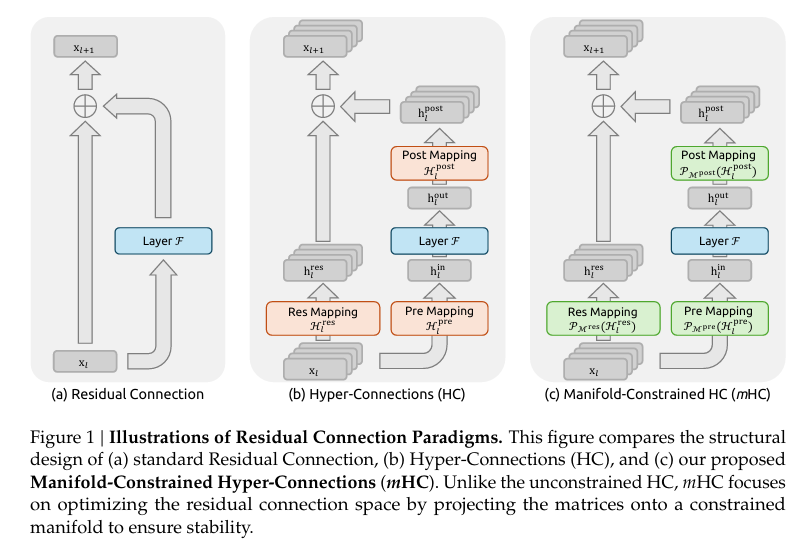
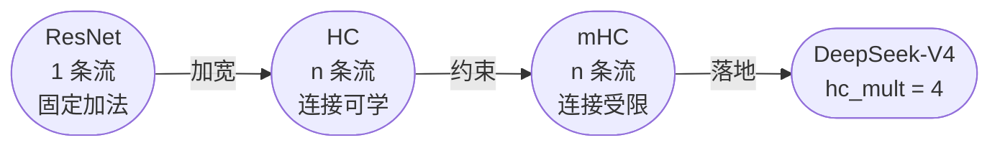
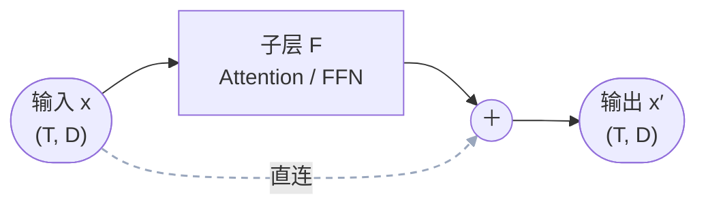
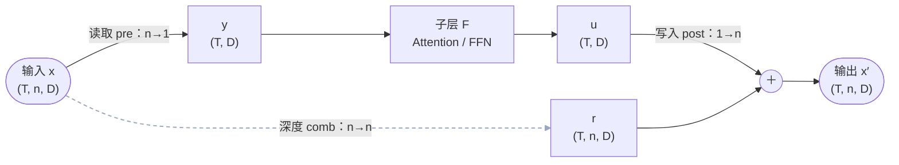
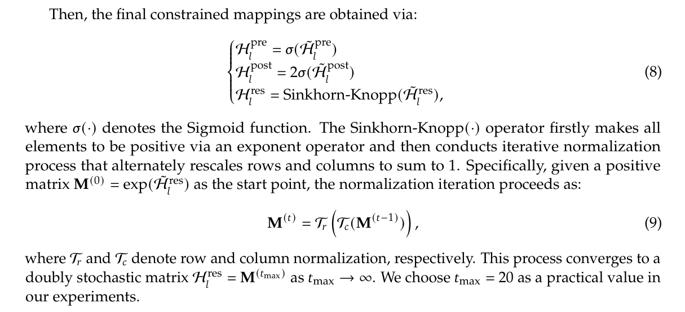
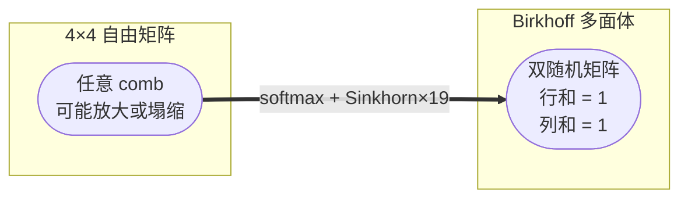
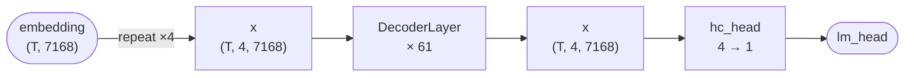
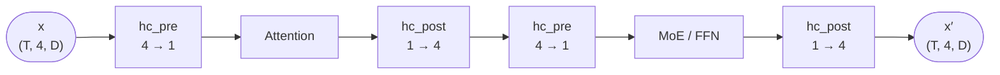

# 残差架构演进：从 Residual Connections 到 DeepSeek mHC

> **范围**：第 0–3 章讲演进与原理；第 4 章给出 vllm-ascend 的代码基线、配置与源码索引。

---

## 阅读指引

各章按"上一章遗留的局限 → 下一章引入的补充"递进组织，建议顺序阅读。

| 章节 | 主题 | 核心问题 | 主要结论 |
| --- | --- | --- | --- |
| 0 | 引言：三代演进 | 三代残差各自的定位与代价是什么？ | 恒等通路 → 多流可学习连接 → 流形约束 |
| 1 | 单流残差与恒等映射 | 深层网络为何退化，残差连接如何缓解？ | 分支改学残差 $F \approx H - x$，最坏退化为恒等映射 |
| 2 | 多流残差与可学习连接 | 如何在不加宽隐藏维度的前提下扩展残差主干？ | 扩为 $n$ 条流，以读取门、写入门、深度混合取代固定加法 |
| 3 | mHC：流形约束 | 多流自由连接为何在深度方向失稳，如何约束？ | 投影至双随机流形，谱范数 $\le 1$，深度连乘非扩张 |
| 4 | DeepSeek mHC 工程实现 | 上述约束如何落地为算子与数据流？ | `hc_pre` 压缩、`hc_post` 写回、`hc_head` 收口；参数约 84 M、激活 ×4、KV Cache 不变 |

---

## 0、引言

从 ResNet 的一条恒等边，到 DeepSeek-V4 的四条残差流加一个双随机混合矩阵，残差连接走过了三代。它的目的始终没变：给主干留一条恒等通路，让子层只学增量，从而压住深层网络的退化。变的是实现方式——**子层算出的增量怎么汇回主干**。先看整体脉络，图片来自 [DeepSeek-V4 论文](https://arxiv.org/pdf/2512.24880)：



先约定两个符号：$x$ 是残差流（residual stream）中跨层传递的表示，即捷径/主干上流动的信息；$F(x)$ 是残差分支算出的、要写回残差流的增量。

三代并排成一张表（$n$ 为残差流条数）：

| 代次 | 残差流（V4 中 $n=4$） | 汇回公式（$A_l$ 读取、$B_l$ 混合、$C_l$ 写入） | 连接的自由度 |
| --- | --- | --- | --- |
| Residual Connections | 1 条 | $x_{l+1} = x_l + F(x_l)$ | 无：直连恒等，加法写死 |
| HC | $n$ 条 | $x_{l+1} = B_l\,x_l + C_l\,F_l(A_l\,x_l)$ | 三组连接全部自由学习 |
| mHC | $n$ 条 | 同式，但 $B_l$ 约束为双随机矩阵 | $B_l$ 受限，$A_l$、$C_l$ 有界 |

**Residual Connections（残差连接）：1 条流，加法写死。** 它压住了深层退化，但主干容量固定，$+$ 也没有选择性。

**HC（超连接）：$n$ 条流，三组映射可学。** 把残差流加宽成 $n$ 条，$A_l$ 读取（`pre`，$1 \times n$）、$B_l$ 混合（`comb`，$n \times n$）、$C_l$ 写入（`post`，$n \times 1$）全部放开学习。容量、选择性、跨流重组一次解决，且 $n \ll d$，额外计算可忽略。代价是 $B_l$ 完全自由、谱范数不受控：61 层连乘，单层谱范数为 1.02 时最坏累计放大 $1.02^{61} \approx 3.35$ 倍，1.1 时是 $1.1^{61} \approx 335$ 倍；前向激活与反向梯度都沿这条通路被同样放大，范数小于 1 时则逐层衰减。

**mHC（流形约束超连接）：$n$ 条流，混合矩阵受限。** 公式不变，只改三组映射的取值域：最危险的 $B_l$ 投影到双随机矩阵（每行、每列和为 1 的非负矩阵），$A_l$、$C_l$ 用 Sigmoid 压成有界正权重（$\sigma(\cdot)+\varepsilon$ 与 $2\sigma(\cdot)$）。

双随机矩阵的谱范数 $\le 1$、对乘法封闭，所以深度连乘既不放大也不塌缩；$A_l$、$C_l$ 恒为非负，门控不会正负抵消。投影由 Sinkhorn-Knopp 迭代完成，细节见 3.2。

三代的动作链：



一句话：**用几何约束换数值稳定性**——不砍表达，只把参数限制在流形上。

---

## 1、Residual Connections

### 1.1 概述

先把三个符号的角色分清：

| 符号 | 含义 | 谁负责 |
| --- | --- | --- |
| $H(x)$ | 这个块**希望最终逼近**的目标映射 | 训练目标，不是某个层的输出 |
| $F(x)$ | 子层**实际输出**的东西 | 可学习参数 |
| $x$ | 输入，走直连通道 | 不经过任何参数 |

传统网络让子层直接拟合 $H(x)$，由此带来**退化问题**（degradation）：网络越深，训练误差反而越大。ResNet 的改动很小——子层不变，只改学习目标：不学 $H(x)$，只学残差 $F(x)=H(x)-x$，也就是"还差多少"。网络不必一次学出完整映射，只需学对当前表示的增量。

这一思路出自 [Deep Residual Learning for Image Recognition（He et al., 2015）](https://arxiv.org/pdf/1512.03385)。ResNet 正是靠它在 2015 年 ILSVRC 上夺冠，把可训练深度从十几层推到 152 层，成为计算机视觉乃至整个深度学习的里程碑。ResNet 是残差网络（Residual Network），其核心创新只有一条：**残差连接**（Residual Connections）——今天 Transformer 的每个 block 仍然是 $x \leftarrow x + \mathrm{Sublayer}(\mathrm{Norm}(x))$ 这一形式。

一个残差块只有两条分支：一条是**不经过任何参数**的直连边，把输入原样送到输出；另一条是子层 $F$。



写成公式就是

$$
x_{l+1} = x_l + F(x_l)
$$

形状没有任何变化：进 $(T, D)$，出 $(T, D)$，$D = 7168$。

两条边合起来：$\mathrm{out}=F(x)+x$。当 $F$ 学的是 $H(x)-x$ 时，

$$
\mathrm{out}\approx\bigl(H(x)-x\bigr)+x=H(x).
$$

加回来的 $x$ 正好**抵消**残差里的 $-x$，不是额外再加一份。只有子层仍按传统方式学 $H(x)$、又接了直连边时，才会得到 $\mathrm{out}=\mathrm{Conv}(x)+x\approx H(x)+x$——这等于把目标和输入重复叠加，是错误设计，ResNet 从未这样定义。另外，"新增层没学到有效特征也不变差"指的是 $F\to0$、输出退化为 $x$，不是子层输出 $\approx H(x)$。

一句话：**短路连接不是"在 $H$ 旁边加一个 $x$"，而是"在 $F$ 旁边加一个 $x$"，而 $F$ 的定义里已经含了 $-x$。**

跨层传递的 $x$ 因此被称为**残差流**（residual stream）：每一层只往这条流里写入一个增量 $F(x_l)$，而不是把整条流替换掉。从表示学习的角度看，每层学的是对当前表示的**修正**，浅层学到的表示可以沿直连边直接被深层复用，不必逐层重新编码。

**结果**：残差主干始终只有**一条流**：直连通道是恒等映射，子层输出经固定的 $+$ 汇回。即使子层什么都没学到（$F \to 0$），输出也退化为 $x_l$，性能至少不劣于加深之前——这就是"短路连接保证性能不下降"的准确含义。此外，直连边也为梯度提供了一条不衰减的通路，顺带缓解了梯度消失。

### 1.2 原理

记第 $i$ 层的子层为 $F_i$（不同层权重不同），每层做的是

$$
x_{i+1} = x_i + F_i(x_i).
$$

从第 $l$ 层开始逐层代入，直到最后一层 $L$：

$$
\begin{aligned}
x_{l+1} &= x_l + F_l(x_l),\\
x_{l+2} &= x_{l+1} + F_{l+1}(x_{l+1})\\
        &= x_l + F_l(x_l) + F_{l+1}(x_{l+1}),\\
&\ \vdots\\
x_L &= x_l + \sum_{i=l}^{L-1} F_i(x_i).
\end{aligned}
$$

记 $\mathcal{L}$ 为损失。$x_L$ 对 $x_l$ 的依赖有两条路：直连的 $x_l$ 本身，以及每个 $F_i(x_i)$ 中间接含有的 $x_l$。对 $x_l$ 求 Jacobian：

$$
\frac{\partial x_L}{\partial x_l}
= I + \sum_{i=l}^{L-1}\frac{\partial F_i(x_i)}{\partial x_l}.
$$

第一项 $I$ 来自直连；第二项里的 $\partial F_i(x_i)/\partial x_l$ 是**总导数**——按链式法则展开，它是所有从 $x_l$ 到 $x_i$ 的路径上的 Jacobian 乘积之和。乘上上游梯度：

$$
\frac{\partial \mathcal{L}}{\partial x_l}
= \underbrace{\frac{\partial \mathcal{L}}{\partial x_L}}_{\text{直连项}}
+\underbrace{\sum_{i=l}^{L-1}\frac{\partial \mathcal{L}}{\partial x_L}\frac{\partial F_i(x_i)}{\partial x_l}}_{\text{子层路径项}}.
$$

两部分的性质完全不同：

- **直连项**：$\partial \mathcal{L}/\partial x_L$ 乘上 $I$，原样传回。不经过权重，也不含多层 Jacobian 连乘，**不会随深度指数衰减**。
- **子层路径项**：每条路径都是一串 Jacobian 连乘，层数越多乘得越长。这些 Jacobian 的谱范数普遍小于 1，乘积随深度指数趋零（梯度消失）；普遍大于 1 则指数放大（梯度爆炸）。深层网络难训，主要难在这一项。

所以"梯度高速公路"的准确含义是：**反向传播时存在一条不经过权重、不做连乘的直连通道，把上游梯度直接送到任意浅层。** 即使所有子层路径都衰减到 0（$\partial F_i/\partial x \to 0$），直连项仍然完整。

标量情形下 $I$ 退化为数字 $1$，上式就是常见写法

$$
\frac{\partial \mathcal{L}}{\partial x_l}
= \frac{\partial \mathcal{L}}{\partial x_L}\left(1+\frac{\partial}{\partial x_l}\sum_{i=l}^{L-1}F_i(x_i)\right),
$$

括号里的 $1$ 就是直连项。

一点边界：这说的是"存在一条不衰减的通路"，不是"梯度总和一定不衰减"——子层路径项在极端情况下可以和直连项抵消（标量下 $F_i'=-1$ 时 $1+F_i'=0$）。但直连项本身不会被逐层乘小，层数增加不会自动把它抹掉，这正是 ResNet 能堆深的关键。

顺带划清另一个边界：残差主要缓解的是深度带来的退化与系统性衰减，**不是梯度爆炸**——$I$ 只保证有一条增益为 1 的通路，不负责给梯度设上限；子层 Jacobian 的谱范数大时，$I+J$ 照样能把梯度放大。爆炸要靠归一化、梯度裁剪、合适初始化等手段。

### 1.3 局限

ResNet 的残差块只有一条主干、一个写死的 $+$，由此带来三个限制：

| 局限 | 具体表现 | HC 的改法 |
| --- | --- | --- |
| 容量固定 | 所有层共用一条 $D=7168$ 的残差流；直接把它加宽 4 倍，Attention/FFN 的主要矩阵乘要涨约 16 倍（宽度平方） | 扩成 $n$ 条流；子层仍只读 1 条，计算基本不变 |
| 汇入无选择性 | $x+F(x)$ 是固定 $1:1$：想更信子层，只能靠 $F$ 自己把输出做大；想忽略子层，只能靠 $F$ 输出 0 | 读取门、写入门逐 token 可学 |
| 无法分流重组 | 所有信息都叠加在同一条流里，多份表示无法独立保存、按需交换 | 满矩阵在 $n$ 条流之间混合 |

具体到一层里，这些限制表现为：

- 想同时保留"原始 token 信息"和"改写后的语义"，只能叠在同一个向量里，后续层无法分开取用；
- 不需要改写的 token，残差仍以固定权重参与相加，子层只能靠"输出 0"来近似旁路。

三条指向同一个根源：**主干只有一条，且汇入方式写死。**

---

## 2、Hyper-Connections

### 2.1 概述

HC（Hyper-Connections）出自 [HYPER-CONNECTIONS](https://arxiv.org/pdf/2409.19606)。它承接 1.3 的三条局限，做两件事：把残差流从 1 条扩成 $n$ 条，再把固定的 $+$ 拆成三组可学习连接：

| 连接 | 方向 | 作用 |
| --- | --- | --- |
| 深度连接 | $n \to n$ | 流与流之间混合，纵向传递 |
| 宽度读取 | $n \to 1$ | 加权压成 1 条，送进子层 |
| 宽度写入 | $1 \to n$ | 子层输出按权重写回各流 |

这里加宽的是**残差流**，不是隐藏维度：子层始终只读 1 条 $D$ 维流，所以 Attention/FFN 的计算基本不变；多出来的只有 $n \times D$ 的激活和每层两组小门控投影。

三组连接的值都由当前 token 的多流状态投影得到，逐 token 不同——共享的只是投影权重，不是连接本身。与引言的符号对应：$A_l$ 即读取门 `pre`，$C_l$ 即写入门 `post`，$B_l=\mathrm{comb}^{\top}$。

### 2.2 原理

记第 $l$ 层的多流状态为 $x_l \in \mathbb{R}^{T \times n \times D}$，第 $j$ 条流为 $x_j \in \mathbb{R}^{T \times D}$。三组连接都是逐 token 的：$\mathrm{pre}, \mathrm{post} \in \mathbb{R}^{T \times n}$，$\mathrm{comb} \in \mathbb{R}^{T \times n \times n}$。

一层的数据流：



按步骤写开：

| 步骤 | 公式 | 形状 |
| --- | --- | --- |
| 读取 | $y = \sum_{j=1}^{n} \mathrm{pre}_j\, x_j$ | $(T, D)$ |
| 子层 | $u = F(y)$ | $(T, D)$ |
| 深度 | $r_c = \sum_{j=1}^{n} \mathrm{comb}_{j,c}\, x_j$ | $(T, n, D)$ |
| 写入 | $x_{l+1,c} = r_c + \mathrm{post}_c\, u$ | $(T, n, D)$ |

把深度与写入合并：

$$
x_{l+1} = \mathrm{comb}^{\top} x_l + \mathrm{post} \odot u
$$

约定 $\mathrm{comb}_{j,c}$ 是"源流 $j$ 写入目标流 $c$"的权重，所以作用在流轴上时用 $\mathrm{comb}^{\top}$；$\mathrm{post} \odot u$ 表示同一个 $u$ 乘上每条流各自的写入门。

> 对照 ResNet 的残差块：$\mathrm{comb} = I$、$\mathrm{post} = \mathbf{1}$ 时，上式精确退化成 $x + F(x)$。**残差连接是 HC 的一个特例。**

这也把 1.3 的三条局限逐个解掉了：容量与分流由 $n$ 条流提供；选择性由逐 token 的 $\mathrm{pre}/\mathrm{post}$ 提供；重组由满矩阵 $\mathrm{comb}$ 提供——流与流之间可以按 token 互相搬运信息，梯度也能走不同的流。

### 2.3 局限

HC 用很小的计算代价换来这三组连接，但代价集中在这几处：

| 项 | 影响 |
| --- | --- |
| 激活显存 | 残差主干从 $(T, D)$ 变成 $(T, 4, D)$，激活约 4 倍（KV Cache **不受影响**，见 4.5） |
| 计算量 | 每层多两次 $(24 \times 4D)$ 的门控投影 |
| 数值稳定性 | $\mathrm{comb}$ 完全自由时，$\prod_{l} \mathrm{comb}_l$ 的谱范数可能随深度指数增长或衰减 |

第三条最危险。残差连接这条通路的系数是 $I$（谱范数恒为 1），HC 把它换成了 $\mathrm{comb}$，于是通路的增益变成 $\prod_l \mathrm{comb}_l$。假设某层学出的 $\mathrm{comb}$ 谱范数为 1.02，61 层连乘后最坏放大 $1.02^{61} \approx 3.35$ 倍；若为 1.1，则是 $1.1^{61} \approx 335$ 倍。

后果分两层。数值上，前向激活与反向梯度都按同样倍数漂移：放大到一定程度就是激活溢出、梯度爆炸，缩小则是激活与梯度一起消失；轻则训练对学习率、初始化和梯度裁剪变得敏感，重则出现 NaN 或深层参数几乎不再更新。结构上，残差流被放大时，每层子层增量相对越来越小，深层等于被旁路；被压缩时则相反，残差积累被逐层覆盖。

**mHC 的出发点就是：把 $\mathrm{comb}$ 钉在一个"绝不放大"的集合里。** 它只动这一个变量——多流结构与三组连接全部保留。

---

## 3、Manifold-Constrained Hyper-Connections



### 3.1 概述

mHC（Manifold-Constrained Hyper-Connections，流形约束超连接）保留 HC 的多流结构，只给三组连接分别加约束。DeepSeek-V4 取 `hc_mult = 4`，即 $n = 4$：

| 连接 | 原始取值范围 | mHC 的约束 | 约束后的集合 |
| --- | --- | --- | --- |
| `comb`（深度） | 任意 $4 \times 4$ 实数矩阵 | Sinkhorn 归一化为**双随机矩阵** | Birkhoff 多面体 |
| `pre`（读取） | 任意实数 | $\sigma(\cdot) + \varepsilon \in (\varepsilon,\ 1+\varepsilon)$ | 有界正权重 |
| `post`（写入） | 任意实数 | $2\sigma(\cdot) \in (0,\ 2)$ | 有界正权重 |



三组约束的分工很清楚：**最危险的 `comb`（要跨层连乘）被钉死，`pre`/`post` 只做有界激活**，把"整体增强/削弱"的能力保留下来。

### 3.2 原理

**为什么有效。** 记所有双随机矩阵的集合为

$$
\mathcal{B}_n = \left\{\, M \in \mathbb{R}^{n \times n} \;\Big|\; \sum_{j} M_{ij} = 1\ (\forall i),\quad \sum_{i} M_{ij} = 1\ (\forall j),\quad M_{ij} \ge 0\ (\forall i,j) \,\right\}
$$

即每行、每列和都为 1 的非负矩阵。它有两条关键性质：

1. **列和为 1**（$\sum_{i} \mathrm{comb}_{ij} = 1$）→ 每条输出流是输入 4 条流的**凸组合**，总"质量"守恒，不会被放大。
2. **行和为 1**（$\sum_{j} \mathrm{comb}_{ij} = 1$）→ 每条输入流的贡献被完整分配出去，不会被某一列吞掉。

数学上，双随机矩阵的谱半径恒为 1（Perron-Frobenius），且其 2-范数不超过 1。于是任意深度的连乘都**非扩张**：

$$
\bigl\| \mathrm{comb}_L \cdots \mathrm{comb}_1\, x \bigr\|_2 \;\le\; \| x \|_2
$$

对任意深度 $L$ 成立。

这正是残差连接那条"恒等通道"在多流场景下的推广：残差连接保证 $\| x + F(x) \|$ 里有一份不衰减的 $x$；mHC 保证"多条流的混合"这一步本身既不衰减也不放大。

**怎么投影。** Sinkhorn-Knopp 定理：对任意正矩阵 $A$，交替做"行归一化 → 列归一化"，迭代收敛到一个双随机矩阵，且它是 $A$ 在 KL 散度意义下到 Birkhoff 多面体的投影。

实现上就是 20 轮交替（第 0 轮是 softmax 本身，之后再做 19 轮）。每一轮的两步归一化是：

$$
M_{ij} \leftarrow \frac{M_{ij}}{\sum_{k} M_{ik} + \varepsilon},
\qquad
M_{ij} \leftarrow \frac{M_{ij}}{\sum_{k} M_{kj} + \varepsilon}
$$

```python
comb = softmax(mixes_comb) + eps            # 第 0 轮
for it in range(1, 20):                     # 第 1 ~ 19 轮
    comb = comb / (comb.sum(dim=-1, keepdim=True) + eps)   # 行归一化
    comb = comb / (comb.sum(dim=-2, keepdim=True) + eps)   # 列归一化
```

**数值演示**：取一个 $4 \times 4$ 的 logits 矩阵，按同样规则实际跑一遍（$\varepsilon = 10^{-6}$）。初始 softmax 后行和为 1、列和未齐：

$$
M^{(0)} =
\begin{bmatrix}
0.5151 & 0.2094 & 0.1040 & 0.1715 \\
0.1524 & 0.5593 & 0.1022 & 0.1862 \\
0.1140 & 0.1701 & 0.4623 & 0.2537 \\
0.2135 & 0.0868 & 0.1748 & 0.5250
\end{bmatrix}
$$

第 19 轮后，行、列和都已到 1.0000：

$$
M^{(19)} =
\begin{bmatrix}
0.5176 & 0.2046 & 0.1269 & 0.1509 \\
0.1550 & 0.5529 & 0.1262 & 0.1659 \\
0.1073 & 0.1555 & 0.5281 & 0.2091 \\
0.2201 & 0.0870 & 0.2188 & 0.4741
\end{bmatrix}
$$

收敛过程：

| 迭代轮次 | max 行和偏差 | max 列和偏差 |
| --- | --- | --- |
| 0（仅 softmax） | $\approx 0$（构造保证） | 0.156 |
| 1 | 0.052 | 0 |
| 2 | 0.0065 | 0 |
| 3 | 0.0010 | 0 |
| 5 | $< 10^{-4}$ | 0 |
| 19 | $< 10^{-5}$ | 0 |

第 1 轮结束时列和已精确为 1，此后行和逐轮收敛：5 轮左右就到 $10^{-4}$ 量级，20 轮是给极端分布留的余量。这也解释了配置里 `hc_sinkhorn_iters=20` 而不是 100——再往上收益趋零，而每轮都要做 4 次除法 + 4 次求和。

一个容易被忽略的变化：Sinkhorn 会调整对角权重，允许"流与流互相借力"，而不是把每条流钉死在原位。示例中第 2 行对角由 `0.4623` 升到 `0.5281`，第 1 行则由 `0.5593` 略降到 `0.5529`。

**表达力够不够。** 常见疑问：把 16 个自由度压到 9 个（$4 \times 4$ 双随机矩阵的维度是 $(n-1)^2 = 9$），模型不会变笨吗？

1. **9 维流形足够表达"流间重组"的主要模式**。真正有害的自由度是"整体放大/缩小"，而它恰好被去掉了。
2. **$\mathrm{pre}$、$\mathrm{post}$ 没有做双随机归一化**，只做有界激活，保留了"整体增强/削弱"的能力。约束只加在最危险的地方——跨层连乘的 $\mathrm{comb}$。
3. **每个 token 独立算一套**门控，表达力在 batch 维度上展开，而不是靠单矩阵的自由度堆。

换句话说：mHC 不是把 HC 变弱，而是把 HC 里**唯一会导致深度不稳定的那一维**（谱半径）钉死，其余维度全部放开。

理论到此完整：**残差连接给出恒等通路 → HC 把通路扩成可学习的多流 → mHC 把最危险的混合矩阵约束到流形上**。下面进入第 4 章。

---

## 4、工程实现

| 项 | 取值 |
| --- | --- |
| 代码基线 | vllm-ascend v0.32.0rc |
| 模型 | DeepSeek-V4-Pro-0813 |
| 量化方式 | W4A8 |
| `hc_mult` | 4 |
| `hc_sinkhorn_iters` | 20 |
| `hc_eps` | 1e-6 |
| `hidden_size` | 7168 |
| `num_hidden_layers` | 61 |

mHC 在 vllm-ascend 中只对应三个新增算子：`hc_pre`（读）、`hc_post`（写）、`hc_head`（收口）。下文先梳理数据流，再逐个拆解，最后给出开销与源码索引。

### 4.1 数据流

模型入口把 embedding 复制成 4 条流，出口用 `hc_head` 压回 1 条：



入口在 [model.py:L1004](../model.py#L1004) 把 embedding repeat 成 4 条流，出口在 [model.py:L949](../model.py#L949) 用 `hc_head` 收口。

一个 Decoder 层里，`hc_pre` 与 `hc_post` 各调用两次，包住 Attention 与 MoE：



关键点：**Attention 与 MoE 始终只看到 1 条 $D$ 维流**，归一化也只作用在这条单流上（Attention 前 `input_layernorm`，FFN 前 `rms_norm_cast`，后者同时产出 bf16/fp32，fp32 供 MoE 路由）。mHC 的额外开销因此集中在层边界；每层在第一个 `hc_pre` 前先 `residual = hidden_states.clone()`，因为 `hc_post` 需要压缩前的 4 条流。

### 4.2 hc_pre

`hc_pre` 把 4 条流压成 1 条，同时算出 `pre`、`post`、`comb` 三套门控。代码入口（[model.py:L783](../model.py#L783)）：

```python
def hc_pre(self, x, hc_fn, hc_scale, hc_base):
    y = torch.ops._C_ascend.npu_hc_pre_v2(
        x, hc_fn, hc_scale, hc_base,
        self.hc_mult, self.hc_sinkhorn_iters, self.norm_eps, self.hc_eps
    )
    return y            # 返回 (y, post, comb)
```

参数（[model.py:L760-L770](../model.py#L760)）：

| 参数 | 形状 | 说明 |
| --- | --- | --- |
| `x` | `(T, 4, 7168)` | 4 条残差流 |
| `hc_fn` | `(24, 28672)` | 门控投影权重，fp32 |
| `hc_scale` | `(3,)` | pre / post / comb 三个温度 |
| `hc_base` | `(24,)` | 三段偏置 |
| 输出 `y` | `(T, 7168)` | 压成 1 条流 |
| 输出 `post` | `(T, 4)` | 写回门控 |
| 输出 `comb` | `(T, 4, 4)` | 双随机组合矩阵 |

`24 = 4 + 4 + 16`：前 4 列给 `pre`，中间 4 列给 `post`，后 16 列给 `comb`。

计算分五步（[hc_pre_base.h:L489](../../../../csrc/moe/hc_pre/op_kernel/hc_pre_base.h#L489)）：

| 步骤 | 公式 | 输出 |
| --- | --- | --- |
| ① 逆均方根 | $r = \left(\operatorname{mean}(x^2) + \varepsilon_{\mathrm{norm}}\right)^{-1/2}$ | 每 token 一个标量 |
| ② 投影 | $\mathrm{mixes} = (x_{\mathrm{flat}} \cdot r)\, W^{\top}$ | $(T,\ 24)$ |
| ③ 读取门 | $\mathrm{pre} = \sigma\!\left(\mathrm{mixes}_{[0:4]} \cdot r \cdot s_0 + b_0\right) + \varepsilon$，$y = \sum_{j=1}^{4} \mathrm{pre}_j\, x_j$ | $(T,\ 4) \to (T,\ 7168)$ |
| ④ 写入门 | $\mathrm{post} = 2\,\sigma\!\left(\mathrm{mixes}_{[4:8]} \cdot r \cdot s_1 + b_1\right)$ | $(T,\ 4)$ |
| ⑤ 组合矩阵 | $\mathrm{comb} = \mathrm{Sinkhorn}_{19}\!\left(\operatorname{softmax}\left(\mathrm{mixes}_{[8:24]} \cdot r \cdot s_2 + b_2\right) + \varepsilon\right)$ | $(T,\ 4,\ 4)$ |

其中 $W$ 是 `hc_fn`，$s_0,s_1,s_2$ 是 `hc_scale` 的三个分量，$b_0,b_1,b_2$ 是 `hc_base` 的三段偏置。对照引言的三代公式与 2.2 节的逐流写法：`pre` 是读取门 $A_l$，`post` 是写入门 $C_l$，`comb` 是 $B_l$ 的转置（$B_l=\mathrm{comb}^{\top}$），约束后为双随机矩阵；② 只是三套门控共享的一次投影。

几个容易踩错的点：

- $r$ 是整块 $4 \times 7168$ 维的逆均方根，不是单条流；它同时乘进投影和 logits（后者相当于 token 级温度）。
- `pre` 是 $\sigma(\cdot)+\varepsilon$，不是 softmax，四个权重和不等于 1，$y$ 的尺度可以大于单条流。
- `post` 乘 2 后落在 $(0,2)$，中心在 1 附近，覆盖"削弱到 0"和"增强到 2 倍"。
- `comb` 按 `[源流, 目标流]` 存储，写回时按列取值（[hc_post_bfloat16.h:L205](../../../../csrc/moe/hc_post/op_kernel/hc_post_bfloat16.h#L205)）。

### 4.3 hc_post

`hc_post` 与 `hc_pre` 对称：把子层输出的单条流按门控写回，并与原始 4 条流做深度混合。代码入口（[model.py:L789](../model.py#L789)）：

```python
def hc_post(self, x, residual, post, comb):
    y = torch.ops._C_ascend.npu_hc_post(
        x.unsqueeze(dim=0), residual.unsqueeze(dim=0), post.unsqueeze(dim=0), comb.unsqueeze(dim=0)
    )
    return y.squeeze(dim=0)
```

公式（$c$ 为目标流，$j$ 为源流）：

$$
x'_{c} = \sum_{j=1}^{4} \mathrm{comb}_{j,c}\,\mathrm{residual}_{j} + \mathrm{post}_{c}\, u .
$$

其中 $u$ 是子层输出（对应代码里的 `x`）。形状：`residual` $(T,4,7168)$、$u$ $(T,7168)$、`post` $(T,4)$、`comb` $(T,4,4)$，输出 $(T,4,7168)$。这就是 2.2 节 $x_{l+1} = \mathrm{comb}^{\top} x_l + \mathrm{post} \odot u$ 的逐元素写法。

三个特例：

- $\mathrm{comb} = I$、$\mathrm{post}_c = 1$：4 条独立残差；
- $\mathrm{comb} = I$、$\mathrm{post}_c = 0$：子层被完全旁路；
- $\mathrm{comb} = J/4$（全 $1/4$ 矩阵）：退化成共享池，信息被彻底打散。

Sinkhorn 保证 `comb` 落在中间地带——既能重组，又不会把信息抹平。

### 4.4 hc_head

61 层跑完后得到的是 `(T, 4, 7168)`，而 `lm_head` 只认 `(T, 7168)`，所以需要一次不带 Sinkhorn 的简化版 `hc_pre`（[model.py:L949](../model.py#L949)）：

```python
def hc_head(self, x, hc_fn, hc_scale, hc_base):
    shape, dtype = x.size(), x.dtype
    x = x.flatten(1).float()                              # (T, 28672)
    x_norm = self.hc_norm(x)                              # RMSNorm(28672)，has_weight=False
    mixes = torch.nn.functional.linear(x_norm, hc_fn)     # (T, 4)
    pre = torch.sigmoid(mixes * hc_scale + hc_base) + self.hc_eps
    y = torch.sum(pre.unsqueeze(-1) * x.view(shape), dim=1)   # (T, 7168)
    return y.to(dtype)
```

与层内 `hc_pre` 的三点差异：

| 项 | 层内 hc_pre | hc_head |
| --- | --- | --- |
| 归一化 | 逆 RMS（只算缩放，不真的除） | RMSNorm（真的归一化） |
| 输出 | 1 条流 + `post` + `comb` | 只有 1 条流 |
| 门控列数 | 24 | 4 |

为什么不直接求平均？因为 4 条流在训练中会分化成不同"语义副本"，求平均等于强行认为它们等权；让模型自己学 4 个读取权重更合理。

### 4.5 开销

按 `hidden_size=7168`、`hc_mult=4`、61 层计算：

| 项 | 计算 | 结果 |
| --- | --- | --- |
| 单层 `hc_attn_fn` | $24 \times 28672$ | 688,128 参数 |
| 单层 `hc_ffn_fn` | $24 \times 28672$ | 688,128 参数 |
| 单层合计（含 `base`/`scale`） | $2 \times (688128 + 24 + 3)$ | 1,376,310 |
| 61 层合计 | $1376310 \times 61$ | $\approx 83.95\ \mathrm{M}$ |
| fp32 权重显存 | $83.95\ \mathrm{M} \times 4\ \mathrm{B}$ | $\approx 335.8\ \mathrm{MB}$ |
| `hc_head` | $4 \times 28672 + 4 + 1$ | 114,693 |
| 每 token 残差流（bf16） | $4 \times 7168 \times 2\ \mathrm{B}$ | 57.3 KB（单流 14.3 KB） |

注意最后一行：**激活变大 4 倍，但 KV Cache 完全不变**。因为 `hc_pre` 在进 Attention 之前就压回了 1 条流，KV 里存的仍是单流 `K/V`。这是 mHC 相比"把模型宽度直接扩 4 倍"最大的工程优势——省下的是长上下文下最贵的显存。

另外，投机解码的 MTP 分支需要"进 `hc_head` 之前"的多流残差，所以主模型专门留了一块缓冲（[model.py:L931-L944](../model.py#L931)、写入在 [model.py:L1039-L1041](../model.py#L1039)）：

```python
self._mtp_hidden_buffer = torch.empty(
    (max_num_batched_tokens, hc_dim), dtype=..., device=...
)   # hc_dim = 4 × 7168 = 28672
```

### 4.6 源码索引

| 内容 | 位置 |
| --- | --- |
| 层内参数定义 | [model.py:L760-L770](../model.py#L760) |
| `hc_pre` Python 封装 | [model.py:L783](../model.py#L783) |
| `hc_post` Python 封装 | [model.py:L789](../model.py#L789) |
| `hc_head` | [model.py:L949](../model.py#L949) |
| 入口 4 流复制 | [model.py:L1004](../model.py#L1004) |
| `hc_pre` 的 pre 门控 kernel | [hc_pre_base.h:L489](../../../../csrc/moe/hc_pre/op_kernel/hc_pre_base.h#L489) |
| `hc_pre` 的 post 门控 kernel | [hc_pre_base.h:L727](../../../../csrc/moe/hc_pre/op_kernel/hc_pre_base.h#L727) |
| softmax 实现 | [hc_pre_base.h:L773](../../../../csrc/moe/hc_pre/op_kernel/hc_pre_base.h#L773) |
| comb 的 scale / softmax / Sinkhorn | [hc_pre_m_k_split_core.h:L947-L980](../../../../csrc/moe/hc_pre/op_kernel/hc_pre_m_k_split_core.h#L947) |
| `hc_post` 写回 kernel | [hc_post_bfloat16.h:L205](../../../../csrc/moe/hc_post/op_kernel/hc_post_bfloat16.h#L205) |

算子级细节（Tiling、arch35 分支、核间划分）见同目录的 [1_npu_hc_pre_npu.md](1_npu_hc_pre_npu.md) 与 [2_npu_hc_post_npu.md](2_npu_hc_post_npu.md)。
