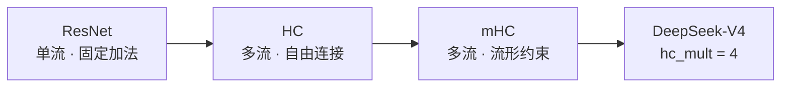
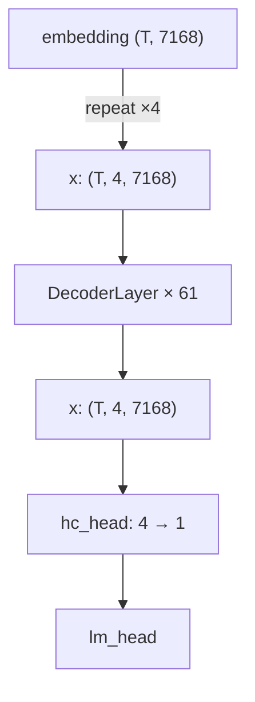
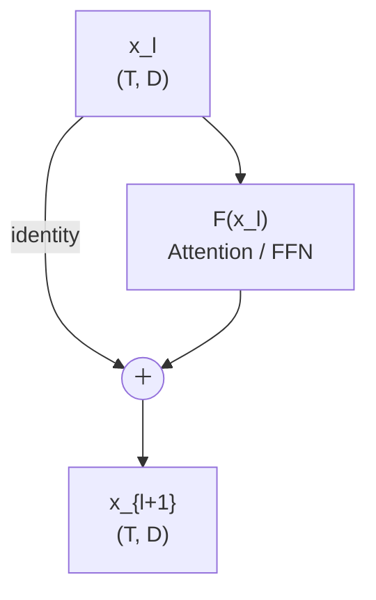
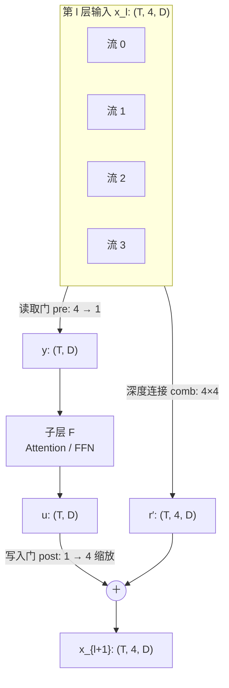
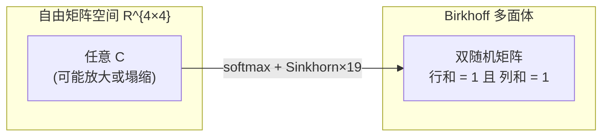
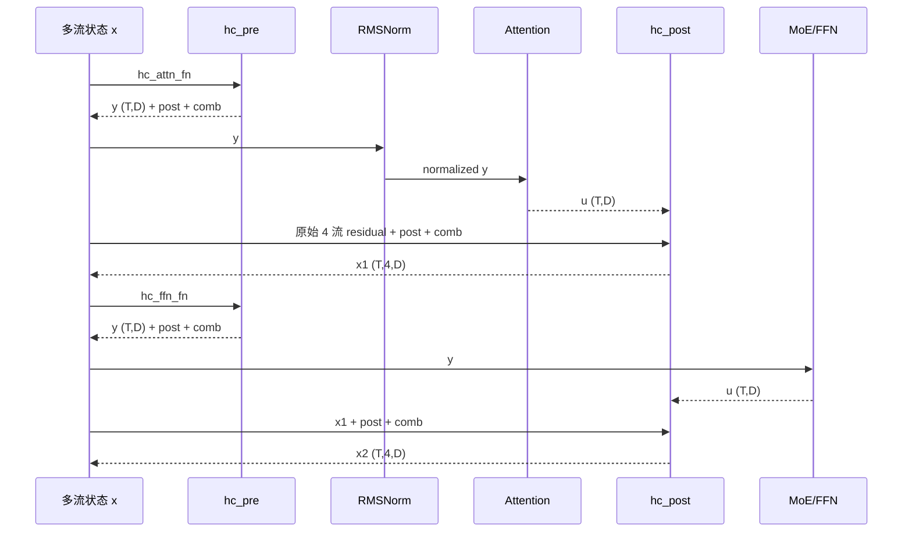

# 从 ResNet 到 DeepSeek mHC：残差架构演进

> **代码基线**：本文的 mHC 部分全部对齐 **vllm-ascend v0.32.0**（分支 `dsv4-v0.32.0`）与 **DeepSeek-V4-Pro-0813 W4A8** 配置。
> 关键配置：`hc_mult=4`、`hc_sinkhorn_iters=20`、`hc_eps=1e-6`、`hidden_size=7168`、`num_hidden_layers=61`。
> 文中 `Lxxx` 均带文件名；链接可直接点击跳转。

---

## 0、引言


### 0.1 一句话概括三代演进


x：是残差流（residual stream）里跨层传递的表示，也就是捷径/主干上流动的信息。
F(x)：是残差分支（residual branch）算出来的“要写回残差流”的增量/变换结果。

残差连接的演进，本质是在回答同一个问题：**子层算完之后，怎么把结果并回主干？**

| 代次 | 并回主干的方式 | 主干形态 |
| --- | --- | --- |
| ResNet | $x + F(x)$，一条固定加法 | 1 条残差流 |
| HC（Hyper-Connections） | 多条流之间用**可学习矩阵**混合 | n 条并行残差流 |
| mHC（Manifold-Constrained HC） | 混合矩阵被**约束在双随机流形**上 | n 条并行残差流 |



### 0.2 三个阶段的共同目标与不同代价

- **共同目标**：让深层网络里信息能"抄近路"，不被一层层的非线性变换磨掉。
- **ResNet 的代价**：只有一条通道，容量固定。
- **HC 的代价**：连接矩阵自由学习，深层连乘后数值可能爆炸或塌缩。
- **mHC 的代价**：用流形约束换数值稳定，但要多做 20 轮 Sinkhorn 归一化。

### 0.3 先看结论：DeepSeek-V4 里 mHC 长什么样

一个 Decoder 层里，mHC 做了两件对称的事：

| 阶段 | 算子 | 方向 | 作用 |
| --- | --- | --- | --- |
| 子层前 | `hc_pre` | 4 条流 → 1 条 | 加权读取，压成普通 hidden 送入 Attention/FFN |
| 子层后 | `hc_post` | 1 条 → 4 条 | 深度混合 + 门控写回，恢复成 4 条流 |

模型入口把 embedding 复制成 4 条流（[model.py:L1004](../model.py#L1004)）：

```python
hidden_states = hidden_states.unsqueeze(1).repeat(1, self.hc_mult, 1)  # (b, s, h) -> (b, s, c, h)
```

模型出口再用 `hc_head` 压回 1 条流（[model.py:L949](../model.py#L949)）。



---

## 1、ResNet

### 1.1 是什么

ResNet 的残差块就是一行公式：

$$
x_{l+1} = x_l + F(x_l)
$$

$F$ 是几层卷积（或今天的 Attention / FFN），$x_l$ 走一条**不经过任何参数**的直连通道。

### 1.2 一个常见困惑：为什么不是 $H(x) + x$

先把三个符号的角色分清楚：

| 符号 | 含义 | 谁负责 |
| --- | --- | --- |
| $H(x)$ | 这个块**希望最终逼近**的目标映射 | 训练目标，不是某个层的输出 |
| $F(x)$ | 卷积分支**实际输出**的东西 | 可学习参数 |
| $x$ | 输入，走短路连接 | 不经过任何参数 |

传统网络让卷积分支直接拟合 $H(x)$，所以输出就是 $\mathrm{Conv}(x) \approx H(x)$。

ResNet 改的是**分支的学习目标**：不学 $H(x)$，学它的残差 $F(x) \approx H(x) - x$。于是

$$
\mathrm{out} = F(x) + x \approx \bigl(H(x) - x\bigr) + x = H(x)
$$

加回来的 $x$ 是用来**抵消**残差里的 $-x$，不是额外再加一份 $x$，所以输出仍然是 $H(x)$。

那什么时候才会出现 $H(x) + x$？只有一种情况：卷积分支仍按传统方式学 $H(x)$，同时又接了短路连接。

$$
\mathrm{out} = \mathrm{Conv}(x) + x \approx H(x) + x
$$

这等于把"目标"和"输入"重复叠加了一次，是错误设计，ResNet 从来没有这样定义。换句话说：**短路连接不是"在 $H$ 旁边加一个 $x$"，而是"在 $F$ 旁边加一个 $x$"，而 $F$ 的定义里已经含了 $-x$。**

再回到"即使新增卷积层没学到有效特征，性能也不会下降"这句话：

- 在残差块里，"没学到有效特征"指的是**残差分支输出接近 0**，即 $F(x) \approx 0$，于是输出 $\approx x$，至少保住恒等映射。
- 它**不是**指卷积分支输出接近 $H(x)$。若真如此，说明分支学的还是传统目标，加上 $x$ 就变成 $H(x) + x$ 了。

还有一个容易说反的因果顺序：不是"加了 $x$ 这条边，网络就自动变成学残差"，而是**先在设计上把分支目标定义为残差**，$x$ 那条边才让 $F(x) + x$ 成立。短路连接提供的是恒等通路，残差的学习目标由"结构 + 损失"共同定义。

### 1.3 干什么用

它解决的是**退化问题**（degradation），不是过拟合也不是梯度消失——这两者是伴随现象。

现象：把网络加深到几十层后，训练误差反而变大；而这个"更深的网络"理论上可以退化成"浅网络 + 若干恒等层"，所以它本该至少不差。

原因：让一堆非线性层**精确地**学出恒等映射 $F(x) = x$ 很难；但让它们学出 $F(x) = 0$ 很容易（权重压到 0 即可）。

于是把目标从"学恒等映射"改成"学残差"：主干直接抄近路，$F$ 只负责学"要额外加多少"。最坏情况 $F \to 0$，网络自动退化成恒等。

### 1.4 结构



形状上没有任何变化：进 `(T, D)`，出 `(T, D)`，`D = 7168`。

### 1.5 为什么有效：反向传播的连乘项

设 $x_L = x_l + \sum_{i=l}^{L-1} F(x_i)$（$\mathcal{L}$ 表示损失，$L$ 表示深度），则

$$
\frac{\partial \mathcal{L}}{\partial x_l}
= \frac{\partial \mathcal{L}}{\partial x_L}
\left(1 + \frac{\partial}{\partial x_l}\sum_{i=l}^{L-1} F(x_i)\right)
$$

括号里的 $1$ 就是那条直连通道贡献的。哪怕后面所有 $\partial F / \partial x$ 都趋近 0，梯度仍然能原样传回第 $l$ 层。这就是"梯度高速公路"的准确含义。

### 1.6 留下的三个问题

| 问题 | 说明 |
| --- | --- |
| 容量瓶颈 | 全网络只有 1 条残差流，$D = 7168$ 是固定宽度，深层无法"多加几条草稿" |
| 加法无选择性 | $+$ 是固定权重 $1 : 1$，网络无法学"这一层我更信残差、那一层我更信子层输出" |
| 跨层不可重组 | 第 $l$ 层的输出只能整体加到第 $l+1$ 层，无法把"流 A 的一部分"送给"流 B" |

HC 就是冲着这三点来的。

---

## 2、HC：看 HC 的多维连接

### 2.1 是什么

HC（Hyper-Connections，超连接）把残差流从 **1 条扩成 n 条**，并用三组**可学习连接**取代固定的 $+$：

- 一条流纵向传下去：**深度连接**（depth connection）
- 多条流读进子层：**宽度读取**（width read）
- 子层输出写回多条流：**宽度写入**（width write）

DeepSeek-V4 取 `n = hc_mult = 4`。

### 2.2 结构：三组连接



三组连接的数学形式（单条流记为 $x_j \in \mathbb{R}^{T \times D}$，共 $n = 4$ 条）：

| 环节 | 公式 | 输出形状 |
| --- | --- | --- |
| 读取 | $y = \sum_{j=1}^{n} \mathrm{pre}_j\, x_j$ | $(T, D)$ |
| 子层 | $u = F(y)$ | $(T, D)$ |
| 深度 | $r'_c = \sum_{j=1}^{n} C_{j,c}\, x_j$ | $(T, n, D)$ |
| 写入 | $x'_c = r'_c + \mathrm{post}_c\, u$ | $(T, n, D)$ |

把深度和写入合并，就是 HC 的核心公式：

$$
x_{l+1} = C^{\top} x_l + \mathrm{post} \odot u
$$

> 对照 ResNet：$C = I$（单位阵）、$\mathrm{post} = \mathbf{1}$（全 1 向量）时，上式精确退化成 $x + F(x)$。**ResNet 是 HC 的一个特例。**

### 2.3 相比 ResNet 多了什么能力

| 能力 | 实现方式 |
| --- | --- |
| 残差流扩容 | $n$ 条 $D$ 维流，等价于把残差主干宽度变成 $n \times D$ |
| 选择性融合 | $\mathrm{post}$ 逐流缩放，可学"这一层多信子层、少信残差" |
| 跨流重组 | $C$ 是满矩阵，允许流间互相搬运信息 |
| 深层梯度路由 | 每个 token 有自己的 $C$，梯度可以走不同的流 |

注意最后一点：`pre / post / comb` **都是按 token 动态计算的**（由 `x` 本身投影得到），不是全模型共享的静态参数。所以它是"动态连接"而不是"静态加权"。

### 2.4 代价与风险

| 项 | 影响 |
| --- | --- |
| 激活显存 | 残差主干从 `(T, D)` 变成 `(T, 4, D)`，激活约 4 倍（KV Cache **不受影响**，见 3.9） |
| 计算量 | 每层多两次 $(24 \times 4D)$ 的门控投影 |
| 数值稳定性 | $C$ 完全自由时，$\prod_{l} C_l$ 的谱范数可能随深度指数增长或衰减 |

第三条是致命的。假设某层学出的 $C$ 谱范数为 1.02，61 层连乘后是 $1.02^{61} \approx 3.3$；若为 1.1，则是 $1.1^{61} \approx 331$。反向传播时同样会放大 61 次。

**mHC 的出发点就是：把 $C$ 钉在一个"绝不放大"的集合里。**

---

## 3、mHC：mHC 的流形约束


### 3.1 是什么

mHC（Manifold-Constrained Hyper-Connections，流形约束超连接）保留了 HC 的多流结构，但给三组连接分别加了约束：

| 连接 | 原始取值范围 | mHC 的约束 | 约束后的集合 |
| --- | --- | --- | --- |
| `comb`（深度） | 任意 $4 \times 4$ 实数矩阵 | Sinkhorn 归一化为**双随机矩阵** | Birkhoff 多面体 |
| `pre`（读取） | 任意实数 | $\sigma(\cdot) + \varepsilon \in (\varepsilon,\ 1+\varepsilon)$ | 有界正权重 |
| `post`（写入） | 任意实数 | $2\sigma(\cdot) \in (0,\ 2)$ | 有界正权重 |



### 3.2 为什么是双随机矩阵

双随机矩阵有两个关键性质：

1. **列和为 1**（$\sum_{i} C_{ij} = 1$）→ 每条输出流是输入 4 条流的**凸组合**，总"质量"守恒，不会被放大。
2. **行和为 1**（$\sum_{j} C_{ij} = 1$）→ 每条输入流的贡献被完整分配出去，不会被某一列吞掉。

数学上，双随机矩阵的谱半径恒为 1（Perron-Frobenius），且其 2-范数不超过 1。于是任意深度的连乘 $C_L \cdots C_1$ 都**非扩张**：

$$
\bigl\| C_L \cdots C_1\, x \bigr\|_2 \;\le\; \| x \|_2
$$

对任意深度 $L$ 成立。

这正是 ResNet 那条"恒等通道"在多流场景下的推广：ResNet 保证 $\| x + F(x) \|$ 里有一份不衰减的 $x$；mHC 保证"多条流的混合"这一步本身不衰减也不放大。

### 3.3 hc_pre：一次前向的完整算术

`hc_pre` 把 4 条流压成 1 条，同时**顺便算出**后面要用的一切门控。它是 mHC 的信息入口。

代码入口（[model.py:L783](../model.py#L783)）：

```python
def hc_pre(self, x, hc_fn, hc_scale, hc_base):
    y = torch.ops._C_ascend.npu_hc_pre_v2(
        x, hc_fn, hc_scale, hc_base,
        self.hc_mult, self.hc_sinkhorn_iters, self.norm_eps, self.hc_eps
    )
    return y            # (y, post, comb)
```

参数形状（[model.py:L760-L770](../model.py#L760)）：

| 参数 | 形状 | 说明 |
| --- | --- | --- |
| `x` | `(T, 4, 7168)` | 4 条残差流 |
| `hc_fn` | `(24, 28672)` | 门控投影权重，fp32；$24 = (2 + 4) \times 4$ |
| `hc_scale` | `(3,)` | 三个温度系数，分别给 pre / post / comb |
| `hc_base` | `(24,)` | 三个偏置段 |
| 输出 `y` | `(T, 7168)` | 压成 1 条流 |
| 输出 `post` | `(T, 4)` | 写回门控 |
| 输出 `comb` | `(T, 4, 4)` | 双随机组合矩阵 |

`mix_hc = 24` 这 24 列不是随意排的，按区间切成三段：

| 列区间 | 含义 | logits 数 |
| --- | --- | --- |
| $[0,\ 4)$ | `pre` 的读取门 | 4 |
| $[4,\ 20)$ | `comb` 的 $4 \times 4$ 组合矩阵 | 16 |
| $[20,\ 24)$ | `post` 的写入门 | 4 |

完整五步（对应 [hc_pre_base.h:L489](../../../../csrc/moe/hc_pre/op_kernel/hc_pre_base.h#L489) `ProcessPre`、[hc_pre_m_k_split_core.h:L947](../../../../csrc/moe/hc_pre/op_kernel/hc_pre_m_k_split_core.h#L947) 的 comb 段）：

| 步骤 | 公式 | 输出 |
| --- | --- | --- |
| ① 逆均方根 | $r = \left(\operatorname{mean}(x^2) + \varepsilon_{\mathrm{norm}}\right)^{-1/2}$ | 每 token 一个标量 |
| ② 投影 | $\mathrm{mixes} = (x_{\mathrm{flat}} \cdot r)\, W^{\top}$ | $(T,\ 24)$ |
| ③ 读取门 | $\mathrm{pre} = \sigma\!\left(\mathrm{mixes}_{[0:4]} \cdot r \cdot s_0 + b_0\right) + \varepsilon$，$y = \sum_{j=1}^{4} \mathrm{pre}_j\, x_j$ | $(T,\ 4) \to (T,\ 7168)$ |
| ④ 写入门 | $\mathrm{post} = 2\,\sigma\!\left(\mathrm{mixes}_{[20:24]} \cdot r \cdot s_1 + b_1\right)$ | $(T,\ 4)$ |
| ⑤ 组合矩阵 | $C = \mathrm{Sinkhorn}_{19}\!\left(\operatorname{softmax}\left(\mathrm{mixes}_{[4:20]} \cdot r \cdot s_2 + b_2\right) + \varepsilon\right)$ | $(T,\ 4,\ 4)$ |

其中 $W$ 即 `hc_fn`，$s_0,s_1,s_2$ 是 `hc_scale` 的三个分量，$b_0,b_1,b_2$ 是 `hc_base` 按 $4 / 16 / 4$ 切分的三段偏置。

几点容易踩错的细节：

- $r$ 算在整个 $4 \times 7168 = 28672$ 维上，不是单条流上。它把"这个 token 在 4 条流上的总能量"归一成一个标量。
- $r$ 被用了两次：一次乘进 $x$ 做归一化后再投影，一次直接乘在 logits 上（等价于给门控加了一个 token 级温度）。
- $\mathrm{pre}$ 是 $\sigma(\cdot) + \varepsilon$，恒正；不是 softmax，所以 4 个权重**加起来不等于 1**，$y$ 的尺度可以大于单条流。
- $\mathrm{post}$ 乘 2 是关键：$\sigma$ 值域 $(0, 1)$，乘 2 后落在 $(0, 2)$，中心在 1 附近，正好覆盖"削弱到 0"和"增强到 2 倍"两个方向。
- $C$ 的存储约定是 `C[源流, 目标流]`，写回时按列取值（[hc_post_bfloat16.h:L205](../../../../csrc/moe/hc_post/op_kernel/hc_post_bfloat16.h#L205) `DoMulAndAdd` 中 `combAddr + j*hcParam + c`）。

### 3.4 Sinkhorn：把矩阵压到双随机流形上

Sinkhorn-Knopp 定理：对任意正矩阵 `A`，交替做"行归一化 → 列归一化"，迭代收敛到的极限是一个双随机矩阵，且它是 `A` 在 KL 散度意义下到 Birkhoff 多面体的投影。

实现上就是 20 轮交替（第 0 轮是 softmax 本身，之后再做 19 轮）。每一轮的两步归一化是：

$$
C_{ij} \leftarrow \frac{C_{ij}}{\sum_{k} C_{ik} + \varepsilon},
\qquad
C_{ij} \leftarrow \frac{C_{ij}}{\sum_{k} C_{kj} + \varepsilon}
$$

```python
comb = softmax(mixes_comb) + eps            # 第 0 轮
for it in range(1, 20):                     # 第 1 ~ 19 轮
    comb = comb / (comb.sum(dim=-1, keepdim=True) + eps)   # 行归一化
    comb = comb / (comb.sum(dim=-2, keepdim=True) + eps)   # 列归一化
```

**数值演示**：取一个 $4 \times 4$ 的 logits 矩阵，按同样规则实际跑一遍（$\varepsilon = 10^{-6}$）：

初始 softmax 后（行和为 1，列和不齐）：

$$
C^{(0)} =
\begin{bmatrix}
0.5151 & 0.2094 & 0.1040 & 0.1715 \\
0.1524 & 0.5593 & 0.1022 & 0.1862 \\
0.1140 & 0.1701 & 0.4623 & 0.2537 \\
0.2135 & 0.0868 & 0.1748 & 0.5250
\end{bmatrix}
$$

第 1 轮（列已归一到 1，行还差一点）：

$$
C^{(1)} =
\begin{bmatrix}
0.5177 & 0.2042 & 0.1233 & 0.1509 \\
0.1532 & 0.5453 & 0.1212 & 0.1638 \\
0.1146 & 0.1658 & 0.5482 & 0.2233 \\
0.2145 & 0.0846 & 0.2073 & 0.4620
\end{bmatrix}
$$

此时行和为 $(0.9962,\ 0.9835,\ 1.0519,\ 0.9684)$。第 19 轮（行、列和都是 1.0000）：

$$
C^{(19)} =
\begin{bmatrix}
0.5176 & 0.2046 & 0.1269 & 0.1509 \\
0.1550 & 0.5529 & 0.1262 & 0.1659 \\
0.1073 & 0.1555 & 0.5281 & 0.2091 \\
0.2201 & 0.0870 & 0.2188 & 0.4741
\end{bmatrix}
$$

收敛过程：

| 迭代轮次 | max 行和偏差 | max 列和偏差 |
| --- | --- | --- |
| 0（仅 softmax） | $\approx 0$（构造保证） | 0.156 |
| 1 | 0.052 | 0 |
| 2 | 0.0065 | 0 |
| 3 | 0.0010 | 0 |
| 5 | $< 10^{-4}$ | 0 |
| 19 | $< 10^{-5}$ | 0 |

可以看到 5 轮左右就基本收敛，20 轮是给极端分布留的余量。这也解释了为什么配置里 `hc_sinkhorn_iters=20` 而不是 100：再往上收益趋零，但每轮都要做一次 4 次除法 + 4 次求和。

值得注意的副作用：Sinkhorn 会**削弱对角优势**。示例里第 0 行原本 `0.5151`，收敛后 `0.5176` 基本没变；但第 2 行对角从 `0.4623` 升到 `0.5281`、第 1 行对角从 `0.5593` 降到 `0.5529`。也就是说，它允许"流与流之间互相借力"，而不是把每条流钉死在原位。

### 3.5 hc_post：写回

`hc_post` 是 `hc_pre` 的逆操作：把子层输出的单流结果 + 深度混合后的 4 条流，合并成新的 4 条流。

代码入口（[model.py:L789](../model.py#L789)）：

```python
def hc_post(self, x, residual, post, comb):
    y = torch.ops._C_ascend.npu_hc_post(
        x.unsqueeze(dim=0), residual.unsqueeze(dim=0), post.unsqueeze(dim=0), comb.unsqueeze(dim=0)
    )
    return y.squeeze(dim=0)
```

公式（$c$ 为目标流，$j$ 为源流）：

$$
x'_{c} = \sum_{j=1}^{4} \mathrm{comb}_{j,c}\ \mathrm{residual}_{j} + \mathrm{post}_{c}\, x,
\qquad c = 1,2,3,4
$$

| 项 | 形状 | 含义 |
| --- | --- | --- |
| `residual` | `(T, 4, 7168)` | 进 `hc_pre` 前的多流状态（未压缩） |
| `x` | `(T, 7168)` | 子层输出（Attention 或 FFN 结果） |
| `post` | `(T, 4)` | 每流的写入强度 |
| `comb` | `(T, 4, 4)` | 深度混合矩阵（双随机） |
| 输出 | `(T, 4, 7168)` | 新的多流状态 |

三个视角看这个式子：

- 若 $\mathrm{comb} = I$、$\mathrm{post}_c = 1$：$x'_c = \mathrm{residual}_c + x$，即 **4 条独立残差**。
- 若 $\mathrm{comb} = I$、$\mathrm{post}_c = 0$：$x'_c = \mathrm{residual}_c$，子层被完全旁路。
- 若 $\mathrm{comb} = J/4$（全 $1/4$ 矩阵）：新状态与源流无关，退化成一个共享池，信息被彻底打散。

Sinkhorn 保证 $\mathrm{comb}$ 落在中间地带——既能重组，又不会把信息抹平。

### 3.6 hc_head：出口收束

61 层跑完后手里是 `(T, 4, 7168)`，`lm_head` 只认 `(T, 7168)`，所以需要一次不带 Sinkhorn 的简化版 `hc_pre`（[model.py:L949](../model.py#L949)）：

```python
def hc_head(self, x, hc_fn, hc_scale, hc_base):
    shape, dtype = x.size(), x.dtype
    x = x.flatten(1).float()                              # (T, 28672)
    x_norm = self.hc_norm(x)                              # RMSNorm(28672)，has_weight=False
    mixes = torch.nn.functional.linear(x_norm, hc_fn)     # (T, 4)
    pre = torch.sigmoid(mixes * hc_scale + hc_base) + self.hc_eps
    y = torch.sum(pre.unsqueeze(-1) * x.view(shape), dim=1)   # (T, 7168)
    return y.to(dtype)
```

与层内 `hc_pre` 的三点差异：

| 项 | 层内 hc_pre | hc_head |
| --- | --- | --- |
| 归一化 | 逆 RMS（只算缩放，不真的除） | RMSNorm（真的归一化） |
| 输出 | 1 条流 + `post` + `comb` | 只有 1 条流 |
| 门控列数 | 24 | 4 |

为什么不直接求平均？因为 4 条流在训练中会分化成不同"语义副本"，求平均等于强行认为它们等权；让模型自己学 4 个读取权重更合理。

### 3.7 一个 Decoder 层的完整时序

一个 `DeepseekV4DecoderLayer` 里，mHC 被调用 **4 次**（[model.py:L795-L829](../model.py#L795)）：



对应代码顺序：

| 步骤 | 代码 | 说明 |
| --- | --- | --- |
| 1 | `residual = hidden_states.clone()` | 备份 4 条流（`hc_post` 要用未被压缩的版本） |
| 2 | `hc_pre(·, hc_attn_fn, …)` | 4 → 1，同时产出 `post` / `comb` |
| 3 | `input_layernorm(y)` | 归一化只作用在压缩后的单流上 |
| 4 | `self_attn(y)` | Attention 看到的仍是 `(T, 7168)` |
| 5 | `hc_post(u, residual, post, comb)` | 1 → 4 |
| 6 | `hc_pre(·, hc_ffn_fn, …)` | FFN 前的第二次 4 → 1 |
| 7 | `rms_norm_cast(y)` | 同时产出 bf16 与 fp32 两份，fp32 给 MoE 路由 |
| 8 | `self.mlp(...)` | MoE 计算 |
| 9 | `hc_post(...)` | FFN 后再 1 → 4 |

关键工程点：**Attention 与 MoE 始终只看到 1 条流**。这让 mHC 的额外开销集中在"层边界"，而不侵入注意力与专家计算的内部。

### 3.8 为什么加了约束反而不损失表达力

这是个常见疑问：把 16 个自由度压到 9 个（$4 \times 4$ 双随机矩阵的维度是 $(n-1)^2 = 9$），模型不会变笨吗？

三点回答：

1. **双随机矩阵仍是 9 维流形**，足够表达"流间重组"的主要模式；真正有害的自由度是"整体放大/缩小"，而它恰好被去掉了。
2. **$\mathrm{pre}$ 和 $\mathrm{post}$ 没有做双随机归一化**，它们只做有界激活（$\sigma(\cdot)$、$2\sigma(\cdot)$），保留了"整体增强/削弱"的能力。约束只加在最危险的地方——跨层连乘的 $C$。
3. **每个 token 独立算一套**门控，表达力在 batch 维度上展开，而不是靠单矩阵的自由度堆。

换句话说：mHC 不是把 HC 变弱，而是把 HC 里**唯一会导致深度不稳定的那一维**（谱半径）钉死，其余维度全部放开。

### 3.9 代价核算

按 `hidden_size=7168`、`hc_mult=4`、61 层计算：

| 项 | 计算 | 结果 |
| --- | --- | --- |
| 单层 `hc_attn_fn` | $24 \times 28672$ | 688,128 参数 |
| 单层 `hc_ffn_fn` | $24 \times 28672$ | 688,128 参数 |
| 单层合计（含 `base`/`scale`） | $2 \times (688128 + 24 + 3)$ | 1,376,310 |
| 61 层合计 | $1376310 \times 61$ | $\approx 83.95\ \mathrm{M}$ |
| fp32 权重显存 | $83.95\ \mathrm{M} \times 4\ \mathrm{B}$ | $\approx 335.8\ \mathrm{MB}$ |
| `hc_head` | $4 \times 28672 + 4 + 1$ | 114,693 |
| 每 token 残差流（bf16） | $4 \times 7168 \times 2\ \mathrm{B}$ | 57.3 KB（单流 14.3 KB） |

注意最后一行：**激活变大 4 倍，但 KV Cache 完全不变**。因为 `hc_pre` 在进 Attention 之前就压回了 1 条流，KV 里存的仍是单流 `K/V`。这是 mHC 相比"直接把模型宽度扩 4 倍"最大的工程优势——省下的是长上下文下最贵的显存。

另外，投机解码的 MTP 分支需要"进 `hc_head` 之前的"多流残差，所以主模型专门留了一块缓冲（[model.py:L931-L944](../model.py#L931)、写入在 [model.py:L1039-L1041](../model.py#L1039)）：

```python
self._mtp_hidden_buffer = torch.empty(
    (max_num_batched_tokens, hc_dim), dtype=..., device=...
)   # hc_dim = 4 × 7168 = 28672
```

### 3.10 源码索引

| 内容 | 位置 |
| --- | --- |
| 层内参数定义 | [model.py:L760-L770](../model.py#L760) |
| `hc_pre` Python 封装 | [model.py:L783](../model.py#L783) |
| `hc_post` Python 封装 | [model.py:L789](../model.py#L789) |
| `hc_head` | [model.py:L949](../model.py#L949) |
| 入口 4 流复制 | [model.py:L1004](../model.py#L1004) |
| `hc_pre` 的 pre 门控 kernel | [hc_pre_base.h:L489](../../../../csrc/moe/hc_pre/op_kernel/hc_pre_base.h#L489) |
| `hc_pre` 的 post 门控 kernel | [hc_pre_base.h:L727](../../../../csrc/moe/hc_pre/op_kernel/hc_pre_base.h#L727) |
| softmax 实现 | [hc_pre_base.h:L773](../../../../csrc/moe/hc_pre/op_kernel/hc_pre_base.h#L773) |
| comb 的 scale / softmax / Sinkhorn | [hc_pre_m_k_split_core.h:L947-L980](../../../../csrc/moe/hc_pre/op_kernel/hc_pre_m_k_split_core.h#L947) |
| `hc_post` 写回 kernel | [hc_post_bfloat16.h:L205](../../../../csrc/moe/hc_post/op_kernel/hc_post_bfloat16.h#L205) |

算子级细节（Tiling、arch35 分支、核间划分）见同目录的 [1_npu_hc_pre_npu.md](1_npu_hc_pre_npu.md) 与 [2_npu_hc_post_npu.md](2_npu_hc_post_npu.md)。

### 3.11 常见误解

| 误解 | 事实 |
| --- | --- |
| "mHC 就是 4 个独立残差并联" | 不是。$\mathrm{comb}$ 是满矩阵，流之间每层都在互相借力，独立残差只是 $\mathrm{comb} = I$ 的特例 |
| "$\mathrm{pre}$ 是 softmax，所以 4 个权重和为 1" | 不是。$\mathrm{pre} = \sigma(\cdot) + \varepsilon$，恒正但和不为 1，允许总体放大 |
| "Sinkhorn 只是归一化，不影响表达" | 它确实不改变矩阵的秩结构，但会显著改变对角优势，进而改变信息在流间的分配 |
| "4 条流会让 KV Cache 涨 4 倍" | 不会。Attention 前已压回 1 条流，KV 开销与普通模型相同 |
| "`comb` 是输入相关的，所以每层都不同" | 是，$\mathrm{comb}$ 由当前 token 的 $(T, 4, D)$ 状态投影得到，逐 token、逐层都不同 |

---

## 附：三代残差一览

| 维度 | ResNet | HC | mHC（DeepSeek-V4） |
| --- | --- | --- | --- |
| 残差流条数 | 1 | n | 4 |
| 深度连接 | 恒等（固定 1） | 可学习 4×4 矩阵 | 双随机 4×4 矩阵（Sinkhorn） |
| 读取方式 | 直接取 $x$ | $\mathrm{pre}$ 加权求和 | $\sigma(\cdot) + \varepsilon$ 加权求和 |
| 写入方式 | 直接加 $F(x)$ | $\mathrm{post}$ 逐流缩放 | $2\sigma(\cdot)$ 逐流缩放 |
| 稳定性保证 | $1 + \partial F / \partial x$ 有恒等项 | 无显式保证 | 谱半径 $\le 1$，深度连乘非扩张 |
| 额外参数 | 0 | $2n + n^2$ 每层 | $2n + n^2$ 每层（另加投影矩阵） |
| KV Cache 影响 | — | 视实现而定 | 无（Attention 前已压回 1 条） |
