# 残差架构演进：从 Residual Connections 到 DeepSeek mHC

> **范围**：第 0–3 章讲演进与原理；第 4 章给出 vllm-ascend 的代码基线、模型参数、算子清单与开销。

***

## 阅读指引

各章按"上一章遗留的局限 → 下一章引入的补充"递进组织，建议顺序阅读。

| 章节 | 主题                | 核心问题                  | 主要结论                                                             |
| -- | ----------------- | --------------------- | ---------------------------------------------------------------- |
| 0  | 引言：三代演进           | 三代残差各自的定位与代价是什么？      | 恒等通路 → 多流可学习连接 → 流形约束                                            |
| 1  | 单流残差与恒等映射         | 深层网络为何退化，残差连接如何缓解？    | 分支改学残差$F \approx H - x$，最坏退化为恒等映射                                |
| 2  | 多流残差与可学习连接        | 如何在不加宽隐藏维度的前提下扩展残差主干？ | 扩为$n$ 条流，以读取门、写入门、深度混合取代固定加法                                     |
| 3  | mHC：流形约束          | 多流自由连接为何在深度方向失稳，如何约束？ | 投影至双随机流形，谱范数$\le 1$，深度连乘非扩张                                      |
| 4  | DeepSeek mHC 工程实现 | 上述约束如何落地为算子与数据流？      | `hc_pre` 压缩、`hc_post` 写回、`hc_head` 收口；参数约 84 M、激活 ×4、KV Cache 不变 |

***

## 0、引言

从 ResNet 的一条恒等边，到 DeepSeek-V4 的四条残差流加一个双随机混合矩阵，残差连接走过了三代。它的目的始终没变：给主干留一条恒等通路，让子层只学增量，从而压住深层网络的退化。变的是实现方式——**子层算出的增量怎么汇回主干**。先看整体脉络，图片来自 [DeepSeek-V4 论文](https://arxiv.org/pdf/2512.24880)：

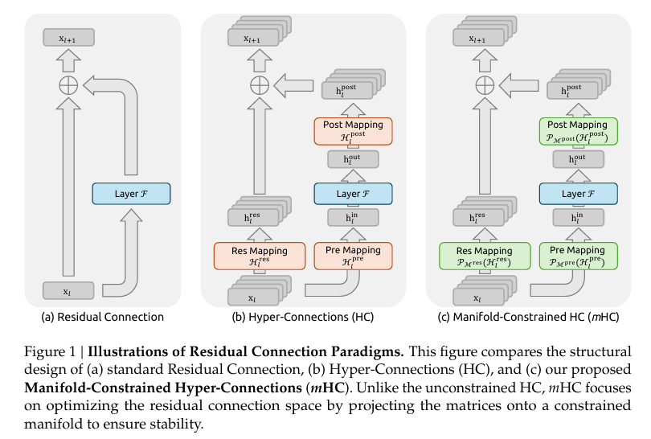

先约定两个符号：$x$ 是残差流（residual stream）中跨层传递的表示，即捷径/主干上流动的信息；$F(x)$ 是残差分支算出的、要写回残差流的增量。

三代并排成一张表（$n$ 为残差流条数）：

| 代次                   | 残差流（V4 中$n=4$） | 汇回公式（$A_l$ 读取、$B_l$ 混合、$C_l$ 写入）          | 连接的自由度                  |
| -------------------- | -------------- | ----------------------------------------- | ----------------------- |
| Residual Connections | 1 条            | $x_{l+1} = x_l + F(x_l)$                  | 无：直连恒等，加法写死             |
| HC                   | $n$ 条          | $x_{l+1} = B_l\,x_l + C_l\,F_l(A_l\,x_l)$ | 三组连接全部自由学习              |
| mHC                  | $n$ 条          | 同式，但$B_l$ 约束为双随机矩阵                        | $B_l$ 受限，$A_l$、$C_l$ 有界 |

**Residual Connections（残差连接）：1 条流，加法写死。** 它压住了深层退化，但主干容量固定，$+$ 也没有选择性。

**HC（超连接）：$n$ 条流，三组映射可学。** 把残差流加宽成 $n$ 条，$A_l$ 读取（`pre`，$1 \times n$）、$B_l$ 混合（`comb`，$n \times n$）、$C_l$ 写入（`post`，$n \times 1$）全部放开学习。容量、选择性、跨流重组一次解决，且 $n \ll d$，额外计算可忽略。代价是 $B_l$ 完全自由、谱范数不受控：61 层连乘，单层谱范数为 1.02 时最坏累计放大 $1.02^{61} \approx 3.35$ 倍，1.1 时是 $1.1^{61} \approx 335$ 倍；前向激活与反向梯度都沿这条通路被同样放大，范数小于 1 时则逐层衰减。

**mHC（流形约束超连接）：$n$ 条流，混合矩阵受限。** 公式不变，只改三组映射的取值域：最危险的 $B_l$ 投影到双随机矩阵（每行、每列和为 1 的非负矩阵），$A_l$、$C_l$ 用 Sigmoid 压成有界正权重（$\sigma(\cdot)+\varepsilon$ 与 $2\sigma(\cdot)$）。

双随机矩阵的谱范数 $\le 1$、对乘法封闭，所以深度连乘既不放大也不塌缩；$A_l$、$C_l$ 恒为非负，门控不会正负抵消。投影由 Sinkhorn-Knopp 迭代完成。

三代的动作链：

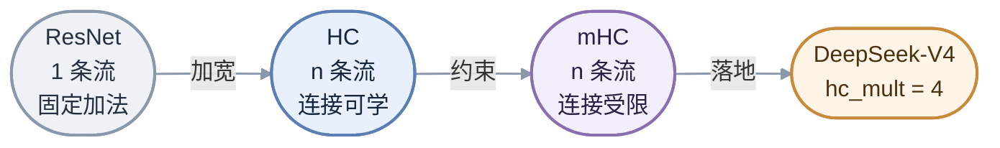

一句话：**用几何约束换数值稳定性**——不砍表达，只把参数限制在流形上。

***

## 1、Residual Connections

### 1.1 概述

先把三个符号的角色分清：

| 符号     | 含义                 | 谁负责           |
| ------ | ------------------ | ------------- |
| $H(x)$ | 这个块**希望最终逼近**的目标映射 | 训练目标，不是某个层的输出 |
| $F(x)$ | 子层**实际输出**的东西      | 可学习参数         |
| $x$    | 输入，走直连通道           | 不经过任何参数       |

传统网络让子层直接拟合 $H(x)$，由此带来**退化问题**（degradation）：网络越深，训练误差反而越大。ResNet 的改动很小——子层不变，只改学习目标：不学 $H(x)$，只学残差 $F(x)=H(x)-x$，也就是"还差多少"。网络不必一次学出完整映射，只需学对当前表示的增量。

这一思路出自 [Deep Residual Learning for Image Recognition（He et al., 2015）](https://arxiv.org/pdf/1512.03385)。ResNet 正是靠它在 2015 年 ILSVRC 上夺冠，把可训练深度从十几层推到 152 层，成为计算机视觉乃至整个深度学习的里程碑。ResNet 是残差网络（Residual Network），其核心创新只有一条：**残差连接**（Residual Connections）——今天 Transformer 的每个 block 仍然是 $x \leftarrow x + \mathrm{Sublayer}(\mathrm{Norm}(x))$ 这一形式。

一个残差块只有两条分支：一条是**不经过任何参数**的直连边，把输入原样送到输出；另一条是子层 $F$。


写成公式就是

$$
x_{l+1} = x_l + F(x_l)
$$

形状没有任何变化：进 $(T, D)$，出 $(T, D)$，$D = 7168$。

两条边合起来：$\mathrm{out}=F(x)+x$。当 $F$ 学的是 $H(x)-x$ 时，

$$
\mathrm{out}\approx\bigl(H(x)-x\bigr)+x=H(x).
$$

加回来的 $x$ 正好**抵消**残差里的 $-x$，不是额外再加一份。只有子层仍按传统方式学 $H(x)$、又接了直连边时，才会得到 $\mathrm{out}=\mathrm{Conv}(x)+x\approx H(x)+x$——这等于把目标和输入重复叠加，是错误设计，ResNet 从未这样定义。另外，"新增层没学到有效特征也不变差"指的是 $F\to0$、输出退化为 $x$，不是子层输出 $\approx H(x)$。

一句话：**短路连接不是"在 $H$ 旁边加一个 $x$"，而是"在 $F$ 旁边加一个 $x$"，而 $F$ 的定义里已经含了 $-x$。**

跨层传递的 $x$ 因此被称为**残差流**（residual stream）：每一层只往这条流里写入一个增量 $F(x_l)$，而不是把整条流替换掉。从表示学习的角度看，每层学的是对当前表示的**修正**，浅层学到的表示可以沿直连边直接被深层复用，不必逐层重新编码。

**结果**：残差主干始终只有**一条流**：直连通道是恒等映射，子层输出经固定的 $+$ 汇回。即使子层什么都没学到（$F \to 0$），输出也退化为 $x_l$，性能至少不劣于加深之前——这就是"短路连接保证性能不下降"的准确含义。此外，直连边也为梯度提供了一条不衰减的通路，顺带缓解了梯度消失。

### 1.2 原理

记第 $i$ 层的子层为 $F_i$（不同层权重不同），每层做的是

$$
x_{i+1} = x_i + F_i(x_i).
$$

从第 $l$ 层开始逐层代入，直到最后一层 $L$：

$$
\begin{aligned}
x_{l+1} &= x_l + F_l(x_l),\\
x_{l+2} &= x_{l+1} + F_{l+1}(x_{l+1})\\
        &= x_l + F_l(x_l) + F_{l+1}(x_{l+1}),\\
&\ \vdots\\
x_L &= x_l + \sum_{i=l}^{L-1} F_i(x_i).
\end{aligned}
$$

记 $\mathcal{L}$ 为损失。$x_L$ 对 $x_l$ 的依赖有两条路：直连的 $x_l$ 本身，以及每个 $F_i(x_i)$ 中间接含有的 $x_l$。对 $x_l$ 求 Jacobian：

$$
\frac{\partial x_L}{\partial x_l}
= I + \sum_{i=l}^{L-1}\frac{\partial F_i(x_i)}{\partial x_l}.
$$

第一项 $I$ 来自直连；第二项里的 $\partial F_i(x_i)/\partial x_l$ 是**总导数**——按链式法则展开，它是所有从 $x_l$ 到 $x_i$ 的路径上的 Jacobian 乘积之和。乘上上游梯度：

$$
\frac{\partial \mathcal{L}}{\partial x_l}
= \underbrace{\frac{\partial \mathcal{L}}{\partial x_L}}_{\text{直连项}}
+\underbrace{\sum_{i=l}^{L-1}\frac{\partial \mathcal{L}}{\partial x_L}\frac{\partial F_i(x_i)}{\partial x_l}}_{\text{子层路径项}}.
$$

两部分的性质完全不同：

- **直连项**：$\partial \mathcal{L}/\partial x_L$ 乘上 $I$，原样传回。不经过权重，也不含多层 Jacobian 连乘，**不会随深度指数衰减**。
- **子层路径项**：每条路径都是一串 Jacobian 连乘，层数越多乘得越长。这些 Jacobian 的谱范数普遍小于 1，乘积随深度指数趋零（梯度消失）；普遍大于 1 则指数放大（梯度爆炸）。深层网络难训，主要难在这一项。

所以"梯度高速公路"的准确含义是：**反向传播时存在一条不经过权重、不做连乘的直连通道，把上游梯度直接送到任意浅层。** 即使所有子层路径都衰减到 0（$\partial F_i/\partial x \to 0$），直连项仍然完整。

标量情形下 $I$ 退化为数字 $1$，上式就是常见写法

$$
\frac{\partial \mathcal{L}}{\partial x_l}
= \frac{\partial \mathcal{L}}{\partial x_L}\left(1+\frac{\partial}{\partial x_l}\sum_{i=l}^{L-1}F_i(x_i)\right),
$$

括号里的 $1$ 就是直连项。

一点边界：这说的是"存在一条不衰减的通路"，不是"梯度总和一定不衰减"——子层路径项在极端情况下可以和直连项抵消（标量下 $F_i'=-1$ 时 $1+F_i'=0$）。但直连项本身不会被逐层乘小，层数增加不会自动把它抹掉，这正是 ResNet 能堆深的关键。

顺带划清另一个边界：残差主要缓解的是深度带来的退化与系统性衰减，**不是梯度爆炸**——$I$ 只保证有一条增益为 1 的通路，不负责给梯度设上限；子层 Jacobian 的谱范数大时，$I+J$ 照样能把梯度放大。爆炸要靠归一化、梯度裁剪、合适初始化等手段。

### 1.3 局限

ResNet 的残差块只有一条主干、一个写死的 $+$，由此带来三个限制：

| 局限     | 具体表现                                                               | HC 的改法                    |
| ------ | ------------------------------------------------------------------ | ------------------------- |
| 容量固定   | 所有层共用一条$D=7168$ 的残差流；直接把它加宽 4 倍，Attention/FFN 的主要矩阵乘要涨约 16 倍（宽度平方） | 扩成$n$ 条流；子层仍只读 1 条，计算基本不变 |
| 汇入无选择性 | $x+F(x)$ 是固定 $1:1$：想更信子层，只能靠 $F$ 自己把输出做大；想忽略子层，只能靠 $F$ 输出 0        | 读取门、写入门逐 token 可学         |
| 无法分流重组 | 所有信息都叠加在同一条流里，多份表示无法独立保存、按需交换                                      | 满矩阵在$n$ 条流之间混合            |

具体到一层里，这些限制表现为：

- 想同时保留"原始 token 信息"和"改写后的语义"，只能叠在同一个向量里，后续层无法分开取用；
- 不需要改写的 token，残差仍以固定权重参与相加，子层只能靠"输出 0"来近似旁路。

三条指向同一个根源：**主干只有一条，且汇入方式写死。**

***

## 2、Hyper-Connections

### 2.1 概述

HC（Hyper-Connections）出自 [HYPER-CONNECTIONS](https://arxiv.org/pdf/2409.19606)。它针对残差连接的三个限制做两件事：把残差流从 1 条扩成 $n$ 条，再把固定的 $+$ 拆成三组可学习连接：

| 连接   | 方向        | 作用            |
| ---- | --------- | ------------- |
| 深度连接 | $n \to n$ | 流与流之间混合，纵向传递  |
| 宽度读取 | $n \to 1$ | 加权压成 1 条，送进子层 |
| 宽度写入 | $1 \to n$ | 子层输出按权重写回各流   |

这里加宽的是**残差流**，不是隐藏维度：子层始终只读 1 条 $D$ 维流，所以 Attention/FFN 的计算基本不变；多出来的只有 $n \times D$ 的激活和每层两组小门控投影。

三组连接的值都由当前 token 的多流状态投影得到，逐 token 不同——共享的只是投影权重，不是连接本身。与引言的符号对应：$A_l$ 即读取门 `pre`，$C_l$ 即写入门 `post`，$B_l=\mathrm{comb}^{\top}$。

### 2.2 原理

记第 $l$ 层的多流状态为 $x_l \in \mathbb{R}^{T \times n \times D}$，第 $j$ 条流为 $x_j \in \mathbb{R}^{T \times D}$。三组连接都是逐 token 的：$\mathrm{pre}, \mathrm{post} \in \mathbb{R}^{T \times n}$，$\mathrm{comb} \in \mathbb{R}^{T \times n \times n}$。

一层的数据流：


按步骤写开：

| 步骤 | 公式                                               | 形状          |
| -- | ------------------------------------------------ | ----------- |
| 读取 | $y = \sum_{j=1}^{n} \mathrm{pre}_j\, x_j$        | $(T, D)$    |
| 子层 | $u = F(y)$                                       | $(T, D)$    |
| 深度 | $r_c = \sum_{j=1}^{n} \mathrm{comb}_{j,c}\, x_j$ | $(T, n, D)$ |
| 写入 | $x_{l+1,c} = r_c + \mathrm{post}_c\, u$          | $(T, n, D)$ |

把深度与写入合并：

$$
x_{l+1} = \mathrm{comb}^{\top} x_l + \mathrm{post} \odot u
$$

约定 $\mathrm{comb}_{j,c}$ 是"源流 $j$ 写入目标流 $c$"的权重，所以作用在流轴上时用 $\mathrm{comb}^{\top}$；$\mathrm{post} \odot u$ 表示同一个 $u$ 乘上每条流各自的写入门。

> 对照 ResNet 的残差块：$\mathrm{comb} = I$、$\mathrm{post} = \mathbf{1}$ 时，上式精确退化成 $x + F(x)$。**残差连接是 HC 的一个特例。**

这也把残差连接的三条局限逐个解掉了：容量与分流由 $n$ 条流提供；选择性由逐 token 的 $\mathrm{pre}/\mathrm{post}$ 提供；重组由满矩阵 $\mathrm{comb}$ 提供——流与流之间可以按 token 互相搬运信息，梯度也能走不同的流。

### 2.3 局限

HC 用很小的计算代价换来这三组连接，但代价集中在这几处：

| 项     | 影响                                                                         |
| ----- | -------------------------------------------------------------------------- |
| 激活显存  | 残差主干从$(T, D)$ 变成 $(T, 4, D)$，激活约 4 倍（KV Cache **不受影响**：进 Attention 前已压回单流） |
| 计算量   | 每层多两次$(24 \times 4D)$ 的门控投影                                                |
| 数值稳定性 | $\mathrm{comb}$ 完全自由时，$\prod_{l} \mathrm{comb}_l$ 的谱范数可能随深度指数增长或衰减         |

第三条最危险。残差连接这条通路的系数是 $I$（谱范数恒为 1），HC 把它换成了 $\mathrm{comb}$，于是通路的增益变成 $\prod_l \mathrm{comb}_l$。假设某层学出的 $\mathrm{comb}$ 谱范数为 1.02，61 层连乘后最坏放大 $1.02^{61} \approx 3.35$ 倍；若为 1.1，则是 $1.1^{61} \approx 335$ 倍。

后果分两层。数值上，前向激活与反向梯度都按同样倍数漂移：放大到一定程度就是激活溢出、梯度爆炸，缩小则是激活与梯度一起消失；轻则训练对学习率、初始化和梯度裁剪变得敏感，重则出现 NaN 或深层参数几乎不再更新。结构上，残差流被放大时，每层子层增量相对越来越小，深层等于被旁路；被压缩时则相反，残差积累被逐层覆盖。

**mHC 的出发点就是：把 $\mathrm{comb}$ 钉在一个"绝不放大"的集合里。** 它只动这一个变量——多流结构与三组连接全部保留。

***

## 3、Manifold-Constrained Hyper-Connections


### 3.1 概述

mHC（Manifold-Constrained Hyper-Connections，流形约束超连接）保留 HC 的多流结构，只给三组连接分别加约束。DeepSeek-V4 取 `hc_mult = 4`，即 $n = 4$：

| 连接         | 原始取值范围              | mHC 的约束                                                         | 约束后的集合       |
| ---------- | ------------------- | --------------------------------------------------------------- | ------------ |
| `comb`（深度） | 任意$4 \times 4$ 实数矩阵 | Sinkhorn 归一化为**双随机矩阵**                                          | Birkhoff 多面体 |
| `pre`（读取）  | 任意实数                | $\sigma(\cdot) + \varepsilon \in (\varepsilon,\ 1+\varepsilon)$ | 有界正权重        |
| `post`（写入） | 任意实数                | $2\sigma(\cdot) \in (0,\ 2)$                                    | 有界正权重        |


三组约束的分工很清楚：**最危险的 `comb`（要跨层连乘）被钉死，`pre`/`post` 只做有界激活**，把"整体增强/削弱"的能力保留下来。

### 3.2 原理

**为什么有效。** 记所有双随机矩阵的集合为

$$
\mathcal{B}_n = \left\{\, M \in \mathbb{R}^{n \times n} \;\Big|\; \sum_{j} M_{ij} = 1\ (\forall i),\quad \sum_{i} M_{ij} = 1\ (\forall j),\quad M_{ij} \ge 0\ (\forall i,j) \,\right\}
$$

即每行、每列和都为 1 的非负矩阵。它有两条关键性质：

1. **列和为 1**（$\sum_{i} \mathrm{comb}_{ij} = 1$）→ 每条输出流是输入 4 条流的**凸组合**，总"质量"守恒，不会被放大。
2. **行和为 1**（$\sum_{j} \mathrm{comb}_{ij} = 1$）→ 每条输入流的贡献被完整分配出去，不会被某一列吞掉。

数学上，双随机矩阵的谱半径恒为 1（Perron-Frobenius），且其 2-范数不超过 1。于是任意深度的连乘都**非扩张**：

$$
\bigl\| \mathrm{comb}_L \cdots \mathrm{comb}_1\, x \bigr\|_2 \;\le\; \| x \|_2
$$

对任意深度 $L$ 成立。

这正是残差连接那条"恒等通道"在多流场景下的推广：残差连接保证 $\| x + F(x) \|$ 里有一份不衰减的 $x$；mHC 保证"多条流的混合"这一步本身既不衰减也不放大。

**怎么投影。** Sinkhorn-Knopp 定理：对任意正矩阵 $A$，交替做"行归一化 → 列归一化"，迭代收敛到一个双随机矩阵，且它是 $A$ 在 KL 散度意义下到 Birkhoff 多面体的投影。

实现上就是 20 轮交替（第 0 轮是 softmax 本身，之后再做 19 轮）。每一轮的两步归一化是：

$$
M_{ij} \leftarrow \frac{M_{ij}}{\sum_{k} M_{ik} + \varepsilon},
\qquad
M_{ij} \leftarrow \frac{M_{ij}}{\sum_{k} M_{kj} + \varepsilon}
$$

```python
comb = softmax(mixes_comb) + eps            # 第 0 轮
for it in range(1, 20):                     # 第 1 ~ 19 轮
    comb = comb / (comb.sum(dim=-1, keepdim=True) + eps)   # 行归一化
    comb = comb / (comb.sum(dim=-2, keepdim=True) + eps)   # 列归一化
```

**数值演示**：取一个 $4 \times 4$ 的 logits 矩阵，按同样规则实际跑一遍（$\varepsilon = 10^{-6}$）。初始 softmax 后行和为 1、列和未齐：

$$
M^{(0)} =
\begin{bmatrix}
0.5151 & 0.2094 & 0.1040 & 0.1715 \\
0.1524 & 0.5593 & 0.1022 & 0.1862 \\
0.1140 & 0.1701 & 0.4623 & 0.2537 \\
0.2135 & 0.0868 & 0.1748 & 0.5250
\end{bmatrix}
$$

第 19 轮后，行、列和都已到 1.0000：

$$
M^{(19)} =
\begin{bmatrix}
0.5176 & 0.2046 & 0.1269 & 0.1509 \\
0.1550 & 0.5529 & 0.1262 & 0.1659 \\
0.1073 & 0.1555 & 0.5281 & 0.2091 \\
0.2201 & 0.0870 & 0.2188 & 0.4741
\end{bmatrix}
$$

收敛过程：

| 迭代轮次         | max 行和偏差          | max 列和偏差 |
| ------------ | ----------------- | -------- |
| 0（仅 softmax） | $\approx 0$（构造保证） | 0.156    |
| 1            | 0.052             | 0        |
| 2            | 0.0065            | 0        |
| 3            | 0.0010            | 0        |
| 5            | $< 10^{-4}$       | 0        |
| 19           | $< 10^{-5}$       | 0        |

第 1 轮结束时列和已精确为 1，此后行和逐轮收敛：5 轮左右就到 $10^{-4}$ 量级，20 轮是给极端分布留的余量。这也解释了配置里 `hc_sinkhorn_iters=20` 而不是 100——再往上收益趋零，而每轮每个 token 要做 32 次除法（行、列各 16 次）和 8 次归约（行、列各 4 次）。

一个容易被忽略的变化：Sinkhorn 会调整对角权重，允许"流与流互相借力"，而不是把每条流钉死在原位。示例中第 3 行（下标 2）的主对角由 `0.4623` 升到 `0.5281`，第 2 行（下标 1）则由 `0.5593` 略降到 `0.5529`。

**表达力够不够。** 常见疑问：把 16 个自由度压到 9 个（$4 \times 4$ 双随机矩阵的维度是 $(n-1)^2 = 9$），模型不会变笨吗？

1. **9 维流形足够表达"流间重组"的主要模式**。真正有害的自由度是"整体放大/缩小"，而它恰好被去掉了。
2. **$\mathrm{pre}$、$\mathrm{post}$ 没有做双随机归一化**，只做有界激活，保留了"整体增强/削弱"的能力。约束只加在最危险的地方——跨层连乘的 $\mathrm{comb}$。
3. **每个 token 独立算一套**门控，表达力在 batch 维度上展开，而不是靠单矩阵的自由度堆。

换句话说：mHC 不是把 HC 变弱，而是把 HC 里**唯一会导致深度不稳定的那一维**（谱半径）钉死，其余维度全部放开。

理论到此完整：**残差连接给出恒等通路 → HC 把通路扩成可学习的多流 → mHC 把最危险的混合矩阵约束到流形上**。下面进入第 4 章。

***

## 4、工程实现

前三章把 mHC 讲成了三个对象：$n=4$ 条残差流、一套逐 token 的门控（`pre` / `post` / `comb`）、一个双随机约束。这一章看它们怎么落进 vllm-ascend：先给代码基线、模型参数与算子清单，再看一次前向的数据流，然后逐个拆算子，最后算开销。

**代码索引**

| 项                   | 位置                                                                                                     |
| ------------------- | ------------------------------------------------------------------------------------------------------ |
| 代码基线                | vllm-ascend v0.32.0rc                                                                                  |
| 模型实现                | [vllm\_ascend/models/deepseek\_v4/model.py](../model.py)（`DeepseekV4DecoderLayer` / `DeepseekV4Model`） |
| `hc_pre` Python 封装  | [model.py:L783-L787](../model.py#L783-L787)                                                            |
| `hc_post` Python 封装 | [model.py:L789-L793](../model.py#L789-L793)                                                            |
| `hc_head`           | [model.py:L949-L956](../model.py#L949-L956)                                                            |
| 算子注册（torch schema）  | [csrc/torch\_binding.cpp:L3526-L3552](../../../../csrc/torch_binding.cpp#L3526-L3552)                  |
| `hc_pre` 算子         | [csrc/moe/hc\_pre](../../../../csrc/moe/hc_pre)                                                        |
| `hc_post` 算子        | [csrc/moe/hc\_post](../../../../csrc/moe/hc_post)                                                      |

**模型与 mHC 参数**

取 DeepSeek-V4-Pro-0813（W4A8），字段来自权重目录下的 [0\_DeepSeek-V4-Pro-0813-w4a8\_config.json](0_DeepSeek-V4-Pro-0813-w4a8_config.json)：

| 参数                  | 值                    | 说明                                 |
| ------------------- | -------------------- | ---------------------------------- |
| 模型                  | DeepSeek-V4-Pro-0813 | —                                  |
| 量化方式                | W4A8                 | 只压线性层；`hc_*` 门控权重仍是 fp32           |
| `hc_mult`           | 4                    | 残差流条数$n$                           |
| `hc_sinkhorn_iters` | 20                   | 1 次 softmax + 19 轮行/列归一            |
| `hc_eps`            | 1e-6                 | 门控下限，兼作 Sinkhorn 的防零项              |
| `hidden_size`       | 7168                 | 单条流宽度$D$                           |
| `num_hidden_layers` | 61                   | 主模型解码层数                            |
| `hc_dim`（派生）        | 28672                | $4 \times 7168$，一个 token 的 4 条流拼起来 |
| `mix_hc`（派生）        | 24                   | $(2 + 4) \times 4$，门控投影的行数         |

**算子清单**

mHC 在 vllm-ascend 里对应**2 个自定义 Ascend C 算子**——`torch.ops._C_ascend.npu_hc_pre_v2`、`torch.ops._C_ascend.npu_hc_post`——以及**一个 `hc_head` 收口操作**：

| 位置     | 接口              | 实现                          | 调用次数                     |
| ------ | --------------- | --------------------------- | ------------------------ |
| 层内 · 读 | `npu_hc_pre_v2` | Ascend C，`csrc/moe/hc_pre`  | 每层 2 次：Attention 前、FFN 前 |
| 层内 · 写 | `npu_hc_post`   | Ascend C，`csrc/moe/hc_post` | 每层 2 次：Attention 后、FFN 后 |
| 模型出口   | `hc_head`       | 纯 PyTorch，无 kernel          | 每前向 1 次                  |

两个 Ascend C 算子都是「算子原型 + Ascend C kernel + ACLNN 接口」的形态：原型在 [hc\_pre\_def.cpp](../../../../csrc/moe/hc_pre/op_host/hc_pre_def.cpp) / [hc\_post\_def.cpp](../../../../csrc/moe/hc_post/op_host/hc_post_def.cpp)，kernel 在各自的 `op_kernel/`，torch 侧经 [torch\_binding.cpp](../../../../csrc/torch_binding.cpp) 的 `EXEC_NPU_CMD(aclnnHcPre, ...)` 调起。两个原型都挂了 `ascend910b` / `ascend910_93`（A2/A3）。**本章按 A2 / A3 这一套讲**，下面提到的切分、workspace、核分工，都是 A2/A3 的代码。`hc_head` 没有 kernel——它只在 61 层跑完后把 4 条流按权重压回 1 条，几行 PyTorch 就够。

按主模型 61 层算，一次前向是 $61 \times 4 = 244$ 次自定义算子调用，外加 1 次 `hc_head`。下面按「数据流 → 算子 → 开销」展开。

### 4.1 数据流

**模型两端。** 入口把 embedding 沿"流"复制 4 份（[model.py:L1004](../model.py#L1004)），出口用 `hc_head` 压回 1 条（调用在 [model.py:L1043](../model.py#L1043)），之后才是最终的 RMSNorm 与 `lm_head`：


注意 `hc_head` 之后还有一层 `self.norm`（[model.py:L1045](../model.py#L1045)）：`hc_head` 只负责"4 → 1"的加权求和，带 $\gamma$ 的最终归一化仍按普通模型放在 `lm_head` 之前。

**层内结构。** 每个 DecoderLayer 里 `hc_pre` / `hc_post` 各两次，把 Attention 和 MoE 各包一圈：

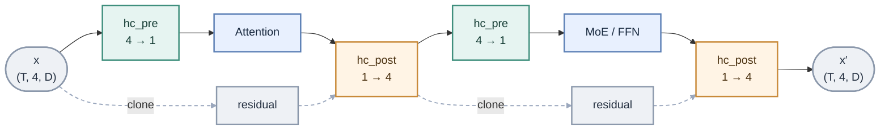

对应的代码骨架（[model.py:L795-L829](../model.py#L795-L829)）：

```python
residual = hidden_states.clone()                            # 留下压缩前的 4 条流
hidden_states, post, comb = self.hc_pre(...)                # 4 → 1
hidden_states = self.input_layernorm(hidden_states)
hidden_states = self.self_attn(hidden_states)               # 子层只看得到 1 条流
hidden_states = self.hc_post(hidden_states, residual, post, comb)   # 1 → 4

residual = hidden_states.clone()
hidden_states, post, comb = self.hc_pre(...)                # 4 → 1
hidden_states, hidden_states_fp32 = self.rms_norm_cast(hidden_states)
hidden_states = self.mlp(hidden_states, hidden_states_fp32=hidden_states_fp32)
hidden_states = self.hc_post(hidden_states, residual, post, comb)   # 1 → 4
```

三点值得记：

- **Attention 与 MoE 始终只看到 1 条 $D$ 维流**，mHC 的额外开销集中在层边界——子层矩阵乘的形状与不加 mHC 时完全一致。
- 归一化也只作用在这条单流上：Attention 前是 `input_layernorm`，FFN 前是 `rms_norm_cast`（一次产出 bf16 与 fp32 两份，fp32 那份供 MoE 路由使用）。
- 每层要存两次「压缩前」的 4 条流（`residual`）：`hc_post` 的深度混合必须用原始 4 条流，不能拿 `hc_pre` 的输出反推，所以两次 `clone()` 省不掉。

### 4.2 hc\_pre

#### 4.2.1 概述与调用链

`hc_pre` 在层里只做一件事：把 4 条残差流压成 1 条，同时产出写回要用的 `post`、`comb`。每个 DecoderLayer 调两次（Attention 前、FFN 前），61 层共 122 次；Python 封装不做任何预处理，shape 校验、输出分配、tiling、计算全在算子内部。

一次调用是 **4 个张量进、3 个张量出**：

| 张量         | 形状             | dtype | 角色                     |
| ---------- | -------------- | ----- | ---------------------- |
| `x`        | `(T, 4, 7168)` | bf16  | 4 条残差流                 |
| `hc_fn`    | `(24, 28672)`  | fp32  | 门控投影权重                 |
| `hc_scale` | `(3,)`         | fp32  | pre / post / comb 三个温度 |
| `hc_base`  | `(24,)`        | fp32  | 三段偏置                   |
| `y`        | `(T, 7168)`    | bf16  | 压成 1 条流                |
| `post`     | `(T, 4)`       | fp32  | 写回门控                   |
| `comb`     | `(T, 4, 4)`    | fp32  | 双随机组合矩阵                |

`24 = 4 + 4 + 16`：前 4 行给 `pre`，中间 4 行给 `post`，后 16 行是 `comb` 的 $4 \times 4$ 摊平；`hc_scale` 的 3 个温度、`hc_base` 的 3 段偏置与这三块一一对应。输入侧 `T` 是矩阵乘的 M，`4 × 7168 = 28672` 就是矩阵乘的 K。

**算子文件清单** （只列 A2/A3 路径）：

```text
csrc/moe/hc_pre/
├── op_host/                        # host 侧：原型 + tiling
│   ├── hc_pre_def.cpp              # 算子原型：4 入 4 出 + 4 个 attr 的声明与默认值
│   ├── hc_pre_proto.cpp            # 空文件（原型全在 def.cpp）
│   ├── hc_pre_tiling.h             # HcPreTilingData 的字段定义 + HcPreTiling 类声明
│   └── hc_pre_tiling.cpp           # 4.2.2 那条链：TilingForHcPre → 五步 → PostTiling
└── op_kernel/                      # device 侧：入口 + 三块实现
    ├── hc_pre.cpp                  # 下面调用链的入口：MIX_AIC_1_2，按 TilingKey 分派 Part1/Part2
    ├── hc_pre_m_k_split_core.h     # 4.2.3 的主体：Part 1 的 M/K 网格 + Part 2 的四步
    ├── hc_pre_cube_compute.h       # 4.2.3 的 cube 段：ComputeDecode / MmadA2 / MmadAB / Fixp
    └── hc_pre_base.h               # 4.2.3 的 vector 原语：ProcessPre/Post、Sinkhorn、Brcb/Reduce
```

合计约 4.1k 行。另有 `op_host/hc_pre_tiling_arch35.h` 与 6 个 `*_arch35.h` 是 ASCEND950（arch35）的实现；

**调用链是 aclnn 两段式。** 上半段 tiling 在 host 同步跑完，下半段 kernel 在 device 上异步起。

```text
model.py:L805 / L820                                   # 层内两次：Attention 前、FFN 前
└─ self.hc_pre(x, hc_fn, hc_scale, hc_base)            model.py:L783   # Python 封装，只透传
   └─ torch.ops._C_ascend.npu_hc_pre_v2(...)            model.py:L784
      │  # 绑 torch::kPrivateUse1：dispatcher 按 NPU 后端派发到下面的 C++ 函数
      └─ npu_hc_pre_v2_npu(...)                        torch_binding.cpp:L1645
         ├─ check_hc_pre_shape_and_dtype(...)          torch_binding.cpp:L1582
         │    hc_mult=4；x 流维=4；hc_fn=(24, hc·d)；x bf16，其余三个 fp32
         └─ run_hc_pre_fusion(...)                     torch_binding.cpp:L1629
            ├─ construct_hc_pre_output_tensor      → y / post / comb_frag
            ├─ construct_hc_pre_pre_output_tensor  → pre
            └─ EXEC_NPU_CMD(aclnnHcPre, ...)           torch_binding.cpp:L1639
               │  # 宏展开见 op_api_common.h:L705-L771
               ├─ ① aclnnHcPreGetWorkspaceSize（host 同步）   op_api_common.h:L707
               │  │  转 aclTensor → 回调 tiling → 申请 workspace → 产出 executor
               │  └─ TilingForHcPre                     hc_pre_tiling.cpp:L725
               │     └─ HcPreTiling::DoOpTiling（五步，见 4.2.2）
               └─ ② aclnnHcPre（device 异步，只入队）     op_api_common.h:L747
                  └─ hc_pre kernel                     hc_pre.cpp:L34
                     ├─ key 0：bs > 32，MIX_AIC_1_2 → 24 AIC / 48 AIV
                     │  ├─ HcPreMembaseKSplitCorePart1<T>
                     │  │     AIV：bf16→fp32→ws1；AIC：x·Wᵀ、x·xᵀ→ws2/ws3
                     │  └─ HcPreMembaseKSplitCorePart2<T, false>
                     │        ws2/ws3 跨 K 求和 → pre/post/comb → y
                     ├─ key 1：bs ≤ 32，Part 1 与 key 0 同
                     │  └─ HcPreMembaseKSplitCorePart2<T, true>（ProcessOriginal，单组核）
                     └─ key 2：preMix（V4 不走）
                        ├─ HcPreMembaseKSplitCorePart1<T>
                        └─ HcPreMembaseKSplitCorePremixPart2<T>
```

四个类的名字与分工（`T = DTYPE_X`，即 bf16）：

| 类                                            | 定义位置                           | 用法与含义                                             |
| -------------------------------------------- | ------------------------------ | ------------------------------------------------- |
| `HcPreMembaseKSplitCorePart1<T>`              | hc_pre_m_k_split_core.h:L26    | key 0/1/2 共用：AIV 转 fp32 写 ws1，AIC 算 x·Wᵀ 与 x·xᵀ |
| `HcPreMembaseKSplitCorePart2<T, useOriginal>` | hc_pre_m_k_split_core.h:L249   | 一份代码两条路，靠模板参数切                                    |
| ├ `useOriginal = false`                       | hc_pre.cpp:L102（key 0）        | MPMD：前 `prePostCoreNum` 核跑 pre/post，其余跑 Sinkhorn  |
| └ `useOriginal = true`                        | hc_pre.cpp:L117（key 1）        | `ProcessOriginal()`：单组核顺序跑完 pre/post/comb         |
| `HcPreMembaseKSplitCorePremixPart2<T>`        | hc_pre_m_k_split_core.h:L1081  | key 2：多一个 `pre_mix` 输入，Part 2 换专用实现               |

ASCEND950（arch35）是另一套：`HcPreMKSplitCorePart1/Part2`（hc\_pre\_m\_k\_split\_core\_arch35.h:L27/L266）、`HcPreMKSplitCorePremixPart1/Part2`、`HcPreMSplitCoreArch35`、`HcPreMSplitCorePremixArch35`，对应 key 1000~1003。

四层分工很薄，每层都只做一件事：

| 层           | 入口                            | 职责                              |
| ----------- | ----------------------------- | ------------------------------- |
| Python 封装   | model.py:L783                 | 透传 4 张量 + 4 个常量，无任何预处理          |
| torch 派发    | schema L3536 / impl L3543     | 按 `PrivateUse1` 找到 C++ 实现       |
| C++ 适配      | `npu_hc_pre_v2_npu` L1645     | 校验 shape/dtype、分配输出、调 aclnn     |
| aclnn 两段    | ① L707 / ② L747                | tiling（host 同步）、kernel（device 异步） |

**交接只有五项**，都在 `PostTiling`（[hc_pre_tiling.cpp:L702](../../../../csrc/moe/hc_pre/op_host/hc_pre_tiling.cpp#L702)）写出：

| tiling 侧写入                                  | kernel 侧读取                                 |
| ------------------------------------------- | ------------------------------------------ |
| `SetTilingKey` L704                         | `TILING_KEY_IS` 选分支（A2/A3 用 0/1/2）         |
| `SetBlockDim(aicCoreNum_)` L705             | 起 24 个 AIC，`MIX_AIC_1_2` → 48 AIV           |
| `SetScheduleMode(1)` L707，仅 key 0（默认 0）      | MPMD：pre/post 组与 Sinkhorn 组独立调度            |
| `GetWorkspaceSizes(1)[0]` L712              | 隐式 `workspace` 指针切 ws1 / ws2 / ws3          |
| `SaveToBuffer` + `SetDataSize` L714         | `GET_TILING_DATA_WITH_STRUCT` 反序列化         |


#### 4.2.2 HcPreTiling host 切分

**一句话。** 以 T = 2048、A3 的 24 AIC / 48 AIV 为例：tiling 把 `x (2048, 4, 7168)` 和 `hc_fn (24, 28672)` 看成 `(2048, 28672) × (28672, 24)` 的矩阵乘（hc\_fn 取转置），x 按 8×3 切，hc\_fn 只按 K 切 3 段，切完再在核内按 1024 列一拍算，最后让 Part 2 用 48 个 AIV 按行收。

> 本文按 A3（Ascend910\_9382）的真实值 **24 AIC / 48 AIV** 举例；A2 的 910B3 是 20 AIC / 40 AIV，网格会不同。

**总调用链。** host 侧只做三件事：把 shape/attr 变成 `bs` / `hc` / `d`，算出每个 AIC 的 M×K 块和每个 vector 核的行块，最后写进 `HcPreTilingData`。

```text
TilingForHcPre                                 hc_pre_tiling.cpp:L725
│  # 入口：ASCEND950 → arch35 那套；A2/A3 → HcPreTiling（本节）
└─ HcPreTiling::DoOpTiling                     L657
   │  # 五步：平台 → shape/attr → 切分 → workspace → 回写
   ├─ GetPlatformInfo                          L68    # AIV/AIC/UB；A3 = 48/24
   ├─ GetShapeAttrsInfoInner                   L108   # shape → bs / d / hcMix=24
   │  └─ GetAttr                               L89    # hc_mult=4、iters=20、eps
   ├─ CalcOpTiling                             L611
   │  ├─ k = hc_mult × d                      L612   # 28672，cube 的 K
   │  ├─ M/K 网格                              L615   # mDimNum=8、kDimNum=3
   │  ├─ singleCoreM / splitKSize              L632   # 每核 256 × 9728，K2 尾 9216
   │  ├─ mL1Size / kL1Size / cvLoopKSize       L636   # 256 行 / 128 / 一拍 1024
   │  ├─ stage1MFactor                         L650   # ≈ UB/12KB ≈ 16 行
   │  └─ CalcMKSplitCoreMembasePart2Tiling     L207   # 定 TilingKey 与 Part 2 切法
   │     ├─ CalcPremixPart2Tiling              L417   # 有 pre_mix 才走：key 2（V4 不走）
   │     ├─ bs <= 32 → key 1（SPMD）          L213   # 48 AIV 各扫一段
   │     └─ bs > 32 → key 0（MPMD）           L217
   │        ├─ CalcVectorCoreNum               L173   # 估时枚举 p 与 48−p
   │        ├─ dFactor / dLoop                 L273   # D 块：7168 → 3584 × 2
   │        ├─ prePostRowFactor                L340   # 一次几行，上限 4
   │        └─ CalcSinkhornTiling              L550   # 由 L413 调用，上限 64
   ├─ GetWorkspaceSize                         L682   # ws1+ws2+ws3+16MB，≥ 208MB
   └─ PostTiling                               L702   # TilingKey / BlockDim / Save
```

1. 行号标的是**函数定义处**，调用点在 `DoOpTiling` / `CalcOpTiling` 里；
2. 顺序是有依赖的：`GetWorkspaceSize` 必须排在 `CalcOpTiling` 之后，它按刚算出的 `mL1Size` / `cubeBlockDimK` 反推大小；`tilingKey_` 在 L207 就定了，`PostTiling` 只负责写进 context；
3. `SetBlockDim` 填的是 **AIC 数（24）**，但 kernel 声明了 `MIX_AIC_1_2`，所以实际起 48 个 AIV。

**PostTiling 做什么。** 它是 host 侧 tiling 的最后一步，不计算，只把启动配置交给 runtime：

- `SetTilingKey(tilingKey_)`：选 kernel 分支（key 0/1/2）；
- `SetBlockDim(aicCoreNum_)`：启 24 个 AIC，`MIX_AIC_1_2` 下实际 48 个 AIV；
- key 0 额外 `SetScheduleMode(1)`（batch mode）：pre/post 组和 Sinkhorn 组跑不同代码、工作量不同，独立调度，不互相等；key 1 不调用这个接口，用的就是默认值 0；
- `GetWorkspaceSizes(1)` + `workspaces[0] = workspaceSize_`：告诉 runtime 分配多少 GM workspace；
- `SaveToBuffer` + `SetDataSize`：把 `HcPreTilingData` 序列化给 kernel，kernel 用 `GET_TILING_DATA_WITH_STRUCT` 读。

`OPS_ERR_IF` 只是检查 `SetScheduleMode` 的返回值：失败就记日志并返回 `GRAPH_FAILED`，tiling 阶段直接失败，不会继续 launch。

**host 和 device 怎么接上。** `PostTiling` 只把配置写进 `TilingContext`，自己不分配、不下发；真正接上分三段：① 框架在 tiling 结束后把 key / blockDim / schedule / tiling data 打包进 `aclOpExecutor` 并回报 `workspaceSize_`；② `EXEC_NPU_CMD` 拿这个字节数自己 `at::empty` 一块 device workspace（[op_api_common.h:L740-L746](../../../../csrc/aclnn_torch_adapter/op_api_common.h#L740-L746)）；③ `aclnnHcPre` 入队时把 workspace 地址、tiling buffer 和 blockDim 一起下发给 kernel。kernel 侧用 `TILING_KEY_IS` 选分支、`GET_TILING_DATA_WITH_STRUCT` 读 tiling、用隐式 `workspace` 指针访问 ws1/ws2/ws3。

**Cube 侧切分。** 输入看成一个矩阵乘：`(M, K, N) = (2048, 28672, 24)`。24 个 AIC 排成 `mDimNum × kDimNum` 的网格，每个格子是一个 AIC 的 M×K 块。


先看 Cube 侧的 shape：

| 张量     | 切前                                  | 切后                                      |
| ------ | ----------------------------------- | --------------------------------------- |
| x      | `(2048, 4, 7168)` = `(2048, 28672)` | 每 AIC `(256, 9728)`；K2 尾段 `(256, 9216)` |
| hc\_fn | `(24, 28672)`                       | 每 AIC `(24, 9728)`；K2 `(24, 9216)`      |

1. **M 轴**：`mDimNum = min(24, ceil(2048 / 256)) = 8`；24 % 8 = 0，不用抬因子。`singleCoreM = RoundUp(ceil(2048 / 8), 16) = 256`。`mDimNum` / `kDimNum` 由 tiling 按 T 与 AIC 核数决定，与 `hc_fn` 无关；`hc_fn` 只提供固定的 K = 28672 与 N = 24。下面只按 T = 2048 讲：M 切 8 块，K 切 3 段，每核 256×9728（K2 尾段 9216）；换 T 时同一组公式重跑，不再展开其他取值。
2. **K 轴**：`kDimNum = 24 / 8 = 3`；`splitKSize = RoundUp(ceil(28672 / 3), 256) = 9728`；`cubeBlockDimK = 3`。8 × 3 = 24，正好铺满 24 个 AIC；K2 是尾段 9216 列（`kGmEndOffset` 截到 28672）：

| K 段 | 列范围         | 列数   | 用它的 AIC              |
| --- | ----------- | ---- | -------------------- |
| K0  | 0–9727      | 9728 | 0,3,6,9,12,15,18,21  |
| K1  | 9728–19455  | 9728 | 1,4,7,10,13,16,19,22 |
| K2  | 19456–28671 | 9216 | 2,5,8,11,14,17,20,23 |

`hc_fn` 也跟着 K 段切：每个 AIC 拿 `(24, 9728)` 或 `(24, 9216)`，24 行全保留；x 多一个 M 轴切分，hc\_fn 没有。24 行的顺序是硬约定：0–3 → `pre`，4–7 → `post`，8–23 → `comb`；`hc_base` 按同样的 4/4/16 切，改了行序 kernel 不报错，只会算错。

K 被切开，每个 AIC 写出的 24 列就只是自己这段 K 的**部分和**；3 段怎么合，等 ws 交给 Part 2 由 AIV 来合并。

**M 和 K 各自对齐到多少。** 上面那两个数是这么凑出来的，两个常量各管一维：

| 常量                             | 值   | 管哪一维 | 为什么是这个数                                                |
| ------------------------------ | --- | ---- | ------------------------------------------------------ |
| `AscendC::BLOCK_CUBE`          | 16  | M    | cube 的分形边长（16×16 tile）；Mmad 的 `m` 最小 16，NZ 落盘也按 16 行对齐 |
| `K_MULIT_CORE_SPLIT_BASE_SIZE` | 256 | K    | 切核粒度的经验值：保证 32 与 128 都整除，且每个核的起点 1 KB 对齐               |

K 这一维**必须**能被 32 整除：`ComputeL0Pairs` 每次固定搬 `K_L0_SIZE = 32` 个元素发一个 Mmad，不看还剩多少，尾块不足 32 会把 L1 里的残留数据乘进去。128 是 L1 的取数粒度（512 B）；256 再放大一档，让每个 `cvLoopKSize = 1024` 的尾部只可能是 256/512/768/1024 四种形态。反例：若只取 `splitKSize = 9558` 不对齐，某核尾段是 `86 = 64 + 22`，最后一个 Mmad 只有 22 个有效列。

这条对齐和双缓冲**无关**——双缓冲的是 ws1、L1 的 A1/B1、L0A/L0B 三级槽位，尺寸由 `mL1Size × cvLoopKSize`、`kL1Size` 决定（见下文"三层双缓冲"，别混）。

**AIC 这一段怎么算。** `x` 是 bf16，A1 要 fp32；AIC 是 cube，不负责 cast，所以由配对的 AIV 先转好放进 ws1（`MIX_AIC_1_2`：1 AIC : 2 AIV）。第 1 步是 AIV 的前置，第 2 步开始才是 AIC。

**数据在哪。** x 和 hc\_fn 都在 GM（HBM）；ws1 是 GM workspace，不是 UB/L1。

| 数据        | 内存           | 形态                         |
| --------- | ------------ | -------------------------- |
| x         | GM（HBM）      | bf16，`(256, 1024)` / 拍     |
| hc\_fn    | GM（HBM）      | fp32，`(24, 1024)` / 拍      |
| ws1       | GM workspace | fp32，`(256, 1024)` / 拍，双缓冲 |
| A1 / B1   | L1           | `256×128` / `24×1024`（整拍） |
| L0A / L0B | L0           | Mmad 左/右操作数                |
| L0C       | L0C          | 累加器                        |
| ws2 / ws3 | GM workspace | 部分和                        |

ws1 不是 UB，也不是 L1：host 先由 `aclnnHcPreGetWorkspaceSize` 算出 `workspace_size`，再用 `at::empty({workspace_size}, kByte)` 在 GM 上分配；AIV 用 DMA 写、AIC 用 DMA 读，双缓冲让两边 overlap。

**一拍怎么流。** 每拍先由 AIV 从 GM 读 `256×1024` 的 bf16 x，UB cast 成 fp32 后写 ws1（GM）；AIC 再从 ws1 读 A1 进 L1，同时从 GM 读 hc\_fn 的 B1 进 L1。AIC 算的时候手里是 L1 的 A1/B1，不直接碰 GM 里的 x。

| 阶段        | 一次多大                      | 从 → 到            | 粒度            |
| --------- | ------------------------- | ---------------- | ------------- |
| AIV 读 x   | `(256, 1024)` bf16        | GM → UB          | 每拍；按 \~16 行一批 |
| AIV 写 ws1 | `(256, 1024)` fp32        | UB → GM ws1      | 每拍，双缓冲        |
| AIC 取 A1  | `(256, 128)` fp32         | ws1 GM → L1      | 每 128 列块      |
| AIC 取 B1  | `(24, 1024)` fp32         | hc\_fn GM → L1   | 每拍（整段 K）     |
| L1 → L0   | `k=32` 碎片                 | L1 → L0A/L0B     | 每个 Mmad 步     |
| Fixp      | `(256, 24)` / `(256, 16)` | L0C → ws2/ws3 GM | 最后一块 K        |

**不是整段搬。** 整段 A1 `(256, 9728)` 是 9.5 MB，L1 放不下；L1 一次只放一块 `(256, 128)` 的 A1（128 KB）和整拍的 `(24, 1024)` B1（NZ 补齐后 128 KB）。一拍 1024 列拆 8 块，8 块走完是一拍，10 拍走完才是整段 K。AIV 按拍写 ws1，AIC 按 128 列块消费 A1、按拍取 B1。

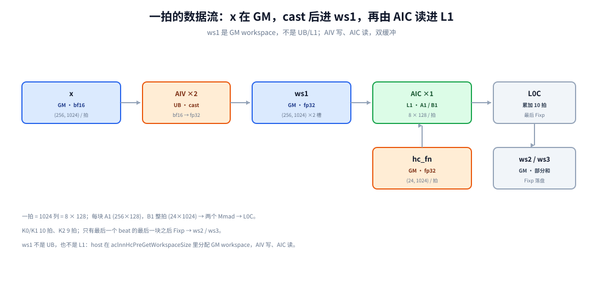

**一拍怎么切。** 同一个 AIC 的 K 段，x 是 `(256, 9728)`，hc\_fnᵀ 是 `(9728, 24)`；两边都按 1024 列切拍。x 的 K 是列，所以 10 拍横向排；hc\_fnᵀ 的 K 是行，所以 10 段纵向排；同号即同一拍：第 i 拍就是 x 的 `(256, 1024)` 对 hc\_fnᵀ 的 `(1024, 24)`，尾拍 512 对 512。K2 是 9216，只有 9 拍，没有尾拍。

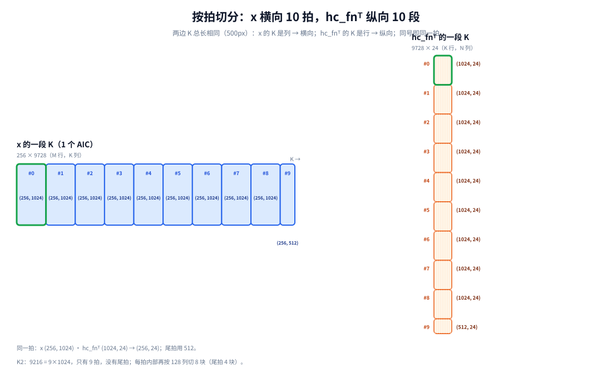

**一拍里算什么。** 一拍 = 1024 列 = 8 个 128 块；每块 A1/B1 发两个 Mmad，累加到 L0C。分四步：

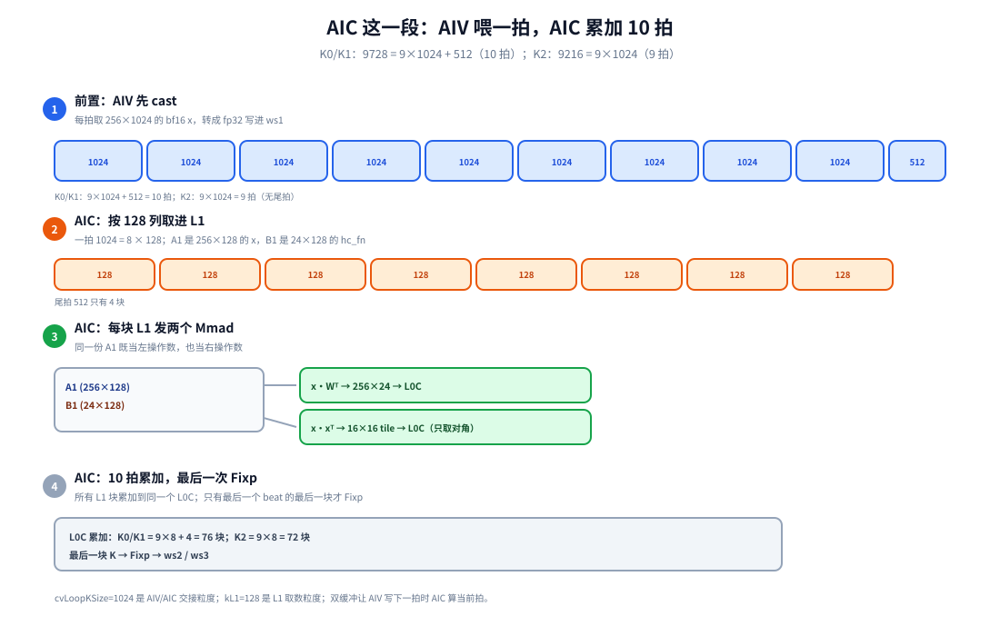

1. **前置：AIV 先 cast。** 每个 beat 取 `256×1024` 的 bf16 `x`，转成 fp32 写进 ws1。K0/K1 的 9728 列 = 9×1024 + 512，所以 10 拍；K2 的 9216 = 9×1024，正好 9 拍。
2. **AIC 取进 L1。** 每个 beat 的 1024 列再按 128 列一块，分 8 次把 A1（`256×128`）取进 L1；B1（`24×1024`）整拍只取一次。尾拍 512 只取 4 块。
3. **每块发两个 Mmad。** `Mmad` 是 cube 的矩阵乘加指令（Matrix Multiply-Accumulate）：`C += A×B`，A/B 在 L0A/L0B，结果累加到 L0C。这里一次发两条，分别算 `x·Wᵀ` 和 `x·xᵀ`。同一份 A1 既当左操作数，也当右操作数：
   - `x·Wᵀ`：`256×128 · 128×24 → 256×24`，累加到 L0C，最后写 ws2；
   - `x·xᵀ`：`256×128 · 128×256`，按 16×16 tile 算，只有对角线是平方和，累加到 L0C，最后写 ws3。

4. **10 拍累加，最后一次 Fixp。** K0/K1 是 9 个满拍 × 8 块 + 尾拍 4 块 = 76 个 L1 块；K2 是 9 拍 × 8 块 = 72 个。所有 K 块都累加到 L0C 里各自的累加器（A2 一块、AB 一块，不混在一起），只有最后一个 beat 的最后一块之后才 Fixp，把结果落到 ws2/ws3。`Fixp` 是 Fixpipe 的封装：把 L0C 的累加结果搬出去，不是计算。AB 走 NZ→ND 写 ws2；A2 保持 NZ 写 ws3。所以只在最后调一次。

`x·Wᵀ` 是混合投影，用 hc\_fn；`x·xᵀ` 不用 hc\_fn，只取 Gram 对角线，给 Part 2 算 `r`。为什么要这个 `r`、为什么用 matmul 算平方和，见 4.2.3。

**为什么 AB 要 NZ→ND，A2 不用。** L0C 是 cube 的 NZ（16×16 fractal）布局；Part 2 读 ws2 时按 token 行取 24 列，ND 行主序最省事，Fixpipe 在搬出时顺手转，不用额外 kernel。ws3 保持 NZ，因为 `CalcRsqrt` 直接用 16×16 对角 mask 取平方和，转成 ND 反而多一步。

**L1 → L0 → L0C 怎么搬。** A1/B1 在 L1；每个 Mmad 前用 `LoadData` 搬到 L0A/L0B：`x·Wᵀ` 是 A1→L0A、B1→L0B；`x·xᵀ` 是 A1→L0A、A1→L0B（同一份 x 既当左操作数也当右操作数）。Mmad 结果累加到 L0C；最后 Fixp 把 L0C 写回 ws2/ws3。

一句话：x 从 ws1、hc\_fn 从 GM 先搬到 L1 的 A1/B1，再按 `k=32` 碎片进 L0A/L0B；`Mmad` 把这一碎片的部分和累加到 L0C；下一块覆盖 L1/L0，L0C 不清零。

**L1 到 L0 再切 32。** L1 的 A1 `(256,128)` 和 B1 `(24,1024)` 都不是整块进 L0；每个 Mmad 只搬 `k=32` 的碎片：A1→L0A `(256,32)`，B1→L0B `(24,32)`。一个 128 块分 4 步（`k=0/32/64/96`），4 步依次累加到 L0C。`x·xᵀ` 还要把同一份 A1 再搬一份到 L0B 当右操作数。L0A/L0B 双槽，下一步搬的时候当前步在算。

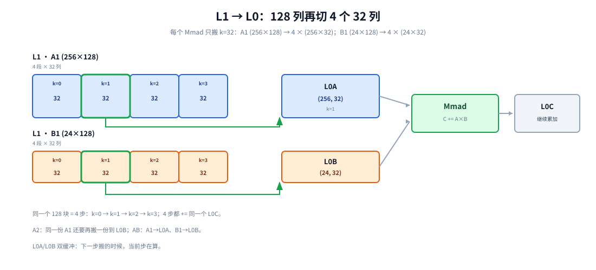

**为什么分两刀。** `cvLoopKSize=1024` 是 AIV 和 AIC 的交接/同步粒度；`kL1=128` 是 L1 的取数粒度。1024 = 8×128：AIV 一次写满一拍，AIC 再按 128 自己切；flag 和等待每 1024 列才一次，cast/DMA 也是大块。若一拍改成 128，同步会多 8 倍、ws1 槽从 1MB 降到 128KB，AIV/AIC 都更碎。AIV 写下一拍时，AIC 可以算当前拍，ws1 双槽 overlap。计算细节在 4.2.3 展开。

**四层双缓冲，别混。** 每一级都有自己的 ping-pong：

| 缓冲 | 谁写 → 谁读 | 重叠什么 |
| --- | --- | --- |
| UB `xQue` / `mmInQue`（AIV 内，2 buffer） | GM → UB → ws1 | 搬第 i+1 批 vs 转/写第 i 批 |
| ws1（GM）双槽 | AIV → AIC | 写下一拍 vs 算当前拍 |
| L1 A1/B1 双槽 | GM/ws1 → Mmad | 搬下一块 128 vs 算当前块 |
| L0A/L0B 双槽 | L1 → Mmad | 搬下一片 32 vs 算当前片 |

这四层落在三种存储上：UB 在 AIV 核内、ws1 在 GM、L1/L0 在 cube 内——**只有 ws1 是跨核共享的**，所以也只有它需要一对 flag 握手。

L0C 不是双缓冲：A2/AB 各占一块独立累加器，最后各 Fixp 一次。

**ws：Cube → Vector 的交接。** 三块 workspace 把 Cube 的部分和交给 Part 2：

| 张量  | shape              | 说明                            |
| --- | ------------------ | ----------------------------- |
| ws1 | `(256, 1024)` fp32 | AIV cast 好的 x 切片；每 AIC 每拍，双缓冲 |
| ws2 | `[3][2048][128]`   | 24 列 logits 的 K 段部分和；前 24 列有效 |
| ws3 | `[3][2048][16]`    | 平方和的 K 段部分和；只有对角有效            |

- **ws1**：AIV 把 bf16 cast 成 fp32 的 `x` 切片，AIC 读它进 L1。`(256, 1024)` 是**一个 AIC 的一拍**，双缓冲两槽；24 个 AIC 各有一份。
- **ws2**：每个 K 段的 24 列 logits 部分和。`[3][2048][128]`：3 = K 段数（`cubeBlockDimK`），2048 = token 数，128 = 24 列按 512 B 对齐后的行距（前 24 列有效）。
- **ws3**：每个 K 段的平方和部分和。`[3][2048][16]`：16 = 16×16 平方和 tile 的宽度，只有对角线是有效的 token 平方和。`[2048][16]` 只是 2048 行 × 16 列的存储；每 16 行摞起来才是一个 16×16 Gram 矩阵，不是每个 token 一个矩阵。每个 token 存 16 个 float（tile 的一行），只有对角是该 token 的 `Σx²`，非对角是 token 间点积，Part 2 丢弃。16 行一组取对角，不是把这 16 个值相加；每个 token 各取自己的对角，再把同一个 token 在 3 个 K 段上的部分和相加。

按 tiling 公式：`ws2 = cubeBlockDimK × bs × RoundUp(hcMix, 128)`；`ws3 = cubeBlockDimK × RoundUp(bs, 16) × SQUARE_SUM_SIZE`，其中 `SQUARE_SUM_SIZE = 16`。

方向别搞反：ws1 是 AIV 写、AIC 读；ws2/ws3 是 AIC 写、AIV 读。

Part 2 把 3 段加起来，得到完整的 `r` / `pre` / `post` / `comb` / `y`。一句话：**cube 在 K 上分家，Part 2 在 K 上团圆。** 具体怎么用见 4.2.3。

两段式的代价：多一份 `x` 的 fp32 副本，每 token 约 114.7 KB 的写与读；换来 Part 2 是纯 vector，不与 cube 抢流水。

`ws2` 的行距是 128 而不是 24：cube 落盘按 512 B 缓存行对齐，Part 2 搬回来得按 128 跨。

**Vector 侧切分。** Cube 的结果经 ws2/ws3 交给 Part 2；Part 2 不在 AIC 上，只用 48 个 AIV。先看 AIV 上算什么：

| 计算     | 公式                                                   | 输出             |
| ------ | ---------------------------------------------------- | -------------- |
| `r`    | $1/\sqrt{\frac{1}{k}\sum_j x_{i,j}^2+\epsilon}$      | `(2048,)`      |
| `pre`  | $\sigma(r s_0 m + b_0)+\epsilon$                     | `(2048, 4)`    |
| `post` | $2\sigma(r s_1 m + b_1)$                             | `(2048, 4)`    |
| `comb` | $\mathrm{Sinkhorn}(\mathrm{softmax}(m r s_2 + b_2))$ | `(2048, 4, 4)` |
| `y`    | $\sum_j \mathrm{pre}_j x_j$                          | `(2048, 7168)` |

`m` 是 `mixes` 里对应的列：`pre` 用前 4 列，`post` 用第 4–7 列，`comb` 用第 8–23 列；`mixes` 是 ws2 跨 3 个 K 段求和后的 `(2048, 24)`。

再看这些计算的输入、中间量和切分后的 shape：

| 计算         | 输入（切前）                                | 中间                    | 输出（切后）               |
| ---------- | ------------------------------------- | --------------------- | -------------------- |
| `r`        | ws3 `[3][2048][16]`                   | 跨段求和 + 取对角 →`(2048,)` | 每 token 1 个          |
| `pre/post` | ws2 `[3][2048][128]`                  | `mixes (2048, 24)`    | 4 行一块 `(4, 4)`       |
| `comb`     | `mixes[:, 8:24]` `(2048, 16)`         | `(2048, 4, 4)`        | 64 行一块 `(64, 16)`    |
| `y`        | x `(2048, 4, 7168)` + pre `(2048, 4)` | `(2048, 7168)`        | 1 token ×`(1, 3584)` |

Vector 侧先按 TilingKey 选跑法：

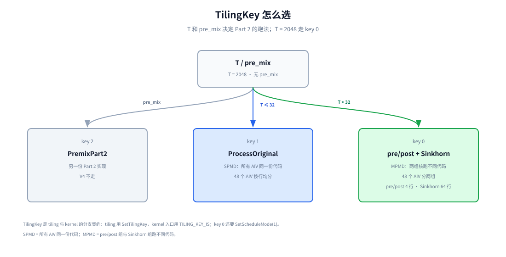

源码里这个条件是 `bs`；本文 3D 路径 `bs = T`。T=2048 走 key 0：pre/post 每行约 `3d`，Sinkhorn 每行约 `64·hcMult·(iters+4)`，`CalcVectorCoreNum` 在 48 个 AIV 上枚举 1…47，取 `max(两组延迟)` 最小、其次最平衡的点；两组跑不同代码路径，所以 `SetScheduleMode(1)`（batch mode）让各核独立调度；key 1 不设，等价于 0。

**MPMD 的 P 是 Program。** key 0 的 pre/post 组跑 `ProcessPrePost`，Sinkhorn 组跑 `ProcessSinkhorn`，两组代码不同，所以是 MPMD；key 1 所有 AIV 都跑 `ProcessOriginal`，只是行不同，所以是 SPMD。


T=2048 走 key 0 时：pre/post 组 `p` 个 AIV，4 行一块，`2048/4 = 512` 块；Sinkhorn 组 `48-p` 个 AIV，64 行一块，`2048/64 = 32` 块；`p` 由 `CalcVectorCoreNum` 枚举行。`y` 逐 token，7168 列分 2 个 3584 半块。key 1（T ≤ 32）则 48 个 AIV 都走 `ProcessOriginal`，每核顺序做完四步。

TilingKey 是 tiling 与 kernel 的分支契约：tiling 按 `bs`、`pre_mix` 选好 key 并 `SetTilingKey`，kernel 入口用 `TILING_KEY_IS` 选对应实现；每个 key 可以有自己的核划分、workspace 和模板实例（`Part2<T,false>` / `<T,true>`），不必在热路径里做运行时分支。

#### 4.2.3 hc\_pre kernel 计算

**先看分工。** Cube 和 Vector 不是“谁更快”，而是两类指令、两套数据通路：

|    | Cube（AIC）                 | Vector（AIV）                                      |
| -- | ------------------------- | ------------------------------------------------ |
| 计算 | 矩阵乘 `Mmad`：`x·Wᵀ`、`x·xᵀ`  | 逐元素/归约：cast、`r`、σ、softmax、Sinkhorn、`Σ pre_j x_j` |
| 并行 | 切 M×K，K 段出部分和             | 切行，Part 2 每行 K 完整                                |
| 精度 | `x·xᵀ` 全 fp32，`x·Wᵀ` HF32 | fp32 计算，`y` 写回 bf16                              |

> HF32 是 cube 的一个计算模式（`SetHF32Mode`）：张量仍按 32 bit 存、占的容量不变，只在 `Mmad` 乘法时把操作数截成 1 符号 + 8 指数 + 10 尾数，**累加仍是 fp32**——本质是拿尾数换算力，fp32 乘法吞吐约翻倍。代码里就是紧贴着开、算完立刻关（`SetHF32Mode(1); MmadAB(...); SetHF32Mode(0);`）。
>
> `x·Wᵀ` 开、`x·xᵀ` 关，差别在误差会不会被抵消：投影的 28672 个乘加项符号随机，截断误差正负相消（整体 ~3e-6）；平方和每项非负，误差同向叠加（~1e-4），而 `r` 是整层的尺度因子，会乘到全部 24 个 logits 上。

一句话：**Cube 负责“乘加”，Vector 负责“非线性与逐元素”**——28672 维的乘加在 cube 上压成 24 列部分和，cast 和 Part 2 的非线性都在 vector 上做。

**一个 `blockIdx` 落在哪一块。** `GetMkBlockInfo`（[L74-L95](../../../../csrc/moe/hc_pre/op_kernel/hc_pre_m_k_split_core.h#L74-L95)）用 `m = idx / kDimNum`、`k = idx % kDimNum` 解出 `(mRange, kRange)`；AIV 的 `blockIdx` 还要 `/ 2` 才对到配对的 AIC（1 AIC : 2 AIV）。T=2048、24 AIC 时共 48 个 AIV，每个 AIC 的两个 AIV 各分 128 行。

**总览。** 一次 `hc_pre` 调用分四步：host 把切分写成 tiling；AIV 喂数据，AIC 做两个 matmul 出部分和；AIV 再把 3 段部分和拼成门控和 y；输出直接落 GM。

| 阶段          | 谁做                | 做什么                                                            | 关键函数                                                                                                                | 产出                           |
| ----------- | ----------------- | -------------------------------------------------------------- | ------------------------------------------------------------------------------------------------------------------- | ---------------------------- |
| 1. 输入       | host + kernel     | host 算 tiling；kernel 取 `userWs`、解析 tiling、按 key 选分支            | `CalcOpTiling`→`GetWorkspaceSize`→`PostTiling`；`GetUserWorkspace` / `TILING_KEY_IS` / `GET_TILING_DATA_WITH_STRUCT` | tiling data · blockDim · key |
| 2. Part1    | 48 AIV + 24 AIC   | AIV 把 bf16 转 fp32 写 ws1；AIC 读 ws1 发两个 Mmad（见 2.1 / 2.2）        | `Part1::ProcessMChunk`：AIV `CopyIn`→`CastTwoDim`→`CopyOut`；AIC `ComputeDecode`→`MmadA2`/`MmadAB`→`Fixp`             | ws1 / ws2 / ws3              |
| 3. Part2 收尾 | 48 AIV            | 跨 3 段 K 求和 → `r` 与 24 个 logits → `pre` / `post` / `comb` / `y` | `Part2::Process` → `CalcRsqrt` / `ProcessPrePostBatch` / `ProcessSinkhornBatch`                                     | `y / pre / post / comb`      |
| 4. 输出       | binding + runtime | 输出 tensor 在 launch 前已建好，kernel 直接写这些 GM 地址                     | `run_hc_pre_fusion`：`construct_hc_pre_output_tensor` + `EXEC_NPU_CMD`                                               | tensor，无 D2H                 |

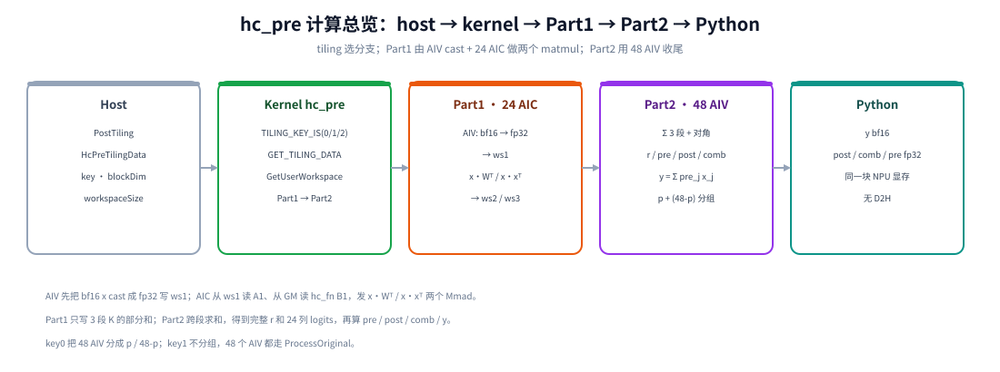

##### 1. 输入：tiling 与隐式参数

host 侧已经把切分算进 `HcPreTilingData`，`PostTiling` 只负责写 key / blockDim / workspace / tiling；kernel 侧要做的是把这份配置接进来。

前 8 个是数据指针，最后两个 `workspace` / `tiling` 由 runtime 注入：

```cpp
extern "C" __global__ __aicore__ void hc_pre(
    GM_ADDR x, GM_ADDR hc_fn, GM_ADDR hc_scale, GM_ADDR hc_base,
    GM_ADDR pre_mix, GM_ADDR y, GM_ADDR post, GM_ADDR comb_frag,
    GM_ADDR pre, GM_ADDR workspace, GM_ADDR tiling)
{
    KERNEL_TASK_TYPE_DEFAULT(KERNEL_TYPE_MIX_AIC_1_2);      // 1 AIC : 2 AIV
    GM_ADDR userWs = GetUserWorkspace(workspace);           // 跳过 header
    TPipe pipe;

    if (TILING_KEY_IS(0)) {                                 // bs > 32，MPMD
        GET_TILING_DATA_WITH_STRUCT(HcPreTilingData, tiling_data_in, tiling);
        HcPre::HcPreMembaseKSplitCorePart1<DTYPE_X> op;
        op.Init(x, hc_fn, userWs, &tiling_data_in, &pipe);
        op.Process();
        pipe.Destroy();                                     // Part 1 的 UB 布局作废

        TPipe pipeStage2;
        HcPre::HcPreMembaseKSplitCorePart2<DTYPE_X, false> op2;  // false：Part 2 两组核
        op2.Init(x, hc_scale, hc_base, y, post, comb_frag, pre_mix, pre,
                 userWs, &tiling_data_in, &pipeStage2);
        op2.Process();
        pipeStage2.Destroy();
    } else if (TILING_KEY_IS(1)) {                          // bs <= 32，SPMD
        GET_TILING_DATA_WITH_STRUCT(HcPreTilingData, tiling_data_in, tiling);
        HcPre::HcPreMembaseKSplitCorePart1<DTYPE_X> op;     // Part 1 与 key 0 完全相同
        op.Init(x, hc_fn, userWs, &tiling_data_in, &pipe);
        op.Process();
        pipe.Destroy();

        TPipe pipeStage2;
        HcPre::HcPreMembaseKSplitCorePart2<DTYPE_X, true> op2;   // true：Part 2 每核跑全流程
        op2.Init(x, hc_scale, hc_base, y, post, comb_frag, pre_mix, pre,
                 userWs, &tiling_data_in, &pipeStage2);
        op2.Process();
        pipeStage2.Destroy();
    }
    // TILING_KEY_IS(2)：pre_mix 场景，V4 不走
}
```

两条分支只差三处，其余完全一样：

|             | key 0（`bs > 32`）                               | key 1（`bs ≤ 32`）                      |
| ----------- | ---------------------------------------------- | ------------------------------------- |
| Part 2 模板参数 | `Part2<DTYPE_X, false>`                        | `Part2<DTYPE_X, true>`（`useOriginal`） |
| Part 2 跑法   | `ProcessPrePost` / `ProcessSinkhorn` 两组核分工     | `ProcessOriginal`：每核分一段行，四步顺序做完       |
| host 侧调度    | `SetScheduleMode(1)`（CANN 叫 batch mode，即 MPMD） | 不调用，即默认 0（同构，SPMD）                    |

Part 1 两分支逐字相同，连 `pipe.Destroy()` → 新建 `pipeStage2` 都一样——两段式对 key 0/1 是同构的，区别只在 Part 2 怎么分核。

入口只做五件事：

1. **`KERNEL_TASK_TYPE_DEFAULT(KERNEL_TYPE_MIX_AIC_1_2)`**：声明 AIC/AIV 混合执行，1 AIC 配 2 AIV——`blockDim=24` 就是 24 AIC + 48 AIV。
2. **`GetUserWorkspace(workspace)`**：跳过 runtime 在 workspace 前面加的 header，拿到可用的 `userWs`（ws1/ws2/ws3 都在里面）。
3. **`TILING_KEY_IS(key)`**：按 key 选 Part 2 实现——`0` → `<false>`（MPMD）、`1` → `<true>`（SPMD）、`2` → preMix（V4 不用），热路径不做运行时判断。
4. **`GET_TILING_DATA_WITH_STRUCT`**：把 GM 里的 tiling buffer 按 `HcPreTilingData` 解析成本地结构体 `tiling_data_in`，取的就是 host 侧 tiling 算好、`SaveToBuffer` 写进去的那份。
5. **`op.Init` + `Process`**：把数据指针、`userWs`、`&tiling_data_in` 交给 Part1/Part2 并跑；两段在**同一个 launch** 内顺序执行，中间 `pipe.Destroy()` 再新建 `pipeStage2`（两段 UB 布局不同）。

一句话：**入口不参与计算，只做"备料 + 分派"——声明执行形态、备好 `userWs` 与 `tiling_data_in`，再按 `key` 选定分支、依次驱动 Part 1 → Part 2；切分怎么变成行列循环，全在它们内部展开。**

##### 2. Part1：cast 与两组矩阵乘

**Part 1 是两段接力。** 一拍（`cvLoopKSize = 1024` 列）里：AIV 把 bf16 的 `x` 转成 fp32 写进 ws1；AIC 读 ws1 后跑两个 Mmad——`MmadA2`（`x·xᵀ`，出平方和）与 `MmadAB`（`x·Wᵀ`，出 24 列门控投影），部分和分别落 ws3 / ws2。交接点就是 ws1：它有两个槽，AIV 写、AIC 读，两个方向各用一个硬件计数器，就是这两个 flag：

```cpp
static constexpr uint64_t SYNC_AIV_TO_AIC_FLAG = 8;   // AIV 发 → AIC 收：这一拍写好了
static constexpr uint64_t SYNC_AIC_TO_AIV_FLAG = 9;   // AIC 发 → AIV 收：这个槽用完了
```

| flag        | 谁 Set（挂哪条流水）                              | 谁 Wait（在哪一步）               | 语义                   | 计数器       |
| ----------- | ----------------------------------------- | ----------------------- | -------------------- | --------- |
| 8 `AIV→AIC` | AIV，`PIPE_MTE3`（写 ws1 的 DMA 就在这条流水上）      | AIC，进 `ComputeDecode` 前 | 这一拍的 fp32 已落 ws1，可以读 | **full**  |
| 9 `AIC→AIV` | AIC，`PIPE_FIX`（消费链 `MTE2→MTE1→Cube→FIX` 的末端） | AIV，覆盖写某个槽前             | 这个槽读完了，可以写           | **empty** |

`full` / `empty` 不是代码变量，是给 8、9 号计数器起的语义别名：一个数"有几拍可读"，一个数"有几个槽可写"，初值都是 0。

**四个关键点：**

1. **谁 Set / 谁 Wait：名字就是方向。** `AIV→AIC` 由 AIC 等，`AIC→AIV` 由 AIV 等。
2. **挂哪条流水：`<PIPE>` 决定何时才算"发出"。** 要挂在真正完成那件事的流水上——写出去挂 `MTE3`，算完落盘挂 `FIX`。
3. **计数器：`SYNC_MODE2` 是计数模式。** `Set` 就是 +1，`Wait` 是"等到 > 0 再 −1"。
4. **开场：AIC 先连 `Set(9)` 两次**（`empty = 2`），把两个槽的"可写"预支出来——对应下表第 1 步。

Part1 整段时序：

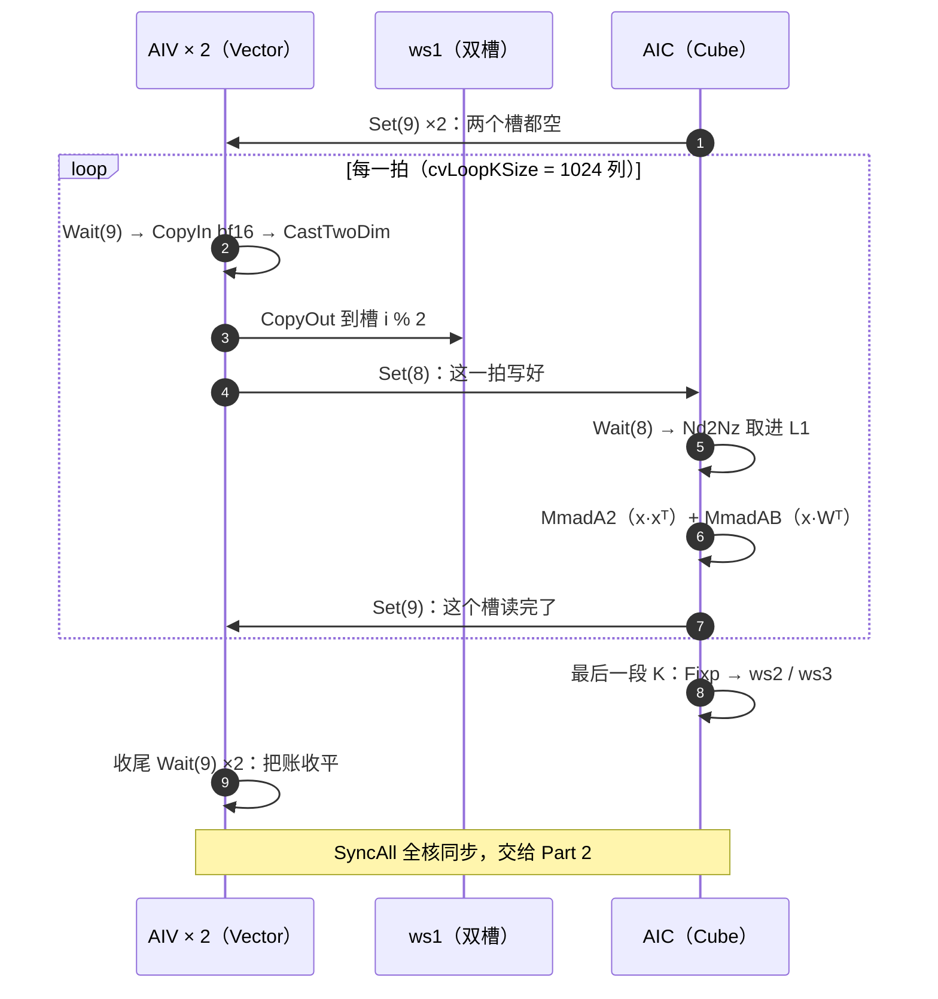

按 3 拍走一遍：先灌满、再流水、最后清账。记 **flag 8 = `SYNC_AIV_TO_AIC_FLAG`（full）**、**flag 9 = `SYNC_AIC_TO_AIV_FLAG`（empty）**，槽 0/1 轮换：

| 步 | 谁   | 动作                         | empty（9） | full（8） | 槽0 | 槽1 |
| - | --- | -------------------------- | -------- | ------- | -- | -- |
| 0 | —   | 硬件复位                       | 0        | 0       | 空  | 空  |
| 1 | AIC | `Set(9)` ×2                | **2**    | 0       | 空  | 空  |
| 2 | AIV | `Wait(9)` → 写槽0 → `Set(8)` | 1        | **1**   | 满  | 空  |
| 3 | AIV | `Wait(9)` → 写槽1 → `Set(8)` | **0**    | **2**   | 满  | 满  |
| 4 | AIC | `Wait(8)` → 读槽0 → `Set(9)` | 1        | 1       | 空  | 满  |
| 5 | AIV | `Wait(9)` → 写槽0 → `Set(8)` | 0        | 2       | 满  | 满  |
| 6 | AIC | `Wait(8)` → 读槽1 → `Set(9)` | 1        | 1       | 满  | 空  |
| 7 | AIC | `Wait(8)` → 读槽0 → `Set(9)` | **2**    | 0       | 空  | 空  |
| 8 | AIV | `Wait(9)` ×2               | **0**    | **0**   | 空  | 空  |

**四个关键点：**

1. **第 1 步 · 预支。** AIC 开场 `Set(9)` ×2，把 `empty` 抬到 2，等价于"两个槽都空着"；没有它，第 2 步 AIV 的 `Wait(9)` 会永久卡住。
2. **第 2–6 步 · 一收一发。** AIV 是 `Wait(9)` → 写槽 → `Set(8)`（`empty −1`、`full +1`），AIC 是 `Wait(8)` → 读槽 → `Set(9)`（`full −1`、`empty +1`）；两边只等对方的票，所以 AIV 不会覆写未读的槽，AIC 也不会读到未写的槽。
3. **第 7–8 步 · 清账。** 账上必然剩 2 张 `empty`——AIC 开场预支 2 张、之后每读一次再还 1 张，而 AIV 每写一拍只收 1 张，写完正好剩 2 张。所以由 AIV 连等两次 `Wait(9)`（[L210-L211](../../../../csrc/moe/hc_pre/op_kernel/hc_pre_m_k_split_core.h#L210-L211)）把账收平、归零——账不平，下一次 launch 就会错位。AIC 的 `Wait(8)` 都发生在每拍开头（第 4/6/7 步）。随后 `SyncAll<false>()`（[L213](../../../../csrc/moe/hc_pre/op_kernel/hc_pre_m_k_split_core.h#L213)）做全核屏障，保证所有 cube 的 ws2/ws3 都已落盘，Part 2 才能开工。
4. **全程 · 不变式。** `empty + full = 2`：每个槽要么空（记在 empty）、要么满（记在 full），没有第三种状态；`empty` 的上限 2 就是双缓冲的深度。

**双槽优势**：

单槽也能跑，只是两条流水会退化成严格串行；两个槽可以 overlap，把"生产"和"消费"错开一拍——AIV 写 `i+1` 时 AIC 正读 `i`，cast 的 `MTE2/V/MTE3` 被藏进 Cube 的 `MTE2→MTE1→Cube→FIX`，顺带吸收两边节拍差（尾拍只有 512 列），并把 AIV 的领先限制在最多两拍。
两边拍长记作 `a`、`b`：串行要 `N × (a + b)`，双槽约 `N × max(a, b)`（外加一次灌满/排空），所以重叠收益上限是 **2×**，只有 `a = b` 时才取到。反过来说，**重叠率被慢的一侧封顶**——谁慢谁定拍。
摊到时间轴上：每一列一拍，AIV 与 AIC 各一行，颜色标出槽 0 / 槽 1——AIC 读的永远是上一拍写的那个槽。


**为什么要在 AIV 上转，再交回 AIC**：
 **Cast 是 vector 指令**（`vcvt`），AIC 的指令集里只有 `Mmad`、`Fixpipe`、`LoadData` 和 DMA，没有逐元素/类型转换单元；**交接必须过 GM**：L1/L0 是 AIC 私有存储，AIV 写不进去，核间唯一共享的只有 GM。这么摆顺带赚了 overlap：AIC 等 ws1 的时候，AIV 正好在转下一拍，双槽让"写第 i+1 拍"和"算第 i 拍"同时进行。代价是 GM 上多一份 fp32 的 `x`。

###### 2.1 AIV：cast → ws1

**这一节只回答一个问题：一拍的数据怎么从 GM 的 bf16 变成 ws1 里的 fp32。**

**硬件形状：1 个 AIC 配 2 个 AIV。** `blockDim = 24` → 24 个 AIC + 48 个 AIV，`KERNEL_TASK_TYPE_DEFAULT(KERNEL_TYPE_MIX_AIC_1_2)` 把两个 Vector 单元都用上。AIV 的 `blockIdx` 2i / 2i+1 属于 cube 核 i（`curCubeBlockIdx = GetBlockIdx() / CV_RATIO`），这一对 AIV 领到同一个 (M 块, K 块)，**按行对半分**：AIV0 取前 `ceil(M/2)` 行、AIV1 取剩下的，各自 cast 完写进同一个 ws1 槽里属于自己的行段，行偏移 `(i*stage1MFactor + mVectorOffset − mGmOffset) * cvLoopKSize`。

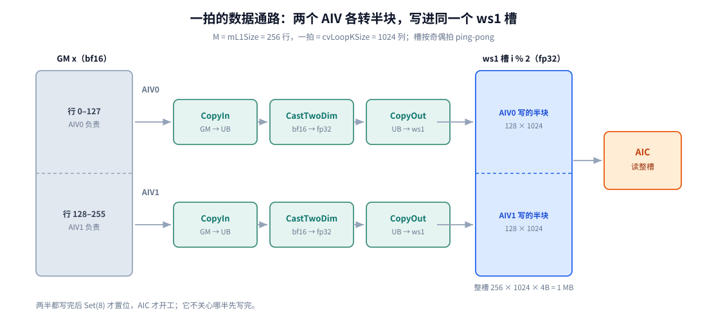

**为什么要劈成两半。** AIV 侧是搬运 + cast（读 bf16、写 fp32，数据量翻倍），单核压力大，劈成两半正好喂满两个 Vector 单元；AIC 侧是矩阵乘，天然吃满一个 cube，只要看到“整槽都写好了”就能开工，不关心哪半先写完。

**这一拍的函数调用链**（AIV 分支，[L152-L184](../../../../csrc/moe/hc_pre/op_kernel/hc_pre_m_k_split_core.h#L152-L184)）：

```text
ProcessMChunk()                                 L100     一拍 = 1024 列 K：AIV 写 ws1、AIC 读 ws1
└─ else（AIV 分支）                             L152     本核是 AIV：只做 cast + 搬运
   ├─ CrossCoreWaitFlag(SYNC_AIC_TO_AIV_FLAG)   L153     等 AIC 发 empty：槽空出来才敢写
   ├─ 行对半分：mVectorOffset / mVectorLength   L156-160 AIV0 取前 ceil(M/2) 行、AIV1 取剩下
   ├─ for i in [0, curUbLoops)                  L165     每批 16 行，批数 = ceil(本半行数 / 16)
   │   ├─ xQue.AllocTensor<T>()                 L167     取 1 个 bf16 槽（2 槽轮换，满了阻塞）
   │   ├─ CopyIn(…)                             L168     GM → UB：一批（≤16 行 × ≤1024 列，MTE2）
   │   ├─ xQue.EnQue / DeQue                    L170-171 挂牌“可读” → 取回，中途等 DMA 完成
   │   ├─ mmInQue.AllocTensor<float>()          L172     取 1 个 fp32 槽（每槽 64 KB）
   │   ├─ CastTwoDim(…)                         L173     本批元素原地 bf16 → fp32（V）
   │   ├─ xQue.FreeTensor(…)                    L174     bf16 用完即还，下一批 DMA 立刻能起
   │   ├─ mmInQue.EnQue / DeQue                 L175-176 挂牌“可读” → 取回，中途等 V 转完
   │   ├─ CopyOut(…)                            L179     写 ws1 槽 `cvLoopIdx_ % 2`，行号 i×stage1MFactor + 本半起点（MTE3）
   │   └─ mmInQue.FreeTensor(…)                 L180     fp32 已落 GM，槽归还
   └─ CrossCoreSetFlag<SYNC_MODE2, PIPE_MTE3>   L183     8 批全写完才 Set(8)，AIC 才读整槽
```

（`MTE2` = GM→UB 搬运，`V` = 向量计算，`MTE3` = UB→GM 搬运；`L###` 是 `hc_pre_m_k_split_core.h` 里的行号）

注意这里有**两种槽**，别混：`xQue` / `mmInQue` 的槽是 UB 里的 2 块 buffer，按**批**轮换（每批取一块）；`ws1` 的槽按**拍**轮换（`cvLoopIdx_ % 2`），一整拍的 8 批写的是同一个 ws1 槽。跨核的 `Wait(9)` / `Set(8)` 也是按拍来的——所以 AIC 要等这 8 批全部写完才被放行。

**为什么一批是 16 行（`stage1MFactor`）。** 这是被两头夹出来的：一拍 256 行、一个 AIV 分到 128 行，UB 装不下，必须切批；而 UB 一共只有 192 KB，每行（1024 列）要占 `(2 B + 4 B) × 2 buffer × 1024 = 12 KB`——输入 bf16、输出 fp32 各一份，还要各配双缓冲。`192 KB ÷ 12 KB = 16`，于是 `stage1MFactor = 16`；一个 AIV 的半块 `curUbLoops = ceil(128 / 16) = 8` 批走完，除不尽时向上取整、尾批由 `curUbMfactorTail` 收。

每个 AIV 的 UB 就按这 16 行切成两个队列（`InitBuffer` 的单位是「buffer 数 × 每块字节数」）：

```text
┌──────────────────────────┬───────────────────────────┐
│ xQue（bf16 输入）        │ mmInQue（fp32 输出）      │
│ 2 槽 × (16, 1024) bf16   │ 2 槽 × (16, 1024) fp32    │
│ 每槽 32 KB，小计 64 KB   │ 每槽 64 KB，小计 128 KB   │
└──────────────────────────┴───────────────────────────┘
```

槽内 shape 是 `(16, 1024)`：16 行 = 一批，1024 列 = 一拍 K；K 的尾拍只有 512 列，只填前 `16 × 512` 个元素。两块加起来正好 192 KB，UB 被占满——这就是一批只能 16 行的直接原因。反过来也对得上：8 批 × 16 行 = 128 行，正好是一个 AIV 的半块；两个 AIV 各占一段行，拼成 `mL1Size = 256` 行，就是一拍写进 ws1 槽的高度。两块 buffer 各两个槽，搬运和计算才有可能同时进行。

一批（一次循环体）里真正干活的只有三件：

**① CopyIn：按 GM 行距 `k` 只取自己那段 K。** 这里的 `k` 是 GM 的行距（上一行到下一行跨过的元素数，即完整的 `hcMult·d`），不是本拍的 K 长度。源地址 `(mVectorOffset + i*stage1MFactor)*k + kGmBaseOffset`，即「第 i 批首行 × 行距 `k` + 本核 K 起点」；一次搬 `curUbMFactor × realKGmSize` 个元素，行间空洞 `k − realKGmSize`。

**② CastTwoDim：bf16 → fp32。** `realKGmSize` 对齐时一条 `Cast` 覆盖整个 tile，否则退化成逐行；走 `CAST_NONE`，只补位宽、不改数值。

**③ CopyOut：写进 ws1 的槽，行距固定 1024。** `off` 分两段：`cvLoopIdx_ % 2 × xCastFp32BufSize_` 选槽，`(i*stage1MFactor + mVectorOffset − mGmOffset) × cvLoopKSize` 选行。行间空洞 `cvLoopKSize − realKGmSize` 把右侧空列跳过，所以槽里始终是 1024 宽的行。

**三条流水各有自己的指令队列。** 标量单元负责发指令：`CopyIn` 进 MTE2 队列、`CastTwoDim` 进 V 队列、`CopyOut` 进 MTE3 队列；三个单元各按自己队列的顺序执行，互不阻塞。但“搬完才能转”这类先后关系仍然要保证。办法是在两条流水之间插一对同步指令：`EnQue` 把 `SetFlag` 插进**生产者队列**（MTE2 执行到这儿时置位），`DeQue` 把 `WaitFlag` 插进**消费者队列**（V 执行到这儿发现旗标为 0 就一直等，等到后清零再继续）。这两条指令的语义：

| 指令 | 插到哪 | 执行条件 | 对标志位 |
| --- | --- | --- | --- |
| `SetFlag` | 生产者队列 | 本队列里它前面的读写全部完成 | 置 **1** |
| `WaitFlag` | 消费者队列 | 执行到它时若为 0，本队列后续指令一直阻塞 | 读到 1 后清 **0**，继续执行 |

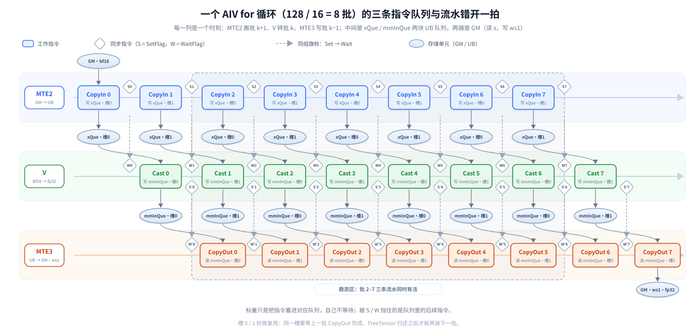

图里三行就是三个指令队列，**同一行从左到右按执行顺序排**。彩色块是干活的指令，菱形 `S` / `W` 是 `EnQue/DeQue` 插进去的 `SetFlag` / `WaitFlag`，虚线把同一组 S 和 W 串成一对；椭圆是两块 UB 队列的槽，细线表示数据从哪个槽进、进到哪个槽。V 相对 MTE2 晚一格、MTE3 又比 V 晚一格——这就是“错开一拍”。

###### 2.2 AIC：两个 Mmad

24 个 AIC 各领 `256 行 × 一段 K`（M 8 块 × K 3 段，每核 `256 × 9728`，尾段 `9216`），同一块由 1 AIC + 2 AIV 共享、一拍一拍地做，AIV 负责把这一拍的 fp32 写进 ws1后，这一节回答一个问题：AIC 怎么把这一拍 ws1 的 fp32 x 变成 ws2 / ws3 的部分和。

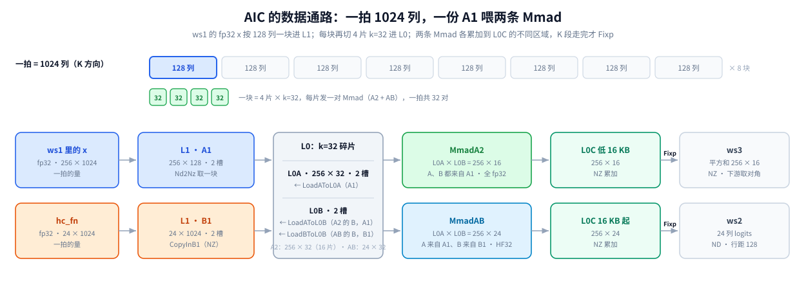

**L1 怎么分：512 KB 正好被 A1 / B1 各占一半，两块都用满。**

```text
L1（512 KB）
┌──────────────────────────┬──────────────────────────┐
│ A1  256 KB               │ B1  256 KB               │
│ ┌──────────┬──────────┐  │ ┌──────────┬──────────┐  │
│ │ 槽0 128K │ 槽1 128K  │  │ │ 槽0 128K │ 槽1 128K │  │
│ │ 256×128  │ 256×128  │  │ │ 32×1024  │ 32×1024  │  │
│ └──────────┴──────────┘  │ └──────────┴──────────┘  │
└──────────────────────────┴──────────────────────────┘
  A1：对齐前就是 256×128（两个维度都是 16 的倍数，不用补）
  B1：真实数据只有 24 行，按 16 对齐后存成 32 行（96 KB → 128 KB）
```

```cpp
InitBuffer(l1aBuffer, 256 * 1024);   // A1：2 槽 × 128 KB
InitBuffer(l1bBuffer, 256 * 1024);   // B1：2 槽 × 128 KB
L1_BUF_OFFSET = 128 * 256;           // 槽距 = 32768 个 fp32 = 128 KB
L1_BUF_NUM    = 2;
```

**A1 分 8 次搬，B1 只搬 1 次**——差别就在“一个槽装不装得下”：

| | A1 | B1 |
| --- | --- | --- |
| 一拍的量 | `256 × 1024` fp32 = **1 MB** | `24 × 1024` fp32 = **96 KB** |
| 一个槽 128 KB 装得下吗 | 装不下 | 装得下（补齐 32 行后正好 128 KB） |
| 搬法 | 按 `128` 列切成 **8 块**，一块一次 Nd2Nz | **一次** Nd2Nz 搬整段 |
| 谁用 | 每块只喂 4 片 `k=32` | 8 个 tile **共用**这一份 |
| 尾拍 | 最后一块照常 128 列 | `dValue = 512`，只用到 64 KB |

**B1 的 24 为什么补到 32。** NZ 分形是 `16 × 16`，N 方向必须是 16 的倍数：`CeilAlign(24, 16) = 32`，即 24 行分成两组（16 行满 + 8 行补零）。代码里就是 `dstNzC0Stride = (24 + 15) / 16 * 16 = 32`。补出来的 8 列不进结果——`MmadAB` 的 `n = 24` 只读前 24 列——但**寻址步长必须落在 16 的整数倍上**，否则第二个分形组会从非对齐地址开始，`LoadData` 读出来就是错位的。代价是 96 KB → 128 KB，正好把槽填满。

**L0A / L0B / L0C 怎么分。**

```text
L0A（64 KB，2 槽：装不同片）
┌────────────────────────┬────────────────────────┐
│ 槽0  32 KB             │ 槽1  32 KB             │
│ 256 × 32 fp32          │ 256 × 32 fp32          │
└────────────────────────┴────────────────────────┘

L0B（64 KB，2 槽：装同一片的两个来源）
┌────────────────────────┬────────────────────────┐
│ 槽0  32 KB             │ 槽1  32 KB             │
│ 256 × 32（A2 的 B）    │ 32 × 32（AB 的 B）     │
└────────────────────────┴────────────────────────┘
  槽 1 的真实数据只有 24 行，按 16 对齐后存成 32 行（4 KB）

L0C（硬件 128 KB，本 kernel 申请 64 KB 作累加区）
┌──────────┬──────────┬──────────────┬──────────────────┐
│ A2 16 KB │ AB 32 KB │ 空闲 16 KB   │ 未申请 64 KB     │
│ 256×16   │ 256×32   │              │                  │
└──────────┴──────────┴──────────────┴──────────────────┘
```

```cpp
InitBuffer(l0aBuffer,  64 * 1024);   // L0A：2 槽 × 32 KB
InitBuffer(l0bBuffer,  64 * 1024);   // L0B：2 槽 × 32 KB
InitBuffer(l0cBuffer,  64 * 1024);   // L0C：只申请 64 KB（放 A2 + AB 够用）
```

- **L0A 两槽装不同的片，角色相同**：第 $i$ 片进槽 `i%2`（每片只装一次、`l0aLoopIdx_` 加 1，所以槽逐片交替）。两条 Mmad 的 A 操作数本来就是同一片，槽里内容一模一样，换成哪个槽都无所谓——它的用处是让 MTE1 搬下一片与 Cube 算当前片重叠；
- **L0B 两槽装同一片的两个来源，角色固定不互换**：槽 0 永远是 A1 的 `256×32`（A2 的 B）；槽 1 永远是 B1 的 `24×32`（AB 的 B，按 16 行对齐后存成 `32×32` = 4 KB）。因为每片正好两次装载（`LoadAToL0B` 一次、`LoadBToL0B` 一次），`l0bLoopIdx_` 每片加 2，奇偶始终不变——槽 0 恒对应 A2、槽 1 恒对应 AB。**它不是用来 overlap 的双缓冲**：两个槽装的是两份**同时在用**的不同数据（A2 的 B 和 AB 的 B 必须同时存在），而真正的流水重叠来自 L1 的 A1 双槽和 L0A 的两槽；
- **L0C 是累加器**：A2 占 `[0, 16 KB)`、AB 占 `[16 KB, 48 KB)`；n=24 按 16 补齐成 32 列，所以 AB 实际占 32 KB。两块地址不重叠；硬件 128 KB，这里只申请 64 KB。

**一张表把分配、对齐前后、实际占用对齐。**

| 缓冲 | 分配 | 对齐前 shape | 存储 shape（NZ） | 实际占用 |
| --- | --- | --- | --- | --- |
| L1·A1 | 2 × 128 KB = **256 KB** | `256 × 128` | `256 × 128` | 每槽 128 KB，**用满** |
| L1·B1 | 2 × 128 KB = **256 KB** | `24 × 1024` | `32 × 1024` | 96 KB → 补零 128 KB，**用满** |
| L0A | 2 × 32 KB = **64 KB** | `256 × 32` | `256 × 32` | 每槽 32 KB，**用满** |
| L0B·槽0 | 32 KB | `256 × 32` | `256 × 32` | 32 KB，**用满** |
| L0B·槽1 | 32 KB | `24 × 32` | `32 × 32` | **3 KB**（16 对齐后 4 KB） |
| L0C·A2 | 64 KB（申请） | `256 × 16` | `256 × 16` | 16 KB |
| L0C·AB | 同上 | `256 × 24` | `256 × 32` | 32 KB（n 补齐到 32） |

合计：**L1 512 KB 用满、L0A + L0B 128 KB 用满、L0C 申请 64 KB 实际用 48 KB**。

**四块双槽、八个旗标：四段握手，谁置位、谁等待。**

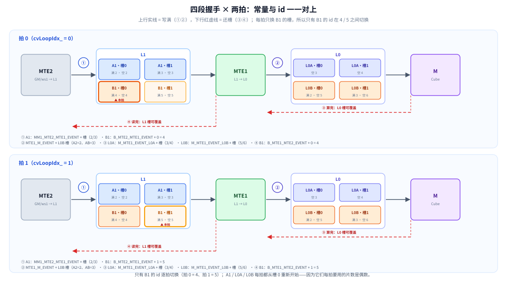

- **上面四个箭头是「写」**：① MTE2 把 A1/B1 写进 L1，② MTE1 把片写进 L0；
- **下面两条红虚线是「还槽」**：③ Cube 算完把 L0 槽还回去，④ MTE1 读完把 L1 槽还回去；
- **每块缓冲 2 个槽**（A1/B1、L0A/L0B），所以上下两条线能同时在跑；`L0C` 是单块累加器，不参与这四段握手；
- **只有 B1 的 id 逐拍切换**（拍 0 = `4 + 0`、拍 1 = `4 + 1`）：A1 / L0A / L0B 每拍要用的片数是偶数，所以下一拍又从槽 0 起。

顺着数据流看 ①②，再顺着回收看 ③④；`Init` 只预置**两个「空」方向**（③④），**「满」方向不预置**（①②），等第一次搬完才成立。

**① MTE2 → MTE1：A1 / B1 写满**（不预置）

```text
MTE2   [CopyInA1 写槽 k] ─S(2+k)─▶
MTE1                              [W(2+k)] [LoadAToL0A / LoadBToL0B 读槽 k]
```

| 缓冲 | 旗标常量 | id | 谁 `Set` | 谁 `Wait` |
| --- | --- | --- | --- | --- |
| L1·A1 | `MM1_MTE2_MTE1_EVENT` | `2 + 槽` | `CopyInA1` L372 / L380、预取 L406 | `ComputeDecode` L386 / L408 |
| L1·B1 | `B_MTE2_MTE1_EVENT` | `4 + 槽` | `CopyInB1` L221、`PreloadNextB1` L241 | `ComputeDecode` 首行 L364 |

**② MTE1 → M：一片的两路装载完成**（不预置，里程碑型）

```text
MTE1   [LoadAToL0A] [LoadAToL0B] ─S(2+槽B)─▶
M                                            [W(2+槽B)] [MmadA2 ×16]
```

| 旗标常量 | id | 谁 `Set` | 谁 `Wait` | 说明 |
| --- | --- | --- | --- | --- |
| `MTE1_M_EVENT` | `2 + L0B 槽`（A2 恒 2、AB 恒 3） | `MmadA2` L493、`MmadAB` L533 | 紧随其后 L494 / L534 | 一条 `Wait` 覆盖 L0A + L0B 两路 |

**③ M → MTE1：L0 算完**（`Init` 预置）

```text
M      [MmadA2 读完槽 A] ─S(5+槽A)─▶
MTE1                                [W(5+槽A)] [LoadBToL0B 覆盖槽 A]
```

| 缓冲 | 旗标常量 | id | 谁 `Set` | 谁 `Wait` |
| --- | --- | --- | --- | --- |
| L0A | `M_MTE1_EVENT_L0A` | `3 + 槽` | 两条 Mmad 算完 L324 / L351 | `LoadAToL0A` 前 L308 / L335 |
| L0B | `M_MTE1_EVENT_L0B` | `5 + 槽` | `MmadA2` 后 L314 / L341、`MmadAB` 后 L322 / L348 | `LoadAToL0B` 前 L311 / L338、`LoadBToL0B` 前 L317 / L344 |

**④ MTE1 → MTE2：A1 / B1 读完**（`Init` 预置）

```text
MTE1   [读完槽 k] ─S(2+k)─▶
MTE2                        [W(2+k)] [CopyInA1 覆盖槽 k]
```

| 缓冲 | 旗标常量 | id | 谁 `Set` | 谁 `Wait` |
| --- | --- | --- | --- | --- |
| L1·A1 | `X_MTE1_MTE2_EVENT` | `2 + 槽` | `ComputeL0Pairs` 之后 L389 / L410 | `CopyInA1` 前 L369 / L376 / L403 |
| L1·B1 | `B_MTE1_MTE2_EVENT` | `4 + 槽` | 拍尾 `SetBL1Mte1ToMte2Flag()` L290 | 拍首 `WaitBL1Mte1ToMte2Flag()` L297、`PreloadNextB1` L229 |

**三条读法：**

1. **空方向必须预置**（③④）：开场槽就是空的，不预置则第一个 `Wait` 直接卡死；
2. **满方向不能预置**（①②）：开场没有数据，只能等第一次搬完 `Set`；
3. **② 是里程碑，其余是资源**：①③④ 的 `+ 槽号` 指真实缓冲槽（两槽可同时状态不同）；② 的 `+ 槽号` 只是给 `MmadA2` / `MmadAB` 各一个独立计数，避免互相串行。

**单拍怎么流、两拍怎么接。** 拍内与跨拍各有一条主线：

- **拍内（MTE2）**：`ProcessMChunk` 先 `CopyInB1`——一次 `Nd2Nz` 搬完整拍 `24 × 1024`；再进 `ComputeDecode`，它的第一条指令就是 `WaitFlag<HardEvent::MTE2_MTE1>(B_…)`，**只等 B1 落地**，然后才搬 A1 块 0。B1 在前、A1 在后，都在同一条 MTE2 队列里按发射顺序执行；
- **拍内（MTE1 → Cube）**：8 个 tile 各切 4 片 `k=32`，每片三次装载（`LoadAToL0A` / `LoadAToL0B` / `LoadBToL0B`），紧跟两条 Mmad（`MmadA2` 16 条、`MmadAB` 1 条）。一个 tile 共 **12 次装载 + 8 条 Mmad**；
- **跨拍（预取）**：本拍尾部 `PreloadNextB1` 把下一拍的 B1 搬进另一个槽，`CopyInA1` 把下一拍首块搬进另一个 A1 槽；
- **跨拍（旗标）**：本拍算完 `Set(9)`（empty，AIV 可覆盖 ws1）；下一拍开头 `Wait(8)`（full，等 AIV 写完）。
- **两级双槽**：L1 的 A1 逐 **tile** 交替（tile 0→槽 0、tile 1→槽 1…，每拍 8 个 tile 是偶数，下一拍又从槽 0 开始）；L0A 逐 **片** 交替（片 0→槽 0、片 1→槽 1，每 tile 4 片同样是偶数，所以每个 tile 都从槽 0 起）。

8 个 tile 共用同一份 B1（`LoadBToL0B` 每次只取 `24 × 32`，8 × 4 = 32 次）；整拍算完 `SetBL1Mte1ToMte2Flag()` 才把 B1 的槽还回去。

图中**每个单元一行，S/W 就是它指令队列里的一格**：MTE2 搬完一块后跟 `S`，MTE1 每条 `Load*` 之后跟 `S`，Cube 每条 `Mmad` 之前插 `W`、之后跟 `S`（释放槽）。**红色竖箭头把同一对 S/W 连起来**——S 由搬完的一方置位、W 由要用的一方等待，所以箭头上下各一个菱形，一对一，不会串行。

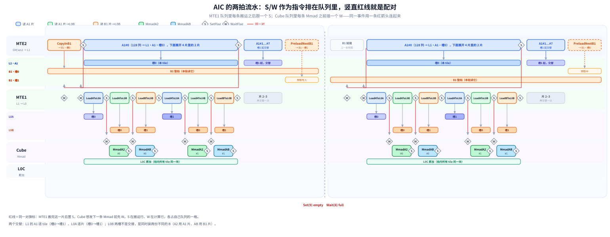

**真正重叠的**是 MTE1 搬下一片与 Cube 算当前片——两条 Mmad 本身在 Cube 队列里严格串行；L0A 的两槽逐片换（两个槽角色相同），L0B 的两槽固定（槽 0 是 A1 片、槽 1 是 B1 片）。

两条 Mmad 前后**看不到 wait**，是因为同步被包进了 `MmadA2` / `MmadAB` 内部：

```cpp
// 调用处（ComputeL0Pairs）：只有搬运
WaitFlag<HardEvent::M_MTE1>(…L0A + slot);  LoadAToL0A(…);   // 等 A 槽空 → 搬
WaitFlag<HardEvent::M_MTE1>(…L0B + slot);  LoadAToL0B(…);   // 等 B 槽空 → 搬（A1 片当 A2 的 B）
MmadA2(…);                                                   // ← 同步在函数里
WaitFlag<HardEvent::M_MTE1>(…L0B + slot);  LoadBToL0B(…);   // 等另一个 B 槽空 → 搬（B1 片当 AB 的 B）
MmadAB(…);                                                   // ← 同步在函数里
SetFlag<HardEvent::M_MTE1>(…L0A + slot);                     // 两条都算完，A 槽才释放
```

```cpp
// MmadA2 开头（L489）/ MmadAB 开头（L529）都是这两行
uint64_t e = MTE1_M_EVENT + (l0bLoopIdx_ % 2);
SetFlag<HardEvent::MTE1_M>(e);    // 插进 MTE1 队列：它前面的搬运都执行完才置位
WaitFlag<HardEvent::MTE1_M>(e);   // 插进 Cube 队列：Mmad 排在这条 wait 之后
```

**为什么 A2 发 16 条、AB 只发 1 条。** 两条 Mmad 吃的是同一份 A1，取法与落点不同，但根源只有一个：B 是否被所有行共用。

| Mmad | L0A 取哪块 | L0B 取哪块 | 一条指令（m×n×k） | L0C 落点 |
| --- | --- | --- | --- | --- |
| `MmadA2` | 第 $i$ 个 16×32 片（$i=0..15$） | 同一片 16×32（源 A1） | $16\times16\times32$ | 低 16 KB，第 $i$ 个 16×16 |
| `MmadAB` | 整块 256×32 | 24×32（源 B1） | $256\times24\times32$ | 16 KB 起，256×32（n 补齐） |

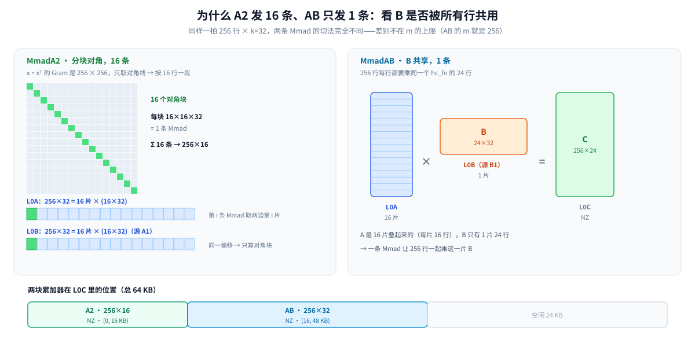

**A2 把 Gram 拆成 16 条**，每条只算 16 行 × 16 行：

$$
C^{(2)}_{i} \mathrel{+}= X_i\,X_i^{\top},\qquad
X_i\in\mathbb{R}^{16\times32},\quad C^{(2)}_{i}\in\mathbb{R}^{16\times16},\quad i=0,\dots,15
$$

第 $i$ 条只拿第 $i$ 段 16 行——`l0a_` / `l0b_` 用同一个偏移，所以 B 操作数也跟着被切成 16 段搬。

**它算的是 RMS 归一化的分母。** mHC 在投影前要按 token 归一化：$r_i = 1/\sqrt{\tfrac{1}{k}\sum_j x_{i,j}^2+\epsilon}$，其中 $k=hcMult\cdot d=28672$。$x\,x^{\top}$ 的对角线正好是 $\sum_j x_{i,j}^2$，Part 2 跨 3 段相加后再 `×1/k → +eps → sqrt → 倒数` 得到 $r$；投影用的是**未归一化**的 x，把 $r$ 当标量后乘到 24 个 logits 上——等价于先归一化再投影，但省掉一次 28672 维的逐元素缩放。

**代价与取舍。** 对角线只有 16 个有用（$i$ 行 $i$ 列），其余 15/16 白算；但 B 直接取自已躺在 L1 的 A1，一次 GM 都不用多读，换来 AIV 保持纯 cast。精度上也不让步：A2 走全 fp32（28672 项累加，尾数不能截）。

**为什么偏偏是 16 行一段。** 因为 cube 的最小计算单位就是 16×16 的分形（`AscendC::BLOCK_CUBE = 16`）：Mmad 的 `m` / `n` 只能按 16 取整，L0A / L0B 里也按 16 行一组存（zz / nz 的 C0 = 16），`LoadAToL0B` 那个 `mL0Offset += 16` 的循环就是在按分形搬。块再大只会更亏——一块 $b\times b$ 里只有 $b$ 个对角线值有用：

| 一段 | 块大小 | 有用 | 白算 |
| --- | --- | --- | --- |
| **16（现在）** | 16×16 | 16 | 15/16 = 93.75% |
| 32 | 32×32 | 32 | 31/32 = 96.9% |
| 64 | 64×64 | 64 | 63/64 = 98.4% |

所以 16 既是硬件下限，也是浪费最少的切法。**不动它的理由也在这里**：若试图用 $m=256$ 一条打完，B 只给 16 行就白算 16 倍，B 给 256 行则输出 256 KB、L0C 装不下。另外两处 16 同源：`singleCoreM = RoundUp(…, BLOCK_CUBE)`（M 对齐分形）、`dstNzC0Stride = CeilAlign(24, 16) = 32`（NZ 补齐）。

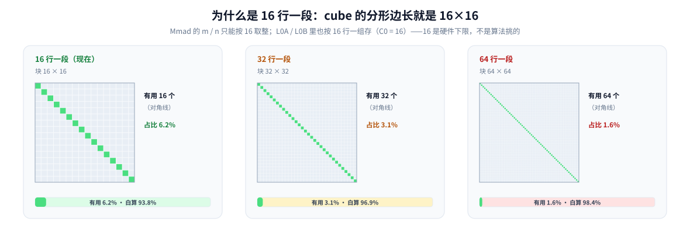

**AB 一条打完**，$m=256$、$n=24$、$k=32$：

$$
C^{(AB)} \mathrel{+}= X\,W^{\top},\qquad
X\in\mathbb{R}^{256\times32},\quad W\in\mathbb{R}^{24\times32},\quad C^{(AB)}\in\mathbb{R}^{256\times24}
$$

B 被 256 行共用、输出只占 24 KB，所以不必切——切了只会多 16 倍指令。这条则开 HF32：24 列投影的 28672 个乘加项符号随机，截断误差正负相消（整体 ~3e-6），拿吞吐换精度划算。

**累加与落盘。** 两条都按 $k=32$ 的碎片一路累加，靠 `unitFlag` 与 `cmatrixInitVal = isFirstK && kGmOffset == 0` 串起来：第一片初始化累加器，中间片只累加，最后一片关掉 `unitFlag` 并触发 `Fixp`。两块的地址互不重叠（16 KB + 24 KB ≤ 64 KB），交替发指令也不会踩到对方的累加器。**L0C 里两块都是 NZ**（cube 的原生格式），格式转换只发生在 Fixp 写出那一刻：

| 落点 | 写出格式 | 为什么 |
| --- | --- | --- |
| ws3（A2） | 保持 **NZ** | 下游只取 16×16 块的对角线，按相位 stride 取最省；且 $n=16$ 正好一个分形，NZ 与 ND 字节相同 |
| ws2（AB） | **NZ → ND**，行距 128 | 下游按行读 24 个连续值；$n=24$ 在 NZ 下被切成 16+8 两块还要补齐，转 ND 才连续 |

**这一拍的函数调用链**（AIC 分支，[L114-L151](../../../../csrc/moe/hc_pre/op_kernel/hc_pre_m_k_split_core.h#L114-L151)）：

```text
ProcessMChunk()                                    L100      一拍 = 1024 列 K：AIV 写 ws1、AIC 读 ws1
└─ if（AIC 分支）                                  L114      本核是 AIC：只做矩阵乘（MTE2 搬入、MTE1 进 L0、Cube 算）
   ├─ 填 MmParams                                  L115-128  本拍的行数/列数/偏移，以及 isFirstK / isLastK
   ├─ [未预取] WaitBL1Mte1ToMte2Flag               L131      等 B1 的 L1 槽被 MTE1 读完
   ├─ [未预取] CopyInB1(…)                         L132      hc_fn 的 24×1024 → L1 B1·槽 i%2（Nd2Nz，MTE2）
   ├─ 算下一拍的 B1 偏移/长度                      L135-138  preloadNextB1 / nextB1Size，留给下面的预取
   ├─ [未预取] CrossCoreWaitFlag(8)                L140      等 AIV 把这一拍 fp32 写进 ws1（full）
   ├─ ComputeDecode(…)                             L141-147  一拍 1024 列，内部再切块、切片
   │   ├─ [未预取] CopyInA1(…)                     L370      ws1 的 128 列 → L1 A1·槽 i%2（Nd2Nz，MTE2）
   │   ├─ while 还有块                             L375      边搬边算：搬下一块的同时算当前块
   │   ├─ ComputeL0Pairs(…)                        L301      128 列切 4 片 k=32，每片一对 Mmad
   │   │   ├─ LoadAToL0A(…)                        L431      读 L1·A1 → 写 L0A·槽 i%2（MTE1）
   │   │   ├─ LoadAToL0B(…)                        L469      读 L1·A1 → 写 L0B·槽（A2 的 B）
   │   │   ├─ MmadA2(…)                            L489      16 条 16×16×32，全 fp32 → L0C[0, 16 KB)
   │   │   ├─ LoadBToL0B(…)                        L512      读 L1·B1 → 写 L0B·另一槽（AB 的 B）
   │   │   ├─ SetHF32Mode(1) → MmadAB(…) → (0)     L529      1 条 256×24×32，HF32 → L0C[16, 48) KB
   │   │   └─ 两条都算完 → SetFlag(M_MTE1)         L324      L0A 槽释放，MTE1 才能搬下一片
   │   ├─ [预取] CrossCoreWaitFlag(8) → CopyInA1   L401-405  提前等下一拍，把它的 A1 搬进另一个 L1 槽
   │   └─ [isLastK] Fixp(…)                        L413      L0C → ws3（NZ）/ ws2（ND，行距 128）
   ├─ SetBL1Mte1ToMte2Flag()                       L148      B1 的 L1 槽归还给 MTE2
   ├─ 更新预取标志                                 L149-150  b1Prefetched = a1Prefetched = preloadNextB1
   └─ CrossCoreSetFlag<SYNC_MODE2, PIPE_FIX>(9)    L151      还槽：Set(9)，AIV 才能写下一拍
```

**把账算完：一拍 8 块 × 4 片 × 17 条。** `ComputeDecode` 把 1024 列切成 8 个 tile，`ComputeL0Pairs` 再把每个 tile 切成 4 个 `k=32` 的碎片、每片发一对 Mmad——每对 16 条 `MmadA2` + 1 条 `MmadAB`，一拍共 $8\times4\times17=544$ 条 Mmad 指令。**但累加不按拍清零**：一个核的 K 是 9~10 拍（`9728 = 9×1024 + 512`，最后一段 `9216`），所有碎片都加进同一组 L0C，只有最后一片才 Fixp。

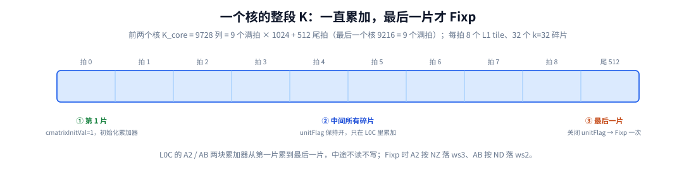

##### 3. Part2：部分和归并与门控计算

**Part 1 留下三块原料：ws3 的平方和、ws2 的 24 列 logits、以及原封不动的 bf16 `x`；Part 2 把它们变成四个输出。**

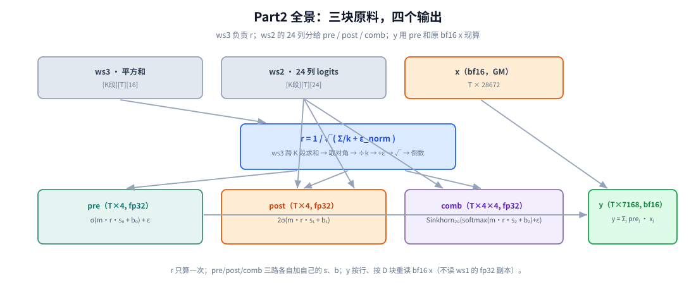

**输入怎么摆。** 每个 token 在 ws3 里有 16 个数（`x·xᵀ` 的对角块），在 ws2 里有 24 个数（pre 4 + post 4 + comb 16）；两份都按 K 段分开存，所以 Part 2 第一步总是“跨 K 段求和”。

**两组核，按任务切而不是按 token 切。** 源码入口 `HcPreMembaseKSplitCorePart2<T,false>::Process()`（L992）只做一次 dispatch：

```text
Process()
├─ blockIdx < prePostCoreNum → ProcessPrePost()          // L747
│    └─ 逐 rowTile:
│         ├─ CalcRsqrt → r
│         └─ ProcessPrePostBatch                        // L674
│              ├─ ProcessPre  → pre
│              ├─ ProcessY    → y
│              └─ ProcessPost → post
└─ else → ProcessSinkhorn()                              // L803
     └─ 逐 rowTile:
          ├─ CalcRsqrt → r
          └─ ProcessSinkhornBatch                        // L774
               ├─ GatherCompactToElementMajor
               ├─ ProcessCompactSinkhorn → comb
               └─ GatherElementMajorToCompact
```

- 两条路径都先算 `r`，区别在后半段：A 组做 `ProcessPre` / `ProcessY` / `ProcessPost`，B 组做 16 列的 softmax + Sinkhorn；
- 两组各自覆盖**全部** token，只是算的输出不同；组内再按行切给自己的核；
- `p = prePostCoreNum` 由 `CalcVectorCoreNum` 按行代价估出来，不是固定值（示例里 bs = 2048）。

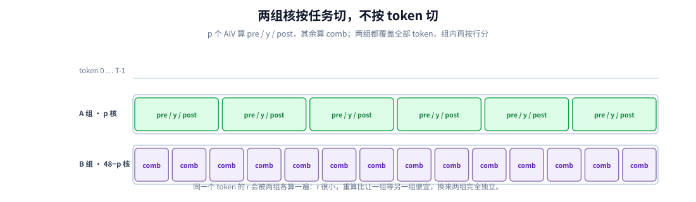

**符号约定**（后面反复用）：`s0/s1/s2` = `hc_scale[0..2]` 三个标量；`b0/b1/b2` = `hc_base` 的 `[0:4]` / `[4:8]` / `[8:24]` 段；`m` = mixes 的对应列（4 / 4 / 16）。

**A. `ProcessPrePost()`：pre / y / post**

**A1. `CalcRsqrt` → `r`**

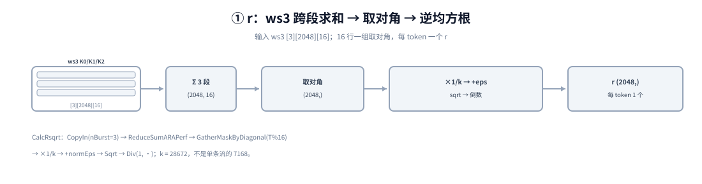

ws3 是 `[k 段][token][16]`，先跨段相加，再用旋转掩码取对角线，最后 `×1/k → + normEps → Sqrt → 倒数`：

```text
CopyIn(ws3, nBurst = cubeBlockDimK)
ReduceSumARAPerf(…, dim0=1, dim1=cubeBlockDimK, dim2=curRowFactor*16)   // 跨 K 段求和
GatherMaskByDiagonal(…, globalRowOffset % 16)                            // 按行相位取对角
× 1/k  →  + normEps  →  Sqrt  →  Div(1, ·)                               // 逆均方根
```

$k = 28672$，所以 $r$ 是**整块 $4 \times 7168$** 的逆均方根，不是单条流的 7168。

**A2. `ProcessPrePostBatch` → `ProcessPre` + `ProcessY`**

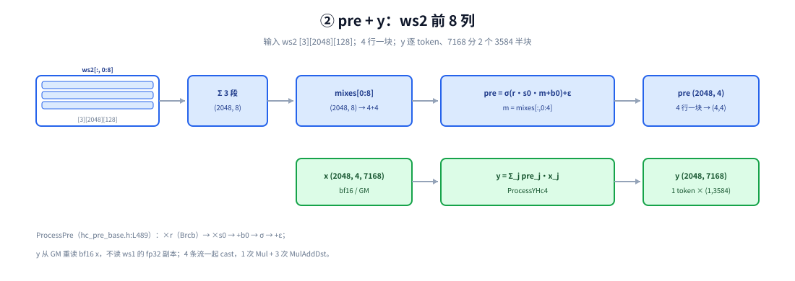

`ProcessPrePostBatch` 名字里的 `Post` 就是 A3 的 `post`：它一次搬 ws2 前 8 列，前 4 列给 pre、后 4 列给 post——A2/A3 是同一个 batch 的前后半。

ws2 的前 8 列按 K 段搬进 UB（`CopyInWithOuterFor` 一次抓 `curRowFactor × 4` 个元素、按 128 的 GM 行距跨段），归约掉 K 段后得到两块 `curRowFactor × 8` 的平面：第一块是 `pre` 的 4 个 logits（pad 到 8），第二块是 `post` 的 4 个。`ProcessPre`（[hc\_pre\_base.h:L489](../../../../csrc/moe/hc_pre/op_kernel/hc_pre_base.h#L489)）就地把第一块算成 `pre`：`× r（先 Brcb 成每行 8 份）→ × s₀ → + b₀ → σ → + ε`。`pre` 是 sigmoid+ε，不是 softmax；4 个权重和不等于 1，`y` 的尺度可以大于单条流。

`y` 按行、按 D 块从 **GM 重新读 bf16 的 `x`**——不读 ws1 的 fp32 副本，因为那是 cube 的私有布局、早被后面的 token 块覆盖了。`ProcessYHc4`（[hc\_pre\_base.h:L626-L694](../../../../csrc/moe/hc_pre/op_kernel/hc_pre_base.h#L626-L694)）很省：4 条流一起 cast 成 fp32，4 个 `pre` 权重 Brcb 成 4 个「8 个相同 float」的 block，靠 `src1BlkStride = 0` 在整行内复用；计算是 1 次 `Mul` + 3 次 `MulAddDst`，最后一次 cast 回 bf16。

**A3. `ProcessPrePostBatch` → `ProcessPost`**

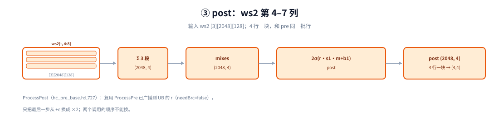

同一批行、同一块 UB 的第二块平面，用 `s₁` / `b₁`，`ProcessPost`（[hc\_pre\_base.h:L727](../../../../csrc/moe/hc_pre/op_kernel/hc_pre_base.h#L727)）与 `ProcessPre` 只差最后一步是 `× 2` 而不是 `+ ε`。它传 `needBrc = false` 是**依赖**而不是开关——复用 A2 里已经广播好的 `r`（同一块 UB），两个调用的顺序不能换。`post` 乘 2 后落在 $(0, 2)$，中心约 1，覆盖削弱到 0、增强到 2 倍。

**B. `ProcessSinkhorn()`：comb**

**B1. `CalcRsqrt` → `r`**

每个 rowTile 仍先算 `r`，和 A1 同一套 `CalcRsqrt`，不重复画。

注意：这里是**重算**，不是复用。key0 的两组各自覆盖全部 token，所以同一个 token 的 `r` 会被算两遍；换来两组完全独立，不需要把 `r` 写回 GM 再跨组同步。`r` 很小，重算比让一组等另一组便宜。key1 的 `ProcessOriginal` 只算一次。

**B2. `ProcessSinkhornBatch` → `comb`**

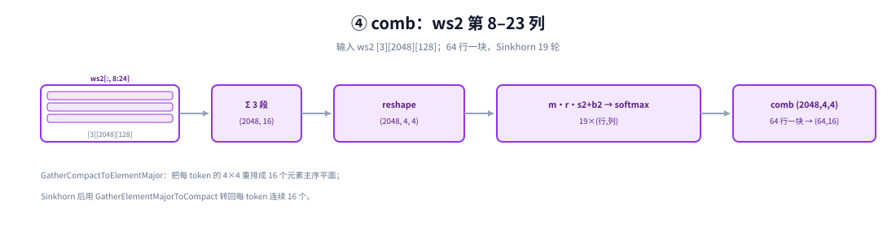

16 列同样按 K 段归约，然后 `GatherCompactToElementMajor`（[L447](../../../../csrc/moe/hc_pre/op_kernel/hc_pre_m_k_split_core.h#L447)）把「每 token 一个 4×4」重排成**元素主序**——16 个平面，每个平面是一段连续行向量。这一步是整个 Sinkhorn 效率的来源：一条 `Add` / `Div` 指令同时处理**一批 token 的同一个元素**，而不是逐 token 做标量除法。`ProcessCompactSinkhorn` 的顺序与公式一一对应：

```text
数据 = mix·r·s₂ + b₂                              // 逐平面乘加
softmax(每行 4 个) + eps                          // SoftmaxCompactRows
colSum → Div                                     // NormalizeCompactCols，第 1 次列归一
for 19 次（iterTimes − 1）：                       // hc_sinkhorn_iters = 20
    rowSum → Div                                 // NormalizeCompactRows
    colSum → Div                                 // NormalizeCompactCols
```

行归约是 4 个平面相加（`ReduceCompactRows`），列归约是跨 4 个平面按 n 步进（`ReduceCompactCols`），归一化各是一条 `Div` 循环 4 次（[L591-L611](../../../../csrc/moe/hc_pre/op_kernel/hc_pre_m_k_split_core.h#L591-L611)）：每轮 16 条向量指令处理一整批 token。最后 `GatherElementMajorToCompact` 转回「每 token 连续 16 个」落盘。第 0 轮只做列归一（行和已由 softmax 保证），之后行、列交替、最后一轮以列归一收尾——所以列和精确为 1、行和逐轮收敛。

`comb` 按 `[源流, 目标流]` 存储：第 $c$ 条输出流用的是「每一行的第 $c$ 个元素」（[hc\_post\_d\_split.h:L329-L343](../../../../csrc/moe/hc_post/op_kernel/hc_post_d_split.h#L329-L343)）。

##### 4. 输出：结果直写 GM

kernel 只往 GM 写；输出 tensor 是 binding 在 launch 前就建好的，所以 Python 拿到的是同一块 NPU 显存，不做 D2H 拷贝。

1. Python 调 `torch.ops._C_ascend.npu_hc_pre_v2/v3` → `run_hc_pre_fusion`（[torch\_binding.cpp:L1629](../../../../csrc/torch_binding.cpp#L1629)）。
2. `construct_hc_pre_output_tensor` 用 `at::empty(x.options())` 建输出；`y` 是 bf16，`post` / `comb` / `pre` 是 fp32。
3. `EXEC_NPU_CMD(aclnnHcPre, ..., y, post, comb_frag, pre)` 把这些 tensor 的 GM 指针传给 aclnn；kernel 的 `y/post/comb_frag/pre` 参数就是这些地址。
4. `run_hc_pre_fusion` 返回 tuple；`npu_hc_pre_v2` 只取前三个，`npu_hc_pre_v3` 返回四个。
5. Python 侧直接拿到 tensor；launch 异步提交到当前 stream，后续同 stream 的 op 自动排序，不需要手动同步。

| 输出     | dtype | shape                               | 说明                   |
| ------ | ----- | ----------------------------------- | -------------------- |
| `y`    | bf16  | `(bs, d)` 或 `(b, s, d)`             | 折叠后的单流               |
| `post` | fp32  | `(bs, hc_mult)` 或 `(b, s, hc_mult)` | 残差混合系数               |
| `comb` | fp32  | `(bs, hc_mult, hc_mult)`            | Sinkhorn 后的 4×4      |
| `pre`  | fp32  | `(bs, hc_mult)` 或 `(b, s, hc_mult)` | v3 才返回；v2 内部有，但调用方丢弃 |

```python
y, post, comb = torch.ops._C_ascend.npu_hc_pre_v2(...)
# 或 v3：y, post, comb, pre = torch.ops._C_ascend.npu_hc_pre_v3(...)
```

只有显式 D2H（如 `.cpu()`、`.item()`）才会把数据搬回 host；正常前向里这些 tensor 一直留在 NPU，直接喂给后续算子。

**实测**（T=2048，A3，`msprof op`）：op 总时长 181.4 us——AIC 109.2 us（24 核离散度 0.7%，Cube 22.4% / MTE1 30.0% / MTE2 33.8%），AIV 170.4 us。**AIV 才是总时长的决定者**，AIC 里 Cube 只跑了 22%，瓶颈在搬运和同步而不是算力。采集脚本、原始 `PipeUtilization.csv` 和完整分析见 [profiling/](profiling/README.md)。

### 4.3 hc\_post

`hc_post` 与 `hc_pre` 对称：把子层输出的 1 条流按门控写回 4 条，并与「压缩前」的 4 条流做一次深度混合（[model.py:L789-L793](../model.py#L789-L793)）：

```python
def hc_post(self, x, residual, post, comb):
    y = torch.ops._C_ascend.npu_hc_post(
        x.unsqueeze(dim=0), residual.unsqueeze(dim=0),
        post.unsqueeze(dim=0), comb.unsqueeze(dim=0)
    )
    return y.squeeze(dim=0)
```

四个 `unsqueeze(0)`（出口再 `squeeze(0)`）不是装饰，是被 **torch 封装**的形状校验逼出来的。vLLM v1 把 batch 和 seq 压成了一维 `T`，模型内部所有激活都是 `(T, ...)`；而 `npu_hc_post` 在 torch 侧只放行 `(b, s, ...)`：`x` 必须 3 维、`residual` 必须 4 维、`post` 3 维、`comb` 4 维（[torch\_binding.cpp:L1493-L1517](../../../../csrc/torch_binding.cpp#L1493-L1517)）。于是把 `T` 当作 `s`、补一个长度 1 的 `b` 送进去，算完再把这一维 squeeze 掉：

| 张量         | 模型里的形状         | `npu_hc_post` 的形状约定 | `unsqueeze(0)` 之后                | dtype |
| ---------- | -------------- | ------------------- | -------------------------------- | ----- |
| `x`        | `(T, 7168)`    | `(b, s, d)`         | `(1, T, 7168)`                   | bf16  |
| `residual` | `(T, 4, 7168)` | `(b, s, hc, d)`     | `(1, T, 4, 7168)`                | bf16  |
| `post`     | `(T, 4)`       | `(b, s, hc)`        | `(1, T, 4)`                      | fp32  |
| `comb`     | `(T, 4, 4)`    | `(b, s, hc, hc)`    | `(1, T, 4, 4)`                   | fp32  |
| 返回值 `y`    | `(T, 4, 7168)` | `(b, s, hc, d)`     | `(1, T, 4, 7168)` → `squeeze(0)` | bf16  |

表里的 `T` 是本次前向的 token 数（prefill 是整段 prompt 的 token 和，decode 是 batch 大小），`d = 7168`，`hc = 4`。

**为什么 `b = 1`、`s = T` 不改变语义？** 因为上面那条约束只来自 torch 封装——kernel 从不单独使用 `b` 和 `s`，只关心它们的乘积：tiling 第一步就把 `bs` 算成 `b × s`（[hc\_post\_tiling.cpp:L98-L106](../../../../csrc/moe/hc_post/op_host/hc_post_tiling.cpp#L98-L106)），之后按 token 逐个处理、按 `bs` 切核。事实上同一份 tiling 还留着一条 2 维分支——`x` 给 `(bs, d)`、`residual` 给 `(bs, hc, d)` 也能跑，连 `(1, T, ...)` 都不需要；但 torch 封装只放行「3 维 `x` + 4 维 `residual`」这一组，Python 侧走不到那条分支。多补的这维是 torch 侧的接口约定，不是 kernel 的要求。

两个附带的点：

- `unsqueeze(0)` 与 `squeeze(0)` 都是 **view**，只改元数据、不动内存，`(1, T, 7168)` 和 `(T, 7168)` 指向同一块 GM，所以这圈转换可以放心放在每层每步的热路径上。之所以插在第 0 维，是因为 torch 封装把前两维固定成 `(b, s)`：`T` 顺位落到 `s` 上，新的 `b` 只能加在它前面。
- 对照 `hc_pre`：它的封装同时接受 3 维和 4 维 `x`（[torch\_binding.cpp:L1592](../../../../csrc/torch_binding.cpp#L1592)），`(T, 4, 7168)` 直接传即可，所以那边没有这圈转换。换句话说，要补的不是数据，是 `hc_post` 在 torch 侧的入口约束。

公式（$c$ 为目标流，$j$ 为源流）：

$$
x'_{c} = \sum_{j=1}^{4} \mathrm{comb}_{j,c}\,\mathrm{residual}_{j} + \mathrm{post}_{c}\, u .
$$

其中 $u$ 是子层输出（代码里的 `x`）：`residual` $(T, 4, 7168)$ bf16、$u$ $(T, 7168)$ bf16、`post` $(T, 4)$ fp32、`comb` $(T, 4, 4)$ fp32，输出 $(T, 4, 7168)$ bf16。任取一条输出流 $c$ 都成立——每条输出流都是「4 条残差的加权和 + 1 份子层输出」：

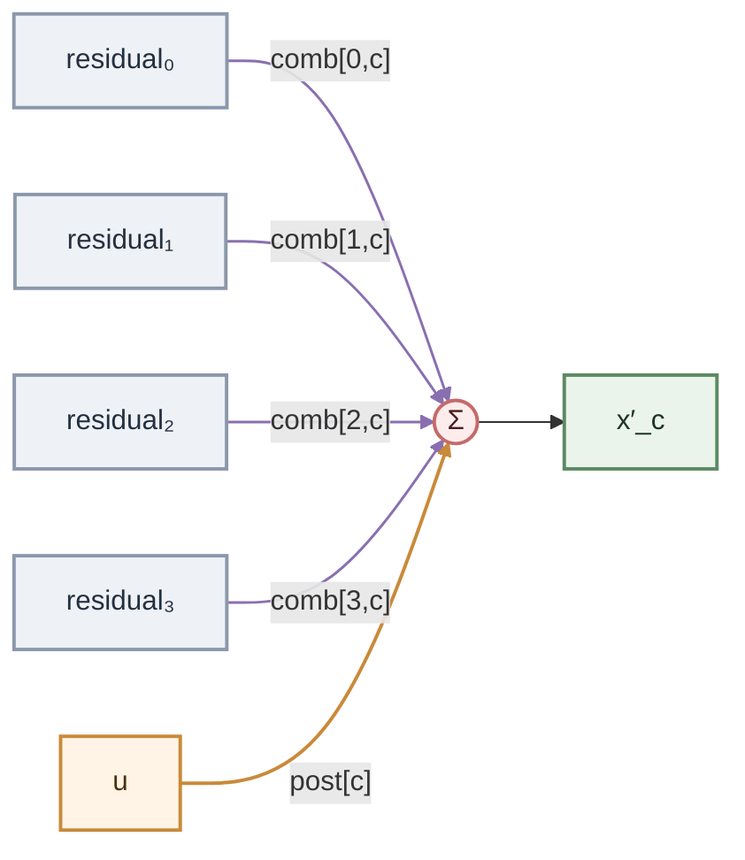

五个加数、一个结果：$c$ 取 0…3 就是完整的 4 条输出流。

三个特例，用来确认 `comb` 的语义没写反：

- $\mathrm{comb} = I$、$\mathrm{post}_c = 1$：4 条彼此独立的残差；
- $\mathrm{comb} = I$、$\mathrm{post}_c = 0$：子层被完全旁路，只剩原样传下去的 4 条流；
- $\mathrm{comb} = J/4$（全 $1/4$）：退化成共享池，4 条流被打散成同一个平均。

Sinkhorn 保证 `comb` 落在中间地带——既能重组，又不会把信息抹平。

**实现上它比 `hc_pre` 轻得多**：纯 Vector 算子，没有 attr（`hc_mult` 直接从 `residual` 的形状里读，固定为 4）。A2/A3 只有一套 kernel（[hc\_post\_d\_split.h](../../../../csrc/moe/hc_post/op_kernel/hc_post_d_split.h)，TilingKey 0）：按 token 切核，核数取 `min(bs, AIV 核数)`，每个核负责一段连续 token；单个 token 内再把 $D = 7168$ 按 2048 分块循环（3 块 + 1024 尾块）。

计算全程 fp32：`x` 乘 `post` 得到 4 条输出流的初值，再对每条源流 $i$ 把 `comb` 第 $i$ 行广播成 4 路权重、乘上第 $i$ 条 `residual` 累加，最后一次性转回 bf16 写出。每条输出流 5 条乘加，于是一个 token 约 $5 \times 4 \times 7168 \approx 1.4 \times 10^5$ 次乘加，是 `hc_pre`（$24 \times 28672 \approx 6.9 \times 10^5$）的两成。这份 kernel 用模板同时覆盖 9 种 dtype 组合。

### 4.4 hc\_head

61 层跑完得到的是 `(T, 4, 7168)`，而 `lm_head` 只认 `(T, 7168)`，所以要一次「不带 Sinkhorn 的简化版 `hc_pre`」（[model.py:L949-L956](../model.py#L949-L956)）：

```python
def hc_head(self, x, hc_fn, hc_scale, hc_base):
    shape, dtype = x.size(), x.dtype
    x = x.flatten(1).float()                                  # (T, 28672)
    x_norm = self.hc_norm(x)                                  # RMSNorm(28672)，has_weight=False
    mixes = torch.nn.functional.linear(x_norm, hc_fn)         # (T, 4)
    pre = torch.sigmoid(mixes * hc_scale + hc_base) + self.hc_eps
    y = torch.sum(pre.unsqueeze(-1) * x.view(shape), dim=1)   # (T, 7168)
    return y.to(dtype)
```

它与层内 `hc_pre` 的差异：

| 项    | 层内 `hc_pre`                      | `hc_head`                    |
| ---- | -------------------------------- | ---------------------------- |
| 归一化  | 只算逆 RMS 标量$r$，折进门控（不物化归一化后的 $x$） | 物化 `x_norm = RMSNorm(x)` 再投影 |
| 输出   | 1 条流 +`post` + `comb`            | 只有 1 条流                      |
| 门控列数 | 24（4 + 4 + 16）                   | 4（只有读取门）                     |
| 实现   | Ascend C 算子                      | 几行 PyTorch                   |

四处差异指向同一个理由：出口只需要「读」，不需要「写回」，所以既没有 `post` / `comb`，也不必为省一次归一化去写 kernel——这里的 $4 \times 28672$ 矩阵乘整个前向只发生一次，走 PyTorch 足够。

为什么不直接对 4 条流求平均？因为训练中 4 条流会分化成不同的「语义副本」，求平均等于强行认为它们等权；让模型自己学 4 个读取权重（`hc_head_fn`，`(4, 28672)` fp32）更合理。另注意 `hc_head` 的 `hc_scale` 是**一个标量**（形状 `(1,)`），不是层内的 3 个——它只有一套门控。

### 4.5 开销

一笔一笔算：**参数怎么多出来 → 计算怎么多出来 → 激活怎么变 → 再和残差连接、HC 摆一起比**。

**(1) 参数：24 个门控数 × 28672 维**

多流本身不产生参数——把 1 条流复制成 4 条，只是激活多了 4 份。参数全部来自「怎么把 4 条流压成 1 条、怎么再写回去」，也就是那三组逐 token 的门控：

| 步骤           | 算式                                      | 结果                          |
| ------------ | --------------------------------------- | --------------------------- |
| 一组门控要几个数     | `pre` 4 + `post` 4 + `comb` 4×4         | 24                          |
| 这 24 个数怎么来   | 由该 token 的 4 条流（4 × 7168 = 28672 维）线性投影 | 24 × 28672 = 688,128        |
| 每层几套         | Attention、FFN 各一套                       | 2 × 688,128 = 1,376,256     |
| 再加偏置与温度      | 两套各 24 个 `base`、3 个 `scale`             | +2 × 27 = 54                |
| 单层合计         |                                         | 1,376,310                   |
| 61 层         |                                         | 83,954,910                  |
| 出口 `hc_head` | 只留读取门，4 行投影                             | 4 × 28672 + 4 + 1 = 114,693 |
| 合计           |                                         | 84,069,603 ≈ 84.07 M        |
| fp32 常驻显存    | × 4 B                                   | ≈ 336.3 MB                  |

这些权重在 checkpoint 里就是 fp32，算子也只接受 fp32（[hc\_pre\_def.cpp](../../../../csrc/moe/hc_pre/op_host/hc_pre_def.cpp)），不随 W4A8 量化，也不做张量并行切分——每张卡完整存一份。

**(2) 计算：投影占八成**

| 来源             | 每 token 每层                                  | 61 层累计                     |
| -------------- | ------------------------------------------- | -------------------------- |
| 门控投影           | $2 \times 24 \times 28672 = 1,376,256$      | $\approx 8.4 \times 10^7$  |
| `y` 的加权求和      | $2 \times 4 \times 7168 = 57,344$           | $\approx 3.5 \times 10^6$  |
| `hc_post` 写回   | $2 \times 5 \times 4 \times 7168 = 286,720$ | $\approx 1.75 \times 10^7$ |
| Sinkhorn 与门控激活 | 每层约$10^3$ 次标量运算                             | 可忽略                        |
| 合计             | $\approx 1.72 \times 10^6$                  | $\approx 1.05 \times 10^8$ |

投影占大头，是因为它每层要把 28672 维的输入读两遍；而 Sinkhorn 只在 $4 \times 4$ 的矩阵上转 20 轮，两者差三个数量级。

顺带一个巧合：投影的 $8.4 \times 10^7$ 次乘加正好等于门控参数个数——每个权重每个 token 只用一次，「参数量」与「每 token 投影乘加数」是同一个数。

**(3) 激活：4 条流，外加一次 clone**

残差主干从 $(T, 7168)$ 变成 $(T, 4, 7168)$，bf16 下每 token 从 14.3 KB 涨到 57.3 KB，正好 4 倍；层间搬运、算子读写也都按 4 倍走。每层还要 `clone` 一份压缩前的 4 条流给 `hc_post`——克隆那一瞬间同一份数据存在两份（瞬时 8 条流），旧副本释放后稳态仍是 4 条。

**(4) 对比：钱花在哪，省在哪**

| 维度                | 残差连接         | HC                            | mHC                   |
| ----------------- | ------------ | ----------------------------- | --------------------- |
| 残差流               | 1 条          | 4 条                           | 4 条                   |
| 门控参数              | 0            | 84.07 M                       | 84.07 M               |
| 参数显存（fp32）        | 0            | 336 MB                        | 336 MB                |
| 每层额外计算            | 1 次 7168 维加法 | $2 \times 24 \times 28672$ 投影 | 同 HC，另加 Sinkhorn 20 轮 |
| 每 token 残差流（bf16） | 14.3 KB      | 57.3 KB                       | 57.3 KB               |
| 子层看到的流            | 1 条          | 1 条                           | 1 条                   |
| KV Cache          | 单流           | 单流                            | 单流                    |
| 跨层增益              | 恒为 1         | 不受控                           | $\le 1$               |

**相对残差连接**，mHC 实打实多出来的只有两笔——84 M 参数、4 倍残差流激活；计算多出约 $1.05 \times 10^8$ 次乘加/token，相对子层动辄数亿次的矩阵乘只是零头。

**KV Cache 一点没变**：`hc_pre` 在进 Attention 之前就把 4 条流压回了 1 条，KV 里仍是单流的 `K/V`。这正是它相对「把模型宽度直接扩 4 倍」的便宜之处——后者 Attention / FFN 的主要矩阵乘要涨约 16 倍、KV 也涨 4 倍；mHC 用 84 M 参数 + 4 倍激活就换到了多流容量，长上下文下省下的是最贵的显存。

**相对 HC**，mHC 的参数形状一模一样，只多了 20 轮 Sinkhorn——稳定性是「算」出来的，不是「存」出来的。

最后补一个工程上的边角：投机解码（MTP / DSpark / DFlash）需要「进 `hc_head` 之前」的多流残差，所以主模型专门留了一块缓冲（[model.py:L931-L944](../model.py#L931-L944)，写入在 [model.py:L1039-L1041](../model.py#L1039-L1041)）：

```python
self._mtp_hidden_buffer = torch.empty(
    (max_num_batched_tokens, hc_dim), dtype=..., device=...
)   # hc_dim = 4 × 7168 = 28672
```

这块缓冲只在开启投机解码时分配（`speculative_config` 非空且走 Eagle / draft model），否则不占显存。

至此工程部分收口：`hc_pre` 一次投影出三套门控并压流，`hc_post` 一次乘加写回 4 条流，`hc_head` 一次加权收口；代价是 84 M fp32 参数与 4 倍激活，换来的是子层计算不变、KV Cache 不变。

***

## 附录

A2 / A3 机器 SoC 实际查询结果如下：

```A3
python3 -c "
import torch, torch_npu
p = torch.npu.get_device_properties(0)
print(p)                                     # 一次把字段全打出来
print('name:', p.name)
print('cube:', getattr(p, 'cube_core_num', None),
      'vector:', getattr(p, 'vector_core_num', None))
"
_NPUDeviceProperties(name='Ascend910_9382', total_memory=62740MB, cube_core_num=24, vector_core_num=48, uuid=00cc0800-d001-0000-0000-8cfadd992adc, L2_cache_size=192MB)
name: Ascend910_9382
cube: 24 vector: 48

```

```A2
python3 -c "
import torch, torch_npu
p = torch.npu.get_device_properties(0)
print(p)                                     # 一次把字段全打出来
print('name:', p.name)
print('cube:', getattr(p, 'cube_core_num', None),
'vector:', getattr(p, 'vector_core_num', None))
"
_NPUDeviceProperties(name='Ascend910B3', total_memory=62420MB, cube_core_num=20, vector_core_num=40, uuid=00cc0800-d000-0000-0000-a85081b05f4b, L2_cache_size=192MB)
name: Ascend910B3
cube: 20 vector: 40
```

```A2
python3 -c "
import torch, torch_npu
p = torch.npu.get_device_properties(0)
print(p)                                     # 一次把字段全打出来
print('name:', p.name)
print('cube:', getattr(p, 'cube_core_num', None),
      'vector:', getattr(p, 'vector_core_num', None))
"
_NPUDeviceProperties(name='Ascend910B2C', total_memory=62420MB, cube_core_num=24, vector_core_num=48, uuid=00000000-0000-0000-0000-000000000000, L2_cache_size=192MB)
name: Ascend910B2C
cube: 24 vector: 48
```

```AI
#!/usr/bin/env python3
import glob, hashlib, os, re, sys
import torch, torch_npu

soc = sys.argv[1] if len(sys.argv) > 1 else torch.npu.get_device_properties(0).name
root = os.environ.get("ASCEND_HOME_PATH") or "/usr/local/Ascend"

cand = {}
for f in glob.glob(f"{root}/**/platform_config/*{soc}*.ini", recursive=True) + \
         glob.glob(f"/usr/local/Ascend/**/platform_config/*{soc}*.ini", recursive=True):
    real = os.path.realpath(f)
    digest = hashlib.md5(open(real, "rb").read()).hexdigest()
    cand.setdefault(digest, real)          # 内容相同只留一条

f = sorted(cand.values(), key=lambda p: ("aarch64" not in p, len(p)))[0]

def human(n):
    for unit, size in (("TB", 1 << 40), ("GB", 1 << 30), ("MB", 1 << 20), ("KB", 1 << 10)):
        if n >= size:
            return f"{n // size} {unit}" if n % size == 0 else f"{n / size:.1f} {unit}"
    return f"{n} B"

print(f"# SoC={soc}  {f}   (去重后剩 {len(cand)} 份不同内容)\n")

for line in open(f, encoding="utf-8", errors="ignore"):
    m = re.match(r"(\w+)=(\d+)\s*$", line.strip())
    if not m:
        continue
    k, v = m.group(1), int(m.group(2))
    if k.endswith("_cnt"):
        print(f"{k:18s} {v:>12d}")
    elif k.startswith("cube_") and k.endswith("_size"):
        print(f"{k:18s} {v:>12d}   (分形维度，非字节)")
    elif "size" in k or "memory" in k:
        print(f"{k:18s} {v:>12d} B  ({human(v):>8s})")

--- A3 查询结果 --- 
python tmp.py 
# SoC=Ascend910_9382  /usr/local/Ascend/cann-9.1.0/aarch64-linux/data/platform_config/Ascend910_9382.ini   (去重后剩 1 份不同内容)

ai_core_cnt                  24
cube_core_cnt                24
vector_core_cnt              48
ai_cpu_cnt                    6
memory_size         68719476736 B  (   64 GB)
l2_size               201326592 B  (  192 MB)
cube_m_size                  16   (分形维度，非字节)
cube_n_size                  16   (分形维度，非字节)
cube_k_size                  16   (分形维度，非字节)
vec_calc_size               128 B  (   128 B)
l0_a_size                 65536 B  (   64 KB)
l0_b_size                 65536 B  (   64 KB)
l0_c_size                131072 B  (  128 KB)
l1_size                  524288 B  (  512 KB)
fb0_size                   2048 B  (    2 KB)
fb1_size                   1024 B  (    1 KB)
fb2_size                   2048 B  (    2 KB)
fb3_size                   2048 B  (    2 KB)
bt_size                    1024 B  (    1 KB)
ub_size                  196608 B  (  192 KB)
ubblock_size                 32 B  (    32 B)
ubbank_size                4096 B  (    4 KB)
padding_size                 32 B  (    32 B)
```
