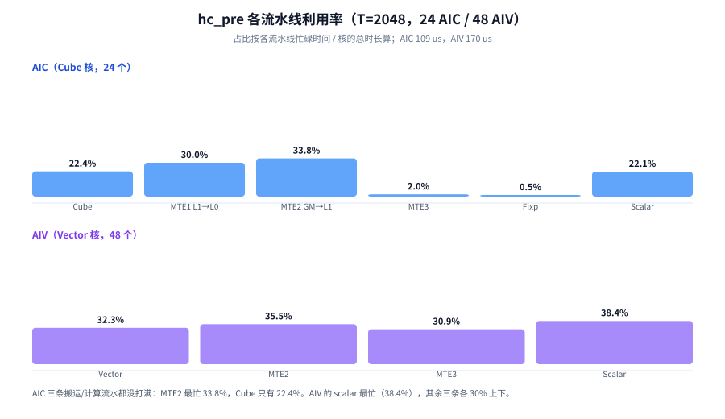

# hc_pre 单算子 profiling 分析

> 采集对象：`torch.ops._C_ascend.npu_hc_pre_v2`
> 形状：T=2048 / hidden=4096 / hc_mult=4 / mix_hc=24 / sinkhorn=20 → M=2048、K=16384、N=24
> 容器：`gchtest`（A3，2 卡，镜像 `vllm:release_0.32.0_1111`，CANN 9.2.1）
> 采集：`msprof op --aic-metrics=PipeUtilization --kernel-name='HcPre*'`

## 1. 总览

| T | op 总时长 | AIC 时长 | AIV 时长 | Cube% | MTE1% | MTE2% | AIC mte2% |
| --- | --- | --- | --- | --- | --- | --- | --- |
| 512 | 70.9 us | 42.6 | 62.9 | 14.5 | 19.7 | 17.5 | 28.4 |
| 1024 | 107.8 us | 65.6 | 99.5 | 18.9 | 25.5 | 26.1 | 34.6 |
| **2048** | **181.4 us** | **109.2** | **170.4** | **22.4** | **30.0** | **33.8** | **35.5** |
| 4096 | 326.9 us | 193.3 | 308.5 | 26.1 | 32.7 | 36.0 | 27.9 |

（Cube/MTE1/MTE2 是 AIC 侧占用率；最后一列是 AIV 侧的 MTE2。）

四个规模下都成立的三件事：

1. **总时长由 AIV 决定**：`aiv_time / duration` 在 0.89~0.94 之间（63/71、99/108、170/181、308/327）。
2. **24 个 AIC 负载极均衡**：`aic_time` 108.8 ~ 109.5 us，离散度 **0.7%**。
3. **AIC 里没有一条流水打满**：MTE2 33.8% > MTE1 30.0% > Cube 22.4%。

## 2. 流水线利用率



AIC 侧的等待明细（T=2048，24 核平均）：

| 指标 | 值 | 占 `aic_time` |
| --- | --- | --- |
| `aic_scalar_cube_stall_time` | 55.2 us | **50.5%** |
| `aic_scalar_wait_id8_time`（等 AIV 的 full） | 11.6 us | 10.6% |
| `aic_scalar_wait_id11_time` | 4.0 us | 3.6% |

AIV 侧：

| 指标 | 值 | 占 `aiv_time` |
| --- | --- | --- |
| `aiv_scalar_wait_id9_time`（等 AIC 的 empty） | **82.3 us** | **48.3%** |
| `aiv_scalar_vector_stall_time` | 21.1 us | 12.4% |
| `aiv_scalar_mte3_stall_time` | 13.3 us | 7.8% |

## 3. 和 4.2 节论断的对照

| 文档论断 | 实测 | 结论 |
| --- | --- | --- |
| B1 整拍搬一次、A1 逐 tile 搬 8 次 → 搬运占比大 | MTE2 33.8%，是 AIC 最忙的流水线 | ✅ 成立 |
| `Load*` 搬下一片与 Cube 算当前片重叠 | Cube 22.4% 与 MTE1 30.0% 同时在线 | ✅ 成立，但两条都没打满 |
| 跨核 8/9 让 AIC 与 AIV 交替 | AIV 82.3 us 等 id9、AIC 11.6 us 等 id8 | ✅ 成立，**AIV 是等待方** |
| （原文未提）AIC 内部同步开销 | `scalar_cube_stall` 55.2 us = 一半时间 | ⚠️ 新发现 |

## 4. 解读

**① AIV 是整体节拍器，不是 AIC。**
`aiv_time` 几乎等于 op 总时长，而 AIV 近一半时间在 `Wait(9)`（等 AIC 把 ws1 槽算完）。
也就是说：**AIV 的 cast/epilogue 工作量 + 等 AIC 的时间一起构成了关键路径**，AIC 只是中间一段。

**② AIC 内部 Cube 远未饱和，瓶颈在搬运。**
Cube 22.4%、MTE2 33.8%、MTE1 30.0%，三者相加 86%——说明确实在并行，但**没有任何一条接近 100%**。
理想情况下 `aic_time` 应该 ≈ `max(MTE2, MTE1, Cube)` ≈ 61 us；实测 109 us，**约 44% 的时间是串行等待**。

**③ `scalar_cube_stall` 55 us 说明 Mmad 队列是串行的。**
每片发 16 条 Mmad 之后，scalar 要等它们全部完成才能继续（`SetFlag<M_MTE1>` 排在 Mmad 之后）。
这段时间 MTE1 无法为下一片装载 → 与文档「L0A 双槽让搬下一片与算当前片重叠」的目标有差距。

**④ 24 核切分是干净的。** 0.7% 的离散度说明 `mDimNum=8 / kDimNum=3` 的 K 切分没有明显的长尾核。

## 5. 建议（待验证）

1. **AIV 侧优先**：cast 的向量化程度（`aiv_vec` 32.3%）与 ws1 往返（`aiv_mte2` 35.5%）是 AIV 自己的两块大头；先把这两条压下去，比优化 AIC 更直接。
2. **AIC 侧**：把「16 条 Mmad 之后才放 L0B 槽」拆细——例如每 4 条 Mmad 放一次槽，可以让 MTE1 更早插入下一片的装载，填掉那 44% 的串行空隙。
3. **验证手段**：改完后重跑 `bash scripts/run_prof.sh device`，看 `aic_time` 是否向 61 us 靠拢。

## 6. 复现

```bash
# 容器内
source /usr/local/python3.11.15/lib/python3.11/site-packages/vllm_ascend/_cann_ops_custom/vendors/custom_transformer/bin/set_env.bash
cd /a3_inference/itask/workdir/gch02599191/hc_pre_prof

bash run_prof.sh plain     # 232.5 us / 次（T=2048，含 launch）
bash run_prof.sh device    # msprof op 设备侧采集
SOC_VERSION=Ascend910_9362 ITERS=1 WARMUP=0 bash run_prof.sh sim   # 指令级（约 11 分钟）
```

## 7. 数据文件

| 目录 | 内容 |
| --- | --- |
| `raw/op_t2048/` | **主数据** · T=2048：`PipeUtilization.csv`（72 行 = 24 AIC + 48 AIV）、`OpBasicInfo.csv` |
| `raw/op_t512/` | 规模扫描 · T=512 |
| `raw/op_t1024/` | 规模扫描 · T=1024 |
| `raw/op_t4096/` | 规模扫描 · T=4096 |
| `raw/trace_core0.csv.gz` | 指令级时间线（core0 的 24.3 万条指令事件，来自 `msprof op simulator`） |
| `raw/core*.cubecore0/` | 各 cube 核的 `*_instr_exe.csv`（按指令聚合的耗时表，24 个核） |
| `report/trace_core0_3us.json` | 上述时间线的 40~43 us 切片，Chrome Trace 格式，可拖进 Perfetto |
| `report/trace_gantt.svg` | 同一段的流水甘特图（MTE1 / MTE2 / CUBE / MTE3 / FIXP 五条轨） |

> 设备侧的 `OPPROF_*/` 目录本身就是 MindStudio Insight 可直接导入的格式
> （含 `visualize_data.bin`），Timeline 视图能看每核条带。
>
> 指令级仿真的完整产物（`trace.json` 1.0 GB、`visualize_data.bin` 1.0 GB）留在容器
> `/a3_inference/itask/workdir/gch02599191/hc_pre_prof/prof_out/OPPROF_20261124162503_AQIJEPESUEBIYXJK/simulator/`，
> 需要时用 `scripts/extract_trace.py` 按核抽取小片再拉回（单次复制上限 100 MB）。
